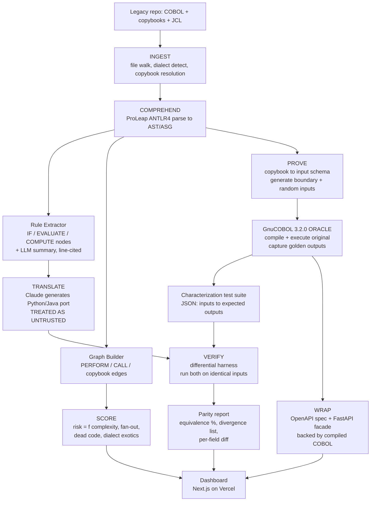

# PS-4: Legacy System Modernization
## Deep research + combined build spec for The Innovator's Court (D-Code)

**For:** Harsh, B.Tech ECE, DTU
**Build tool:** Claude Code
**Budget:** ~₹0 (student/free tiers)
**Date compiled:** 14 August 2026

---

## 0. Executive summary

**The thesis in one line:** everyone is racing to *translate* COBOL. Almost nobody is building an open, affordable layer that *proves the translation is correct*. Translation without proof of behavioural equivalence is precisely what destroyed TSB in 2018 (£48.65M in regulatory fines, ~£330M total cost). Build the proof layer.

**The combined product:** a single pipeline that ingests a legacy codebase, explains it with line-level citations, scores migration risk, generates characterization tests by executing the original code, lets an LLM attempt a translation, then **proves or disproves equivalence by differential execution**, and finally wraps the original in a REST façade so migration can be incremental rather than big-bang.

```
INGEST → COMPREHEND → SCORE → PROVE → TRANSLATE → VERIFY → WRAP
```

**Why this wins the room:** every other team in this track will demo "we used AI to convert COBOL to Java." When a judge asks "how do you know it's correct?", they have no answer. Your entire submission *is* the answer. And your demo's climax is you catching your own LLM being wrong, live.

**Honest positioning:** this is not a novel research contribution. IBM, AWS and a July 2026 arXiv paper are all working on differential validation. Your contribution is that it is **open, vendor-neutral, runs off-mainframe on GnuCOBOL, and costs nothing** — which means a district cooperative bank, a state transport department or a government hospital can use it. That framing is defensible and honest. Do not claim novelty you don't have.

---

## PART 1 — EVIDENCE BASE

Every number below is tagged with how much you should trust it. Use the **[SOLID]** ones on slides. Use the **[SOFT]** ones only with the qualifier attached, out loud. A judge who catches you asserting a soft number as fact will destroy your credibility for the rest of the pitch.

### 1.1 The scale of COBOL — handle with care

| Claim | Source | Trust |
|---|---|---|
| 220 billion lines of COBOL in production | A single Reuters estimate (variously cited as 2015/2017), repeated everywhere since | **[SOFT]** Single-source estimate, never independently measured |
| 800 billion lines | 2022 Micro Focus commissioned survey, 1,104 respondents across 49 countries | **[SOFT]** Survey extrapolation, vendor-commissioned |
| 95% of US ATM swipes, $3 trillion/day transaction value, 43% of banking systems | Same Reuters lineage | **[SOFT]** Same provenance |

**How to say this on stage, honestly:** "Estimates of COBOL still in production range from 220 to 800 billion lines. Both figures are extrapolations from single sources, and I'd treat them as order-of-magnitude, not measurement. What is not disputed is the shape: it is a very large number and it is still running banks."

This single line of intellectual honesty will differentiate you from every team that confidently asserts "220 billion lines" as if it were census data. Judges notice.

### 1.2 The workforce cliff — also softer than people claim

- The most-cited figure, "average COBOL programmer age is 58, 10% retiring per year, 84,000 unfilled mainframe positions by 2020," traces to **Phil Teplitzky (2019)**, republished in a systems journal via the Open Mainframe Project mailing list, and repeated by IBM and Fujitsu. **[SOFT]** — one analyst's estimate, and the 2020 prediction date has passed without verification.
- **Computerworld survey (2012, n=357 IT professionals):** 46% already noticed a COBOL programmer shortage; 50% said their COBOL staff averaged 45 or older; 22% said 55 or older. **[MEDIUM]** — real survey, but small, self-reported, and 14 years old.
- Commonly repeated: average age 55, ~70-85% of universities dropped COBOL from curricula. **[SOFT]** — recycled across blogs without primary sourcing.

**The defensible version:** the *direction* is well-evidenced (shortage is real, workforce is old, pipeline is thin); the *precise numbers* are not. Say the direction, not the decimals.

**The one incident that is [SOLID] and does all the persuasive work you need:**

> **New Jersey, April 2020.** Governor Phil Murphy publicly appealed for volunteer COBOL programmers when the state's unemployment insurance system buckled under a claims surge of roughly 1,600% (over 362,000 applicants in two weeks). A US state government could not find people to maintain the software that pays unemployment benefits during a pandemic.

That story is worth more than any statistic. It is concrete, dated, verifiable and emotionally legible in ten seconds.

Also **[SOLID]**: the **SSA Office of the Inspector General (2018)** documented 60+ million lines of COBOL at the Social Security Administration and the practice of rehiring retirees to maintain it.

### 1.3 Government audits — the strongest evidence tier

**United States (GAO, primary source, high trust):**
- **GAO-19-471:** identified the 10 most critical federal legacy systems, aged 8-51 years, costing approximately **$337 million per year** to operate. Several run COBOL or assembly.
- **GAO-25-107795 (February 2025):** follow-up. Only **3 of the 10 had been modernized**. The remaining 7 were now 23-59 years old. Six years of federal attention moved the needle on three systems.
- **IRS Individual Master File:** the authoritative record of US taxpayer accounts, written in assembly and COBOL, 60+ years old.

**United Kingdom (primary: Parliament Public Accounts Committee, DSIT, January 2025 State of Digital Government Review):**
- By **January 2025**, 28 public sector organisations had identified **319 legacy systems**; around **25% were rated "red"** (high likelihood *and* high impact of risk materialising). Note some reporting cites 22% and some "nearly a quarter" — the figure moved between drafts, so say "roughly a quarter."
- **DSIT does not know how many legacy systems exist in total.** The Public Accounts Committee explicitly criticised this. The government cannot count its own legacy estate.
- DSIT estimated legacy technology comprised **28% of the public sector IT estate** (up from 26% in 2023), ranging **10-60% by department**; NHS trusts 10-50%, police forces 10-70%.
- DSIT financial modelling put unrealised savings and productivity gains at approximately **£45 billion annually**. **[MEDIUM]** — a modelled figure, not measured.
- The review noted maintenance of legacy systems "often costing three to four times that of modern alternatives," and recorded **123 outages affecting NHS England in 2024**, plus border e-gate delays and emergency call disruption.
- **March 2026 follow-up:** DSIT stated current legacy data is incomplete and focuses only on the most critical service systems, with "thousands of non-critical legacy systems" unmapped; it committed to restarting data collection in 2026.

The UK evidence is the single best material for your Problem Statement slide because it is a government auditing *itself* and reporting that it does not know the size of its own problem.

### 1.4 Failed migrations — the cost of getting it wrong

**TSB, 2018 (primary: FCA press release, 20 December 2022) [SOLID]:**
- Migration to the Proteo4UK platform failed at go-live in April 2018.
- Approximately **1.9 million of 5.2 million customers** were locked out of accounts.
- **225,492 complaints** between April 2018 and April 2019.
- FCA and PRA imposed combined fines of **£48,650,000** (£29.75M FCA + £18.9M PRA), reduced 30% for settlement from £69.5M, for operational risk management and governance failures.
- TSB paid **£32.7 million** in customer redress. Total cost widely reported at **£330M+**; approximately 80,000 customers left.
- **April 2023:** the PRA fined former CIO **Carlos Abarca £81,620** (reduced 30% on settlement from £116,600) for breaching Senior Manager Conduct Rules.

**The root cause matters more than the fine.** The FCA/PRA findings centre on inadequate testing and inadequate assurance that the new platform would behave correctly at scale. Nobody proved equivalence before cutover. **This is the sentence your entire project exists to answer.**

**Commonwealth Bank of Australia:** core COBOL platform replacement completed 2012, roughly **five years** and **over A$700 million**. **[MEDIUM]** — widely reported, figures vary by source.

**US Department of Veterans Affairs (GAO, primary) [SOLID] — the healthcare example:**
- VistA, the VA's legacy health record system, is written in **MUMPS/M** and has been in operation **more than 30 years**.
- The VA has attempted modernization **four times over two decades** (HealtheVet, iEHR, VistA Evolution, and the current EHRM programme begun 2017). The first three failed.
- First deployment October 2020; **deployments paused April 2023** after clinician and veteran feedback that the system was not meeting expectations.
- As of February 2025, **~1,800 configuration change requests remained unaddressed** (GAO-25-106874, GAO-25-108091).
- **2022 Institute for Defense Analyses estimate: $49.8 billion lifecycle cost** — $32.7B for 13 years of implementation plus $17.1B for 15 years of sustainment. The 2019 estimate had been $16.1 billion.
- As of December 2025 (GAO-26-108812), VA had **not fully implemented 16 of 18 GAO recommendations**, and had still not provided an updated cost estimate despite a Congressional request with a 30 September 2025 deadline.

Four attempts, two decades, a cost estimate that tripled, serving roughly 9 million veterans. This is your healthcare slide, and it is entirely primary-sourced.

### 1.5 India — why this matters here

**Regulatory driver [SOLID]:**
- **RBI (Information Technology Governance, Risk, Controls and Assurance Practices) Directions, 2023**, issued **7 November 2023**, effective **1 April 2024**. Applies to scheduled commercial banks (excl. RRBs), small finance banks, payments banks, NBFCs, credit information companies, and All India Financial Institutions (EXIM, NABARD, NaBFID, NHB, SIDBI). Foreign bank branches on a comply-or-explain basis.
- It consolidates and repeals prior circulars covering IT governance, risk, controls, assurance and **Business Continuity/Disaster Recovery Management**, with BC/DR framed as operational resilience across people, processes and systems.
- It imposes third-party/outsourcing risk obligations including **mitigation of single-point-of-failure risk**, high availability for uninterrupted customer service, and supply chain risk management.
- Practitioner analyses repeatedly flag the same gap: **patch SLAs defined on paper but not met for legacy or high-availability systems**, and DR drills that are tabletop-only without near-live failover.
- **CERT-In SBOM Guidelines v2.0 (July 2025)** require structured software component inventories across the lifecycle. Legacy systems typically lack structured component data.

**Operational evidence [MEDIUM to SOLID]:**
- **UPI outages, March-April 2025:** three nationwide outages. 26 March 2025 (30 min to 3 hours, ~2,750 peak Downdetector complaints), 2 April, and **12 April 2025 — 4 to 5 hours, the longest in over three years**, attributed to API overload from multiple banks. UPI processed **18.3 billion transactions worth ₹24.8 trillion in March 2025** alone.
- Analysts have attributed a meaningful share of UPI technical declines to **strain on older Core Banking Systems** struggling with digital transaction volume. **[MEDIUM]** — analyst attribution, not an official RCA.
- **SBI** ran repeated scheduled maintenance windows through October 2025 (11 Oct, 25 Oct, 01:10-02:10 IST) taking UPI, IMPS, NEFT, RTGS, YONO and internet banking offline, following intermittent UPI disruption on 7-8 October 2025.
- **NPCI's public uptime dashboard was not updated beyond March 2025**, during exactly the period of significant disruption. **[SOLID]** — observable absence.
- **AIIMS Delhi, 23 November 2022:** ransomware took eHospital, lab and billing systems offline; the hospital reverted to paper for over two weeks. Reporting indicated systems had not been substantially upgraded in roughly 30 years. Investigation involved CERT-In, NIA, CBI, DRDO and Delhi Police cyber cell. The "40 million records at risk" and "₹200 crore ransom" figures are **[SOFT]** press estimates — attribute, don't assert.
- **Indian Railways PRS:** origins in 1985-86 (IMPRESS, later CONCERT), still serving **1.6M+ berths per day**; CRIS modernization targets raising booking capacity from roughly 25,000 to 1.25 lakh tickets per minute. **[MEDIUM]**
- Indian PSU bank cores run **Infosys Finacle, TCS BaNCS and Oracle Flexcube**, many with deployment vintages stretching back 15-25 years, heavily customised.

**The India framing that lands:** India built world-class new rails (UPI, Account Aggregator, DigiLocker) on top of core banking and government systems that in many cases predate them by two decades. The failure surface is the seam between the two.

### 1.6 The security angle

PS-4 says "vulnerable to failures" and asks for modernization done "securely." The link is direct:
- Legacy systems are frequently out of vendor support, so **security patches simply do not exist**. The UK Legacy IT Risk Assessment Framework literally scores "L1 Software out of support," "L2 Expired vendor contracts," "L3 Lack of knowledge & skills," and "L6 Known security vulnerabilities" as likelihood criteria. Systems scoring ≥16 (likelihood × impact) are red-rated.
- Legacy systems typically lack modern authentication, encryption in transit, and structured logging — which also makes forensic investigation harder after an incident (a specific concern flagged under the RBI Directions).
- AIIMS is the Indian case study: decades-old systems, catastrophic ransomware, two weeks of manual operation in a national referral hospital.

**The argument to make:** you cannot secure what you do not understand, and you cannot safely patch or replace what you cannot test. Comprehension and equivalence testing are *security* prerequisites, not just engineering conveniences.

---

## PART 2 — STATE OF THE ART AND THE GAP

### 2.1 What the commercial vendors are doing

| Vendor | What it does | Constraint |
|---|---|---|
| **IBM watsonx Code Assistant for Z** | Announced Aug 2022, GA Q4 2023. 20B-parameter model. COBOL→Java refactoring with a **Validation Assistant** for semantic equivalence | z/OS-oriented, enterprise pricing, IBM ecosystem |
| **AWS Transform / Blu Age** | Automated refactoring of mainframe workloads to AWS | AWS commitment, enterprise engagement model |
| **Google Cloud (Dual Run / G4)** | Parallel-run the legacy and modernized systems, compare outputs | GCP commitment, enterprise scale |
| **OpenText/Micro Focus (Enterprise Analyzer, Visual COBOL)** | Static analysis, impact analysis, COBOL on modern platforms | Licence cost, proprietary |
| **TSRI, Heirloom, EvolveWare, Modern Systems, Mechanical Orchard** | Automated transformation services | Services engagements, six-to-seven-figure contracts |

**Note the pattern:** Google's Dual Run is *literally differential testing*. IBM ships a Validation Assistant. The industry has independently concluded that equivalence proof is the crux. That is strong validation of your thesis — and you should say so on stage rather than pretending nobody thought of it. "The largest vendors all built this. None of them built it for people who can't write a seven-figure cheque or run z/OS."

**Who is locked out:** district cooperative banks, regional rural banks, state government departments, municipal corporations, public hospitals, state transport undertakings. Exactly the institutions in India running the oldest software with the thinnest budgets.

### 2.2 What the research says about LLMs and COBOL

**LLM COBOL translation is measurably unreliable:**
- **COBOLEval** (BloopAI, now under the zorse-project org; 146 tasks; MIT licence; evaluates against GnuCOBOL 3.2.0): **GPT-4o achieved 41.8% compile success and 16.4 Pass@1**. A model that cannot reliably produce *compiling* COBOL is not a model you trust with a core banking ledger.
- **COBOL-Coder (arXiv 2604.03986):** mined **40,829 COBOL files** from public GitHub, of which **31,492 compiled**. Found Java→COBOL performance near zero for general-purpose models.
- **arXiv 2507.23356** examines the output quality of watsonx Code Assistant for Z.
- **IBM's own warning:** naive automated translation produces unreadable "JOBOL" — Java that is structurally COBOL, satisfying no one.
- **Diggs et al., arXiv 2411.14971:** "Leveraging LLMs for Legacy Code Modernization: Challenges and Opportunities for LLM-Generated Documentation."

**The industry has already pivoted to comprehension over translation:**
- **Morgan Stanley's DevGen.AI**, launched January 2025, built in-house on OpenAI GPT models. Per WSJ (3 June 2025), Mike Pizzi, global head of technology and operations, reported it had reviewed **9 million lines of code and saved roughly 280,000 developer hours** across 15,000 developers in five months. Crucially, **it does not auto-translate. It translates legacy code into plain-English specifications** that human developers then use to rewrite. Morgan Stanley built it in-house because commercial tools "lacked expertise in deciphering older coding languages."

That is a $100B+ bank concluding that comprehension, not autonomous translation, is the reliable path. Your IDEA slide can cite it directly.

**The most relevant paper, and read it before you build:**
- **Ferenczi, Docherty, Bessonov, Findlay, Lingamneni — "Agentic Method for Deterministic Validation of Legacy Code Migration," arXiv:2607.28271 (submitted 30 July 2026).** Proposes the "Locksmith Loop": COBOL source and generated Java target are each instrumented with mocks and **executed off-mainframe on commodity hardware**, then an agentic loop performs "Witness Search" over input mocks to penetrate program branches, followed by parity-preserving mutations. When exploration stalls, an analyzer identifies a "Locked Paragraph." Evaluated across three case studies (two open-source, one production-like), **430 to 4,114 source lines**. Parity checked on three declared axes including **stub_log** (ordered comparison of consumed external-operation sequence, whitespace-normalised) and **terminal_state** (pointwise comparison of observable variable values after the run, ignoring runtime-private bookkeeping).
- Also: **arXiv 2506.10999, "Automated Validation of COBOL to Java Transformation"** — generates equivalent JUnit tests with equivalent mocking to check semantic equivalence.
- **arXiv 2504.11335, "Code Reborn: AI-Driven Legacy Systems Modernization from COBOL to Java"** — uses a 50,000-file Legacy COBOL 2024 Corpus.

**Read 2607.28271's parity-axis design and steal it.** The three-axis equivalence definition (stub log, terminal state, output stream) is exactly what you need and saves you from inventing a worse one. Cite it in your deck. Judges respect a student who read the July 2026 literature; they do not respect one who reinvents it badly and pretends it's original.

### 2.3 The canonical patterns (cite these, they're free credibility)

- **Characterization tests / golden master testing** — term coined by **Michael Feathers** in *Working Effectively with Legacy Code*. Capture what the system currently does (not what a spec says it should do) so any change that alters observable behaviour fails loudly. Known limitation, and state it yourself before a judge does: **characterization tests detect change, they do not tell you whether the captured behaviour was correct in the first place.**
- **Strangler fig pattern** — Martin Fowler. Wrap the legacy system, redirect functionality piece by piece, retire the old system only when nothing calls it.
- **Related production techniques:** GitHub Scientist (run old and new code paths side by side on live traffic, return the old result), Twitter's Diffy (shadow traffic multicast to both implementations pre-cutover), and Google Cloud Dual Run.

### 2.4 The gap, stated precisely

There *is* prior art. Be honest about it:
- IBM has a Validation Assistant. Google has Dual Run. arXiv 2607.28271 (July 2026) and 2506.10999 do agentic differential validation. Azure-Samples/Legacy-Modernization-Agents is an open-source COBOL→Java/C# agent framework.

**What does not exist:**
1. An **open, vendor-neutral** differential equivalence harness that runs entirely **off-mainframe on GnuCOBOL** with **zero licence cost**.
2. A tool that **unifies** comprehension, risk scoring, test generation, verification and API wrapping in one pipeline. The existing pieces are scattered across vendors and papers.
3. Anything targeted at institutions that cannot afford IBM/AWS/Google engagements — which is most of India's public sector.

**Say exactly this to judges.** "This isn't a new idea. IBM, Google and a paper from three weeks ago all do a version of it. What's new is that it's free, it's open, and it runs on a laptop." That is a *stronger* position than a false novelty claim, because it's the position you can actually defend under questioning.

---

## PART 3 — THE COMBINED PRODUCT

### 3.1 Naming

| Name | Rationale | Risk |
|---|---|---|
| **Rosetta** | Translation + verification | Heavily overused |
| **Ledger of Record** | Emphasises proof | Sounds like a fintech product |
| **Carbon** | Carbon dating old code + carbon copy (equivalence) | Google has a language called Carbon |
| **PARITY** | The single word describing what you prove | Clean, memorable, technically precise |
| **Cassandra** | Sees what the legacy code does; nobody believes it | Cute but obscure |

**Recommendation: PARITY.** It is the exact technical term for what the product delivers, it's one word, it's pronounceable, and it fits in a slide title. Tagline: *"Modernize legacy systems without betting the bank."*

### 3.2 Architecture



### 3.3 What is deterministic vs what is LLM — the single most important design decision

This table is your defence against every hallucination question. Put a version of it on a slide.

| Stage | Deterministic | LLM | Grounding mechanism |
|---|---|---|---|
| Ingest | File walk, dialect detection, copybook resolution | — | — |
| Parse | ProLeap ANTLR4 → AST/ASG | — | Parser output is ground truth |
| Rule extraction | Locate IF/EVALUATE/COMPUTE nodes, extract conditions | Phrase the rule in English | **Every rule carries program + paragraph + line range. UI shows source next to summary.** |
| Dependency graph | PERFORM/CALL/copybook edge extraction | — | Pure static analysis |
| Risk score | Cyclomatic complexity, fan-in/out, dead paragraphs, dialect exotics | — | Pure computation, formula published in-app |
| Input generation | Copybook PICTURE clauses → field types, lengths, boundaries | Suggest semantically interesting values | Every generated input is **schema-valid by construction** |
| Golden outputs | **GnuCOBOL compiles and executes the real program** | — | This is the oracle. Not a model. A compiler. |
| Translation | — | Claude writes the port | **Explicitly untrusted. This is the thing under test.** |
| Verification | Byte-level/field-level diff of two execution results | — | Deterministic comparison, no model in the loop |
| API wrapper | OpenAPI generated from copybook schema; adapter marshals to the compiled binary | — | Real COBOL executes behind the endpoint |

**The line to memorise:** *"The LLM writes the translation. The compiler decides whether it's right. No model is ever in the position of grading itself."*

### 3.4 Equivalence definition (adapted from arXiv 2607.28271)

Declare parity on three axes, and put this on a slide because it shows engineering seriousness:

1. **Output stream** — stdout / report file, whitespace-normalised, with numeric fields compared by value not string (so `007.50` == `7.5`).
2. **Terminal state** — pointwise comparison of observable WORKING-STORAGE variable values after the run, ignoring runtime-private bookkeeping.
3. **External-operation log** — ordered comparison of the sequence of file I/O and external calls consumed, via stubs on both sides.

A test **passes** only if all three axes match. Report equivalence as `passing_tests / total_tests`, and list every divergence with its axis, field and both values.

### 3.5 Data model

```
Program(id, name, path, dialect, loc, source_hash)
Copybook(id, name, path, source_hash)
Field(id, copybook_id, name, picture, level, offset, length, type_inferred)
Paragraph(id, program_id, name, start_line, end_line, cyclomatic)
Rule(id, program_id, paragraph_id, start_line, end_line,
     condition_text, action_text, english_summary, ast_node_ref, confidence)
Edge(id, from_program, to_program, kind)  -- CALL | PERFORM | COPY
RiskScore(program_id, complexity, fan_in, fan_out, dead_paragraph_count,
          exotic_feature_count, composite, rank)
TestCase(id, program_id, input_blob, golden_stdout, golden_state,
         golden_oplog, generation_method)  -- boundary | random | llm_suggested
TranslationArtifact(id, program_id, target_lang, code, model, created_at)
Run(id, test_case_id, artifact_id, actual_stdout, actual_state,
    actual_oplog, verdict, axis_failed)
Divergence(id, run_id, axis, field, expected, actual, severity)
```

Postgres on Supabase or Neon free tier. Roughly 12 tables. Claude Code will scaffold this in one prompt.

### 3.6 Verified toolchain (licences matter — a judge may ask)

**Core, all free:**

| Tool | Version/status | Licence | Note |
|---|---|---|---|
| **GnuCOBOL** | 3.2.0 (released 28 July 2023) | GPLv3 compiler / **LGPLv3 runtime** | `apt install gnucobol` on Ubuntu/Debian 12. **Build without Berkeley DB** — use the VBISAM or NODB variant to avoid licence-string complications. |
| **ProLeap COBOL parser** | ANTLR4-based, emits AST + ASG, passes the NIST suite | **MIT — parser only** | The ProLeap **transformer is AGPLv3**. Use the parser. Do not pull in the transformer. |
| **ANTLR grammars-v4 COBOL85** | Maintained grammar | BSD | Fallback if ProLeap/JVM integration is painful; can target Python. |
| **NIST COBOL-85 test suite (newcob.val)** | ~8,800+ test cases | Effectively public domain | GnuCOBOL auto-downloads it for `make test`. Free, realistic, legally clean COBOL. |
| **COBOLEval** | 146 tasks, zorse-project org | MIT | Uses GnuCOBOL 3.2.0. **Runs untrusted model code — sandbox it.** |
| **IBM cobol-is-fun** | Sample programs | Apache 2.0 | Clean-licence corpus |
| **IBM Project CodeNet** | Multi-language | CDLA-Permissive-2.0 | COBOL is a negligible fraction. Do not rely on it. |
| **Hercules emulator** | S/370, ESA/390, z/Architecture | Q Public License (OSI) | **Overkill.** Ships no OS. GnuCOBOL is the right call. Mention it only if asked "why not a real mainframe?" |

**Licence warning to state honestly:** a large share of hobbyist COBOL repos on GitHub carry **no licence file**, which means all rights reserved by default. Use NIST (public domain), IBM cobol-is-fun (Apache 2.0), and explicitly MIT-licensed banking demos. Do not scrape unlicensed repos and put it in a deck.

**Infra, free tiers with real limits:**

| Service | Use | Limit to know |
|---|---|---|
| Vercel | Next.js dashboard | Hobby tier; fine for demo; serverless function timeout ~10s (Hobby) |
| Supabase / Neon | Postgres | Free Postgres; **both pause/sleep on inactivity** |
| Render / Railway / Fly.io | FastAPI + GnuCOBOL container | Free tiers **cold-start**; Render free spins down after inactivity |
| GitHub Actions | CI running the differential suite | 2,000 min/month free on personal accounts |
| GitHub Student Developer Pack | Extra credits across providers | Apply now if you haven't; approval takes days |
| Groq / Gemini free API tiers | LLM translation step | Rate-limited; **cache demo responses** |

**Demo-day infra rule:** free tiers sleep. Pre-warm every service 10 minutes before you present, and have a locally-running fallback plus a recorded video. Losing a pitch to a Render cold start is an avoidable death.

### 3.7 Day-by-day build plan (5-7 days solo with Claude Code)

**Day 1 — Oracle first.** Install GnuCOBOL. Compile and run three real COBOL programs (one NIST, one Apache-licensed banking sample, one you write to include a nasty COMP-3 packed-decimal rounding case). Write the harness that feeds a program an input file and captures stdout + final state. **Gate: if you cannot deterministically execute COBOL and capture output by end of Day 1, stop and descope to the static-analysis-only version.**

**Day 2 — Parse and comprehend.** ProLeap → AST. Extract paragraphs, copybook fields with PICTURE clauses, IF/EVALUATE/COMPUTE nodes. Build the call/PERFORM graph. Store in Postgres.

**Day 3 — Rules and risk.** Claude summarises each conditional node into an English rule, anchored to line ranges. Compute the risk score. This is the ArchDecision pattern retargeted — reuse aggressively.

**Day 4 — Generate and prove.** Copybook → input schema → boundary + random input generation. Run all inputs through GnuCOBOL. Store golden outputs. You now have a characterization test suite for a program nobody documented.

**Day 5 — Translate and verify.** Claude ports each program to Python. Run the same inputs through the port. Three-axis diff. **Deliberately keep a program with a COMP-3 rounding subtlety or a REDEFINES clause so the LLM gets it wrong and your harness catches it.** That failure is your demo's climax. Do not fix it.

**Day 6 — Wrap and dashboard.** OpenAPI spec from copybook schema; FastAPI adapter that marshals JSON → fixed-format record → compiled COBOL binary → JSON. Next.js dashboard.

**Day 7 — Polish, deck, rehearse.** Rehearse the demo six times. Time it.

**Descope ladder (cut in this order):**
1. Cut the **strangler-fig API wrapper** first. It's the most impressive-to-explain, least essential to the thesis.
2. Cut the **risk scorer** second. Nice decision support, not the core argument.
3. Cut the **Java target**, keep Python only.
4. Cut **random input generation**, keep hand-curated boundary inputs.
5. **Never cut** the GnuCOBOL oracle + differential diff. That is the entire product. Comprehension + differential proof on three programs beats a half-broken seven-stage pipeline.

**Minimum viable demo that still wins:** one COBOL program, ingested and explained with cited rules; twelve auto-generated characterization tests; an LLM port; a differential run that shows 11 pass and 1 fail with the exact diverging field. That is five minutes and it is enough.

### 3.8 Demo script (5 minutes)

- **0:00-0:45** — The hook. "In 2018 TSB migrated its core banking platform. 1.9 million customers were locked out. 225,000 complaints. £48.65 million in fines from the FCA and PRA. The regulator's finding was about inadequate testing. Nobody had proven the new system behaved like the old one." No slides yet. Just say it.
- **0:45-1:30** — Ingest. Point PARITY at a COBOL repo. Show the rule catalogue populating: each business rule in English, each one clickable to the exact source lines. "Nobody at this bank has read this code in fifteen years. Now they can."
- **1:30-2:15** — Prove. Show the copybook parsed into a field schema. Hit "generate characterization tests." Show 24 tests generated and executed **against the real GnuCOBOL binary**. "These aren't AI guesses. That's a compiler running the actual production logic."
- **2:15-3:15** — Translate and verify. Claude ports it to Python. Run the differential harness. **23 pass, 1 fails — a COMP-3 rounding divergence, expected 1042.35, actual 1042.34.** Sit in the silence for a beat. "The AI got it wrong. One paisa. On a million transactions that's ten thousand rupees a day, and it would have shipped."
- **3:15-4:00** — Judge participation. "Give me an input." Type it in live. Both sides execute. Show the result. This is the moment they remember.
- **4:00-4:30** — Wrap. Show the generated OpenAPI docs. Call the 1980s COBOL program over HTTP from a browser. "The mainframe logic is untouched. It now speaks JSON. You can replace it one endpoint at a time instead of all at once."
- **4:30-5:00** — Close. "IBM built a version of this. So did Google. Both require a seven-figure contract and a mainframe. This runs on my laptop, on GPL tools, for zero rupees. The institutions with the oldest software have the smallest budgets."

### 3.9 Real vs simulated — say this unprompted

**Real:** the COBOL programs, the GnuCOBOL compiler and its execution, the parser and AST, the line citations, the generated test inputs, the differential comparison, the divergences, the API executing real COBOL.

**Not real:** the codebase is public/sample COBOL, not a bank's production code (obviously — and you'd be committing a crime otherwise). The programs are batch, not CICS transactions. Scale is 3-10 programs, not 10 million lines.

**Declare this on the Feasibility slide before anyone asks.** Volunteering your limitations reads as confidence. Being caught hiding them reads as fraud.

---

## PART 4 — DECK CONTENT AND DEFENCE

### 4.1 Slide 1 — Problem Statement

> Governments, banks and hospitals run software that nobody currently employed fully understands.
>
> - The UK government assessed 319 central systems in January 2025 and rated roughly a quarter "red." It also stated it **does not know how many legacy systems it has in total**.
> - The US GAO found the 10 most critical federal legacy systems cost ~$337M/year. Six years later, 7 of 10 were still unmodernized, now aged 23-59 years.
> - The VA has tried to replace its 30-year-old MUMPS health record system **four times in two decades**. The lifecycle cost estimate went from $16.1B to $49.8B.
> - When TSB tried a big-bang migration in 2018, 1.9 million customers lost access, and the FCA and PRA fined it £48.65 million for, in essence, not proving the new system worked.
>
> Replacement is too risky. Standing still is too expensive. **The blocker is not writing new code. It is proving the new code does the same thing.**

### 4.2 Slide 2 — Idea/Solution

> **PARITY** — modernize legacy systems without betting the bank.
>
> One pipeline: **Ingest → Comprehend → Score → Prove → Translate → Verify → Wrap**
>
> The core insight: **treat the AI translation as untrusted, and make a compiler the judge.**
>
> 1. Parse the legacy code and explain every business rule in English, cited to exact line numbers.
> 2. Generate characterization tests by **executing the original program** and recording golden outputs.
> 3. Let the LLM attempt a translation.
> 4. Run both on identical inputs and diff on three axes: output stream, terminal state, external-operation log.
> 5. Wrap the original in a REST API so migration is incremental, not big-bang.
>
> Morgan Stanley reached the same conclusion: their DevGen.AI translates legacy code to **English specs**, not directly to Java, because direct translation isn't reliable. GPT-4o scores 16.4 Pass@1 on the COBOLEval benchmark. IBM warns its own tooling can produce unreadable "JOBOL."
>
> **We don't trust the AI. We test it.**

### 4.3 Slide 3 — Mockups / Wireframes

Six screens to draw (Figma or hand-drawn is fine; clarity beats polish):

1. **Ingest view** — repo tree, dialect badges, LOC count, copybook resolution status, "12 programs, 8,400 lines, 3 unresolved copybooks."
2. **Rule catalogue** — left: searchable list of extracted business rules in English. Right: the actual COBOL source, highlighted, line numbers visible. **The citation link is the hero element of this screen** — it's what proves you're not hallucinating.
3. **Dependency graph** — nodes = programs, edges = CALL/PERFORM, node colour = risk score. One obviously red high-fan-out node.
4. **Risk heatmap** — table sorted by composite risk with the recommended migration order, lowest risk first.
5. **Differential test results** — the money screen. 24 rows, 23 green, 1 red. The red row expanded showing axis (terminal_state), field (WS-INTEREST-AMT), expected 1042.35, actual 1042.34, and both source snippets side by side.
6. **Generated API docs** — Swagger UI for a program written in 1987, with a live "Try it out" button.

Make screen 5 the largest element on the slide.

### 4.4 Slide 4 — Feasibility

> **Built:** 6 days, solo, with Claude Code.
> **Cost:** ₹0. GnuCOBOL (GPLv3), ProLeap parser (MIT), NIST COBOL-85 suite (public domain), Vercel + Supabase + Render free tiers.
> **No mainframe required** — GnuCOBOL executes COBOL on commodity hardware. This is the same off-mainframe approach used in the July 2026 arXiv work on deterministic migration validation (2607.28271).
>
> **Hardest technical risk:** parsing fixed-format COBOL records and PICTURE clauses correctly, especially COMP-3 packed decimal.
> **Mitigation:** ProLeap handles copybook layout; the prototype scope is batch COBOL with curated, verified layouts.
>
> **Stated honestly:** the demo runs on public sample and NIST COBOL, not production bank code. Scope is batch programs, not CICS/IMS transactions. 3-10 programs, not 10 million lines.

### 4.5 Slide 5 — Scalability / Future Impact

> **Technical scaling:** the pipeline is embarrassingly parallel per program. The dependency graph tells you the safe order. GitHub Actions runs the differential suite in CI, so equivalence becomes a **merge gate**, not a one-time audit.
>
> **Language scaling — the pattern generalises.** Only the parser is language-specific. Everything else is not:
>
> | Component | Language-specific? |
> |---|---|
> | Parser / AST | Yes — one per language |
> | Rule extraction, dependency graph | Mostly reusable |
> | Characterization test generation | Reusable given an executable runtime |
> | **Differential harness** | **Fully language-agnostic** |
> | Strangler-fig API wrapper | Reusable |
>
> Targets: **MUMPS/M** (VA VistA, InterSystems Caché lineage in healthcare), **Delphi/VB6** (government desktop apps), **FoxPro/Clipper**, **PowerBuilder**, **FORTRAN** (scientific and transport), **Oracle Forms**, legacy **Java EE**.
>
> **Model:** open-source core (adoption + trust, essential when you're asking a bank to run your tool on its crown jewels) + hosted enterprise tier for scale, audit trails and compliance reporting. Sell it as **migration insurance**: no migration ships without a passing parity suite.
>
> **India impact:** the RBI IT Governance Directions 2023 (effective 1 April 2024) require business continuity, change management and single-point-of-failure mitigation. CERT-In SBOM Guidelines v2.0 (July 2025) require component inventories that legacy systems cannot produce. A free, open comprehension-and-parity tool is exactly what a regional rural bank or a state transport undertaking can actually adopt.

### 4.6 The ten hardest judge questions

**1. "How is this different from IBM watsonx Code Assistant for Z?"**
It isn't, conceptually — IBM ships a Validation Assistant and Google ships Dual Run, and both do a version of differential validation. That convergence validates the approach. The difference is access: watsonx is z/OS-oriented and enterprise-priced. PARITY is open source, runs off-mainframe on GnuCOBOL, and costs nothing. The institutions with the oldest code have the smallest budgets, and they are currently unserved.

**2. "Why would a bank trust a student's tool?"**
It doesn't have to trust me. It has to trust GnuCOBOL — a GNU project — and its own compiler output. The tool's only job is to run both programs and compare. There is no model in the verification loop. Every claim it makes is reproducible by running the same commands.

**3. "What about CICS, DB2, IMS — real transactional COBOL?"**
Out of scope for the prototype, and I'd rather say that than pretend. The path is stubbing: the arXiv 2607.28271 approach instruments both sides with mocks for external operations and compares the ordered operation log as a parity axis. That extends to DB2 calls and CICS commands. It is real engineering work, not a weekend, and I'm not going to claim I've done it.

**4. "PL/I, JCL, assembler, Natural/ADABAS?"**
Each needs its own parser — that's the language-specific part. The oracle-and-diff core is language-agnostic; it only needs an executable runtime. JCL is actually the more interesting gap because it encodes job orchestration and data set dependencies that the COBOL itself doesn't reveal. That's roadmap.

**5. "How do you generate meaningful test inputs without understanding the program?"**
Three sources. Copybook PICTURE clauses give exact field types, lengths and boundaries — that's deterministic, not guessed. Random fuzzing within those schemas. And branch-directed search: the arXiv "Witness Search" idea, where you iterate inputs to penetrate unreached branches, with coverage as the measurable objective. I report branch coverage so you can see how much of the program is actually characterised.

**6. "What about programs that depend on dates, randomness or external state?"**
Real problem and a known limitation of golden-master testing. Mitigation is determinism injection: freeze the system clock, seed the RNG, and stub external I/O identically on both sides. Anything that can't be made deterministic gets flagged as **unverifiable** rather than silently passed. A test suite that quietly passes non-deterministic code is worse than no suite.

**7. "IBM Enterprise COBOL and GnuCOBOL aren't the same dialect. Doesn't that break your oracle?"**
Yes, and this is the most legitimate criticism. GnuCOBOL is a strong approximation, not IBM Enterprise COBOL. Divergences in COMP-3 handling, some intrinsic functions, and vendor extensions exist. Two responses: first, I detect and flag dialect-exotic constructs during parsing so users know where the approximation is thin. Second, the architecture doesn't depend on GnuCOBOL specifically — swap in Enterprise COBOL as the oracle and everything downstream is unchanged. GnuCOBOL is what makes it free, not what makes it work.

**8. "What's the business model?"**
Open-source core, because nobody runs a closed tool from an unknown vendor against their core banking system. Revenue from the hosted tier: scale, audit trails, compliance reporting mapped to RBI IT Governance Directions and CERT-In SBOM requirements, and support. The framing is migration insurance — the buyer is the CIO whose job depends on the migration not becoming TSB.

**9. "What happens when the LLM translation is wrong?"**
That's the product working. In the demo I showed it being wrong — a COMP-3 rounding divergence of one paisa. That divergence would have passed code review, passed a smoke test, and shipped. The harness caught it because a compiler ran the real program. Every other team in this track is asking you to trust the LLM. I'm asking you to distrust it and verify.

**10. "How does this scale to 10 million lines?"**
Per-program parallelism, and the dependency graph gives you the safe ordering so you never migrate a program before its dependencies. But I'll be direct: I've tested on programs of a few thousand lines, and the arXiv work I'm building on evaluated at 430 to 4,114 lines. Neither of us has proven this at 10 million. What I'd claim is that it scales *per program*, and that a 10-million-line estate is not one program — it's tens of thousands of them, each of which fits.

### 4.7 Limitations, stated before you're asked

1. GnuCOBOL approximates IBM Enterprise COBOL. Dialect gaps are real and are flagged, not hidden.
2. Characterization tests capture current behaviour, including current *bugs*. They detect change; they do not validate correctness. (Feathers' own caveat — cite it, it shows you read the source.)
3. Batch COBOL only. CICS/IMS/DB2 need stub instrumentation not built yet.
4. Branch coverage is measured but not complete; unreached branches are unverified and reported as such.
5. Non-deterministic programs are flagged as unverifiable rather than passed.
6. Demonstrated on sample and NIST COBOL, not production code.
7. This is not a novel research contribution. IBM, Google and arXiv 2607.28271 have prior art. The contribution is openness, cost and integration.

### 4.8 Differentiation from the typical submission

The median PS-4 entry: "we fed COBOL to an LLM and got Java out, here's a screenshot."

| Them | You |
|---|---|
| LLM output is the deliverable | LLM output is the **thing under test** |
| No oracle | A real compiler executing real COBOL |
| "It looks right" | Three-axis parity report with a measured equivalence percentage |
| Demo shows a success | Demo shows a **caught failure**, which is more convincing |
| Hallucination risk unaddressed | Every English claim line-cited to source; every behavioural claim compiler-verified |
| Big-bang replacement implied | Strangler-fig, incremental, TSB-aware |
| Claims novelty | Cites IBM, Google, Morgan Stanley and the July 2026 literature, and positions against them honestly |

---

## PART 5 — EXTENSION BEYOND COBOL

PS-4 names governments, healthcare and transportation, not just banks. Cover this in one slide's worth of speaking, because it converts a COBOL project into a platform thesis.

| Stack | Where it lives | Oracle available? | Notes |
|---|---|---|---|
| **MUMPS/M** | VA VistA (30+ years), InterSystems Caché lineage across healthcare | Yes — GT.M / YottaDB are free and open | **Strongest second target.** The VA story is fully GAO-documented: four attempts, two decades, $16.1B → $49.8B estimate, deployments paused April 2023, ~1,800 unaddressed change requests as of Feb 2025. |
| **Delphi / VB6** | Government desktop applications worldwide | Partial — VB6 runtime is Windows-only, Delphi needs a compiler | Enormous installed base in state government |
| **FoxPro / Clipper** | Small government offices, older Indian PSU back-offices | Partial | Often completely undocumented |
| **PowerBuilder** | Insurance, government | Proprietary runtime | Harder |
| **FORTRAN** | Scientific, meteorological, transport modelling | Yes — gfortran, free | Easiest technical extension after COBOL |
| **Oracle Forms** | Government ERP, university systems | No easy free oracle | Hardest |
| **Legacy Java EE** | Everywhere | Yes — trivially | Lowest-hanging fruit; Diffblue Cover already targets Java test generation |

**The generalisation argument:** only the parser is language-bound. Rule extraction and dependency graphing are mostly reusable. **Characterization test generation and the differential harness are fully language-agnostic — they need only an executable runtime and a defined equivalence relation.** That is why this is a platform and not a COBOL tool.

---

## PART 6 — PRE-BUILD CHECKLIST

- [ ] Apply for the **GitHub Student Developer Pack** today if not already approved (takes days).
- [ ] `apt install gnucobol` and compile a "hello world" COBOL program **before** committing to this idea. Everything depends on the oracle working.
- [ ] Download the NIST COBOL-85 suite via GnuCOBOL's `make test` path. Confirm licence-clean source material.
- [ ] Clone ProLeap **parser** (MIT). Confirm you can get an AST out. If JVM integration fights you for more than half a day, switch to the ANTLR grammars-v4 COBOL85 grammar with a Python target.
- [ ] Read **arXiv:2607.28271** sections on parity axes and the Locksmith Loop. Steal the equivalence definition. Cite it.
- [ ] Read the **FCA press release of 20 December 2022** on TSB directly, so you can quote the regulator's own framing rather than a secondhand summary.
- [ ] Write one COBOL program with a deliberate COMP-3 rounding subtlety. Confirm Claude mistranslates it. **This is your demo climax — verify it exists before you build around it.**
- [ ] Pre-warm all free-tier services 10 minutes before the pitch. Record a fallback video.

---

## Appendix A — Source list

**Primary / high trust**
- FCA press release, 20 December 2022 — TSB fined £48,650,000 (FCA + PRA), £32.7M redress
- PRA, April 2023 — Carlos Abarca fined £81,620
- GAO-19-471 — 10 most critical federal legacy systems, ~$337M/yr
- GAO-25-107795 (Feb 2025) — 3 of 10 modernized; remaining 7 aged 23-59 years
- GAO-25-106874, GAO-25-108091, GAO-26-108812 — VA EHRM: VistA 30+ years, four modernization attempts, IDA 2022 estimate $49.8B lifecycle, ~1,800 unaddressed configuration change requests
- UK Parliament Public Accounts Committee, "Government cyber resilience" — 319 legacy systems, ~25% red-rated, DSIT does not know the total
- DSIT State of Digital Government Review, January 2025 — 28% legacy estate, £45B modelled unrealised gains, 123 NHS England outages in 2024
- RBI Master Direction on IT Governance, Risk, Controls and Assurance Practices, issued 7 November 2023, effective 1 April 2024
- CERT-In SBOM Guidelines v2.0, July 2025
- SSA Office of the Inspector General, 2018 — 60M+ lines of COBOL

**Academic**
- Ferenczi et al., "Agentic Method for Deterministic Validation of Legacy Code Migration," arXiv:2607.28271 (30 July 2026)
- "Automated Validation of COBOL to Java Transformation," arXiv:2506.10999
- "Code Reborn: AI-Driven Legacy Systems Modernization from COBOL to Java," arXiv:2504.11335
- COBOL-Coder, arXiv:2604.03986 — 40,829 COBOL files mined, 31,492 compiled
- Diggs et al., "Leveraging LLMs for Legacy Code Modernization," arXiv:2411.14971
- arXiv:2507.23356 — watsonx Code Assistant for Z output quality
- COBOLEval (zorse-project, MIT) — GPT-4o: 41.8% compile success, 16.4 Pass@1
- Michael Feathers, *Working Effectively with Legacy Code* — characterization tests
- Martin Fowler — strangler fig pattern

**Industry**
- WSJ, 3 June 2025 — Morgan Stanley DevGen.AI, 9M lines reviewed, ~280,000 developer hours, 15,000 developers, Mike Pizzi
- IBM watsonx Code Assistant for Z — announced Aug 2022, GA Q4 2023
- Google Cloud Dual Run; AWS Transform / Blu Age
- Azure-Samples/Legacy-Modernization-Agents (open-source COBOL→Java/C# agents)

**Soft / attribute with caveats**
- Reuters estimate — 220 billion lines, 95% ATM swipes, $3T/day
- Micro Focus 2022 survey (1,104 respondents, 49 countries) — 800 billion lines
- Phil Teplitzky (2019) — average COBOL programmer age 58, 10% retiring annually, 84,000 unfilled positions by 2020
- Computerworld survey (2012, n=357) — 46% noticed shortage, 50% staff aged 45+, 22% aged 55+
- AIIMS Delhi — "40 million records," "₹200 crore ransom" (press estimates, never officially confirmed)
- Commonwealth Bank of Australia — ~5 years, A$700M+
- UPI outage attribution to legacy core banking strain (analyst attribution, not official RCA)
