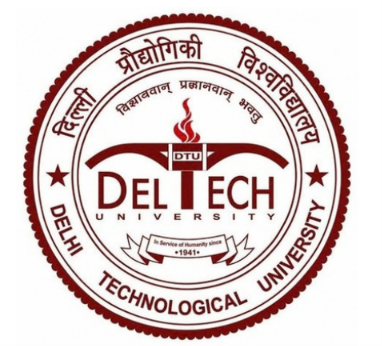
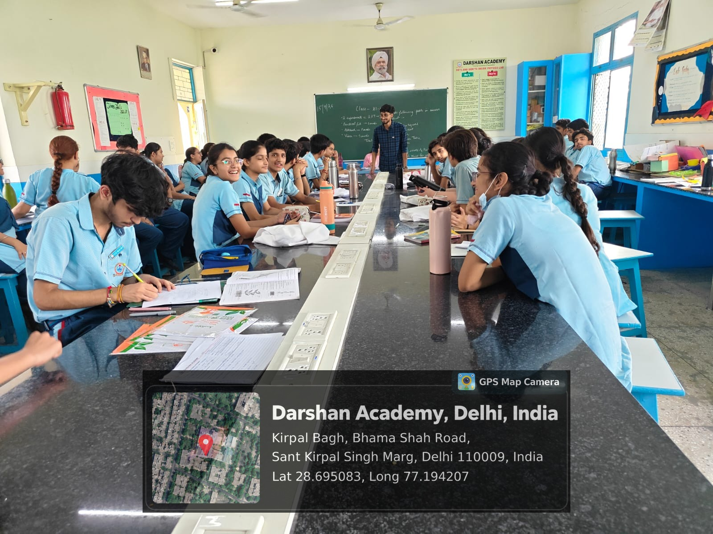
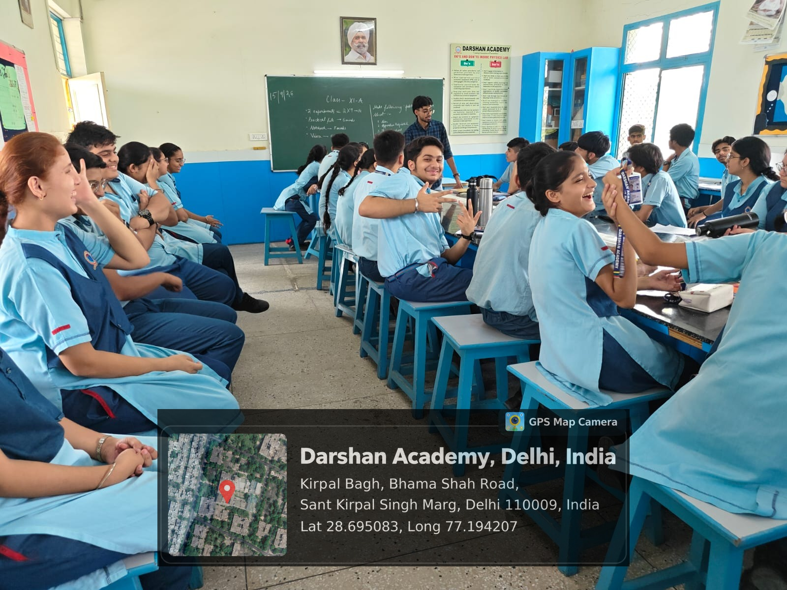
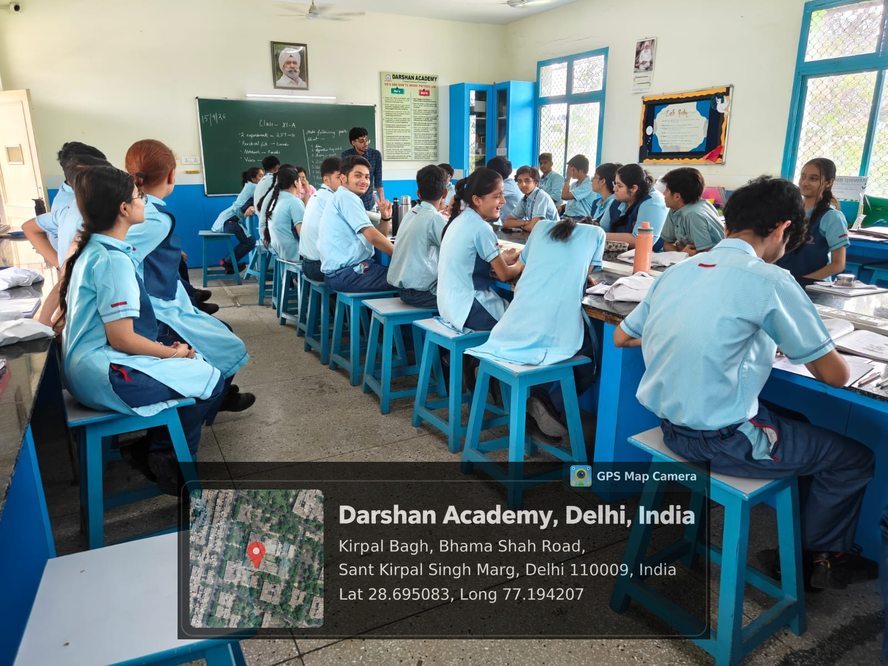
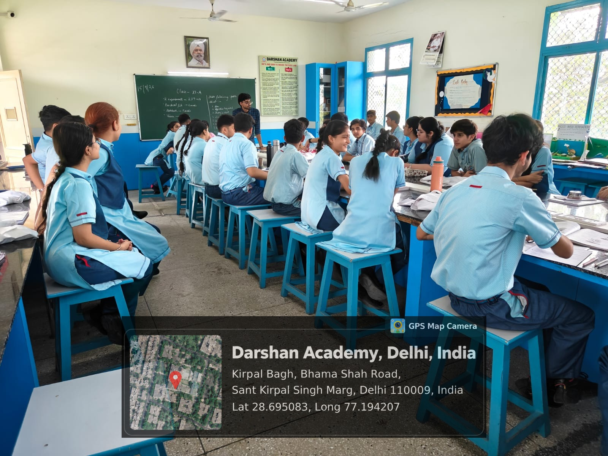
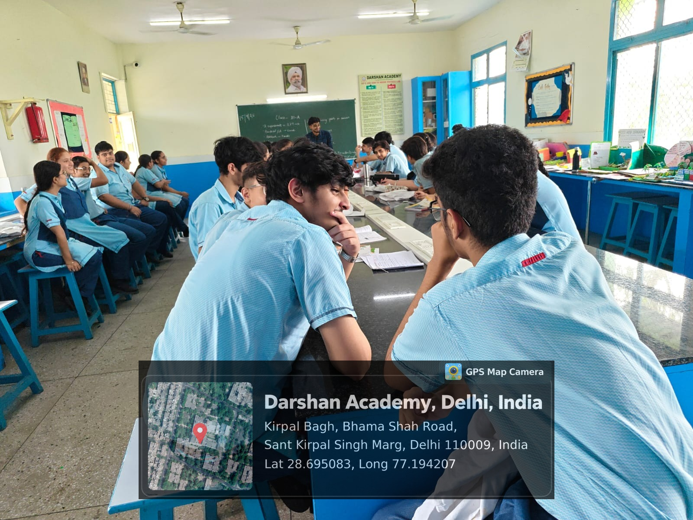
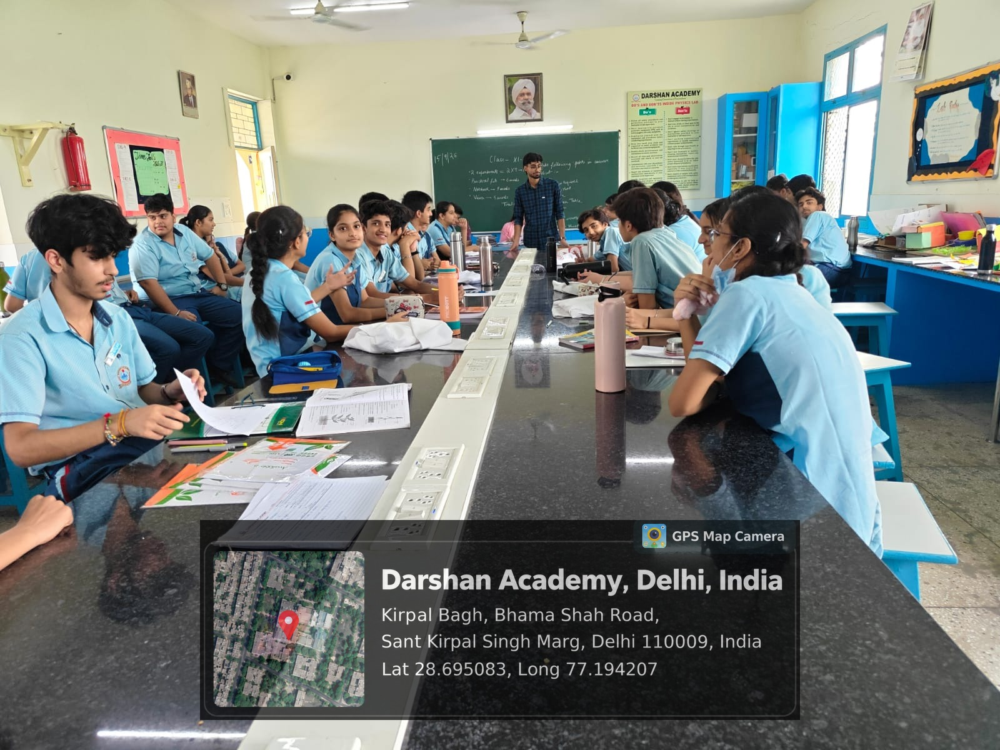

**DELHI TECHNOLOGICAL UNIVERSITY**

Department of Electronics and Communication Engineering

New Delhi - 110042, India

**MS-299**

**COMMUNITY ENGAGEMENT COURSE**

**Submitted By:** HARSH KAWATRA, 25/EC/073

**Submitted To:** Dr. Anukul Pandey, Course Coordinator (ECE)

**School Name:** Darshan Academy, Kirpal Bagh, Bhama Shah Road, Sant Kirpal Singh Marg, Delhi 110009

**Mentee Group:** Class XII A Students

---

## About Mentor:

Harsh Kawatra is a first-year student of Electronics and Communication Engineering at Delhi Technological University.

He qualified JEE Main in 2024 and 2025 and JEE Advanced in 2025. The exam conversations in these sessions came from someone who sat the same papers only months earlier.

Outside the classroom he has competed in national AI hackathons, finishing in the top five at Google's GDG Build with AI, and cleared three stages of the Amazon ML Summer School.

For the students, the gap between mentor and mentee was a single year, which made the advice easier to trust and easier to act on.

## About Mentee:

The programme ran with Class XII A at Darshan Academy, Delhi, a mixed section of about twenty-five students from the Science, Commerce and Humanities streams.

The full section attended the introductory sessions. Over the following weeks, most of the mentoring time went to seven students who attended every session and kept returning with questions of their own:

Kashvi Kapoor, Class XII A

Anurag Anand, Class XII A

Noorpreet Kaur, Class XII A

Shubh Singh Rajput, Class XII A

Saksham Khanna, Class XII A

Diya Chauhan, Class XII A

Khushi Chawla, Class XII A

## Mentee's Needs and Challenges:

**Stream chosen, destination unclear.** Most students could name their stream but not where it leads. PCM students said “engineering” without a branch in mind, and most Commerce students knew of exactly one route, chartered accountancy.

**Worry about AI, without specifics.** Nearly every session produced some version of the same question, whether a given career would still exist in four years. The concern came from headlines and social media, with little sense of how particular roles are actually changing.

**Exam preparation without a personal plan.** Several JEE aspirants were following their coaching institute's pace. None had a weekly plan built around their own weak chapters.

**No view of what happens after admission.** Few students had heard of hackathons, research programmes or first-year internships. For most of the class, planning stopped at the entrance exam result.

**Questions held back for months.** Some students said they had career questions they had never raised with teachers or parents, either because the questions felt too basic or because the answer at home already seemed decided.

## Focus Area:

The programme set out to give Class XII A a workable plan for the five years after school, built on four areas.

**AI literacy.** Which kinds of work are changing, which skills hold their value, and how students can start using AI tools in their own preparation.

**Stream-specific career maps.** Computer Science, ECE, VLSI and Mechanical for PCM; Genetics and Molecular Biology for PCB; Consulting, Finance and Marketing for Commerce and Humanities.

**Entrance exam strategy.** Weekly planning, time management and mock-test review for JEE and other entrance examinations.

**Early-college habits.** How first-year students secure internships and compete in hackathons and business case competitions.

The measure of success was simple: each student in the core group should leave with one concrete next step they could start that week.

## Planned Weekly Approach:

The programme ran across fifteen sessions of about two hours each, thirty hours in total, organised in three weekly blocks.

| Week | Goal | Planned Activity |
|---|---|---|
| Week 1 (Days 1 to 5) | Build a realistic shared understanding of AI and set a tone where any question is welcome | How AI is changing different job sectors, which skills stay valuable, and an open question round at the end of every session |
| Week 2 (Days 6 to 10) | Give every stream a set of named career options | Stream-wise sessions: CS, ECE, VLSI and Mechanical for PCM; Genetics and Molecular Biology for PCB; Consulting, Finance and Marketing for Commerce and Humanities |
| Week 3 (Days 11 to 15) | Turn awareness into a plan each student can act on | Time management for JEE and other entrance exams, a walkthrough of first-year internships and hackathons, and a closing session where each student drafted a ninety-day plan |
| Subsequent Sessions | Continuous mentoring | Follow-up conversations as students settle their stream choice and exam strategy |

## Geo-Tagged Photographs:

Image 1: Opening session with Class XII A on how AI is changing entry-level work.

Image 2: Walking students through career branches for the PCM, PCB and Commerce streams.

Image 3: Small-group discussion on JEE time management and exam strategy.

Image 4: Working session with the core group on internships and hackathons in the first year of college.

Image 5: Question round at the end of a session.

Image 6: Students mapping their own stream options during a hands-on exercise.

## Early Observations:

The section was more uneven than its shared exam calendar suggested. A few students already had a branch and a backup option worked out, while others were still unsure what to ask.

AI worried students differently depending on their stream. Commerce and Humanities students were mostly curious about it. Several PCM students saw it as a threat to a path they had already put years of coaching into.

The most engaged students were often the quietest ones in the full-class setting. They opened up only once we moved into the smaller group, which is how the core group of seven came together.

Specific examples held attention far better than general encouragement. A real branch cutoff or the actual prize structure of a hackathon kept the room focused, so I built the later sessions around examples of that kind.

Family expectations came up more than once. Some students felt pressure to choose a safe career over one they were curious about. In those conversations I laid out the options and left the decision with the student and their family.

Attention dipped whenever a session stayed too long on exam logistics without a story to anchor it. For the second half of the programme, each session will open with a real case and keep the logistics short.
