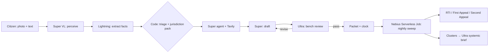

# NIVARAN — Execution Plan (Nebius × NVIDIA Global AI Hackathon)

> **Read this whole file before writing any code.** It is written for Sonnet-class executors and subagents. Every task has exact files, code, commands and acceptance criteria. Where it says **VERIFY**, do not guess: run the verification step and record the source URL. Where code is given, copy it, then adapt only what the task says to adapt.

---

## 0. Context

**Why we are building this.** In India, filing a civic complaint is easy, but getting it resolved is hard. A broken hand pump, a dispensary with no medicine, an unpaid pension or an unlit road all have an owner and, often, a statutory deadline. Citizens lose for four reasons:
- they file with the wrong office;
- their complaint is vague enough to be closed;
- nobody watches the clock;
- the escalation path (reminder → RTI → First Appeal → Information Commission → collective / PIL dossier) is legal machinery most people cannot run.

The user (Harsh) has already shipped Adhikaar, a deterministic RTI engine with deadlines, a linter and auto First Appeal. He has also built public-health (SwasthyaGrid), payments-inclusion (Hisaab) and civic projects. Nivaran combines that domain knowledge into **one new agentic product** built on NVIDIA Nemotron models served by **Nebius Token Factory**.

**What Nivaran is (one line).** *File once. Nivaran keeps the government's clock.* A citizen sends a photo and a few sentences, in Hindi or English. Nivaran then:
1. reads the evidence;
2. decides in code which office is legally responsible;
3. checks the current official channel live on the web;
4. drafts a complaint that is hard to reject;
5. has a stronger model attack that draft before filing;
6. starts the statutory clock once the citizen files;
7. escalates on its own every night when the government misses a deadline;
8. clusters repeated failures across a ward into a systemic dossier that a legal-aid clinic can take further.

**Hackathon facts (verified 2026-10-25):**
- Deadline: **Fri 30 Oct 2026, 10:00 AM PT = 10:30 PM IST**. Our internal submission target is **30 Oct, 18:00 IST**, leaving 4.5 h of buffer.
- Track: **Best Apps and Agents**. Bonus target: **Best Use of Tavily ($3k)**, which requires a functional runtime Tavily call. We also aim for **Most Valuable Feedback**.
- Judging criteria, equally weighted: Technological Implementation, Design (a complete product, not a proof of concept), Potential Impact, Quality of Idea.
- Judge advice from the "Will It Ship?" session: solve a real problem, and **reach the "aha" within 30 s of the demo**.
- Requirements:
  - a working hosted demo URL, free and unrestricted until 15 Dec 2026;
  - a public GitHub repo with an MIT license visible in About;
  - a README with setup steps and a clear account of Nemotron, Token Factory and Nebius usage;
  - a public YouTube video under 3:00;
  - written feedback on Token Factory, AI Cloud and NVIDIA models;
  - the track choice;
  - a "what was updated" note (we are a new repo and disclose what we reused).

**User's answers (locked decisions):**
- Concept: Nivaran.
- Track: Best Apps & Agents.
- Accounts available today: **Docker Desktop only**. Nebius, Tavily, Supabase and Vercel are set up on Day 0 (§2).
- Video: a hybrid in the style of Next Signal, with the user's own voice (one take per scene), Playwright-captured product beats, HyperFrames cutaways and whisper word-timing.

---

## 1. Strategy: how each judging criterion is won

| Criterion | What judges must see | Where in the product / video |
|---|---|---|
| **Tech implementation** | Four Nemotron models, each sized for its job, are routed deliberately. A real tool-calling agent uses Tavily. Structured outputs are schema-validated. An adversarial reviewer with a revise loop gates filing. A Nebius Serverless Job runs async batch work. The full model ledger shows tokens, latency and cost per case. An eval harness reports numbers. | Live pipeline timeline on `/case/[id]`; `/how` transparency page; video S07 |
| **Design** | A complete citizen journey: report → file → track → escalate → resolve. Mobile-first, an editorial civic visual language, Hindi support, and honest states (verified / unverified / needs input / emergency) | Every page; video S02–S06 |
| **Potential impact** | A specific audience (urban poor and lower-middle-class households in Delhi, plus legal-aid clinics), sourced numbers, a real legal escalation ladder, and a systemic layer that turns individual complaints into collective evidence | Landing hero stat; `/board`; `/cluster/[id]`; video S01 + S06 |
| **Quality of idea** | Non-obvious: the agent does not just "write a complaint". It runs the **statutory clock and the escalation ladder**, and uses the *government's own deadlines* as the trigger. "The models propose, the code decides" is a credible answer to LLM unreliability in legal work. | Seals reading "DECIDED BY CODE" and "REVIEWED BY ULTRA"; video S03–S05 |

**Model routing (the core technical story). Every tier has a distinct, defensible job:**

| Tier key | Token Factory model ID (verified in catalog) | $/1M in / out | Job in Nivaran | Thinking |
|---|---|---|---|---|
| `lightning` | `nvidia/Nemotron-3_5-Lightning` | 0.06 / 0.24 | Fast intake: field extraction from citizen text (JSON), emergency flagging, follow-up questions, Hindi plain-language copies. **Also the brain of the real-time Hindi/English voice agent "Nivaran Sahayak"** (streaming + tool calling, ~314 tok/s, so time to first audio stays near 1 s) | OFF |
| `superVL` | `nvidia/Nemotron-3.5-Super-VL` | 0.30 / 0.90 | Evidence perception: photo of the problem → findings; acknowledgement slip → registration number and date; government reply letter → text | OFF |
| `super` | `nvidia/nemotron-3-super-120b-a12b` (**lowercase**) | 0.30 / 0.90 | Research agent with tool calling (Tavily search/extract + deterministic tools), drafting and revisions | ON |
| `ultra` | `nvidia/Nemotron-3-Ultra-550b-a55b` | 1.00 / 3.00 | "The Bench": adversarial pre-filing review; reply classification (evasive / partial / resolved); systemic cluster briefs | ON |
| `nano` | `nvidia/NVIDIA-Nemotron-3-Nano-30B-A3B` | 0.06 / 0.24 | Nightly Serverless Job: short status digests per ladder event (cheap bulk calls) | OFF |

**Do NOT use** `nvidia/Llama-3_1-Nemotron-Ultra-253B-v1`, `Nemotron-3-Nano-Omni` or `Cosmos3-Super-Reasoner`. They were removed from serverless on 31 Aug 2026.

**Nebius services used:**
1. **Token Factory**: every model call.
2. **Nebius Serverless Job** `nivaran-nightly`: sweeps all open cases, advances the ladder, re-clusters, writes Ultra systemic briefs and Nano digests.
3. **Nebius Serverless Endpoint** `nivaran-voice`: hosts the voice-agent WebSocket service (§9B), a FastAPI container ported from SwasthyaGrid. **VERIFY on Day 2 that Endpoints pass WebSocket upgrades.** If they do not, host it on Cloud Run with the existing SwasthyaGrid `backend/scripts/deploy.sh` pattern, or on Railway, and keep the Endpoint for the HTTP health route only.
4. Stretch (P2): a Nebius Serverless Endpoint mirror of the web app.

**Third-party voice I/O:** Sarvam AI (`saaras:v3-realtime` STT, `bulbul:v3` TTS, speaker `simran`), using the **same `SARVAM_API_KEY` and architecture as SwasthyaGrid**. Sarvam handles speech only. Every reasoning and tool-calling token in the voice agent is Nemotron on Token Factory (SwasthyaGrid's `sarvam-105b` chat model is replaced).

Vercel hosts the long-lived demo URL, because an endpoint running for two months would burn the credits. The README states this honestly.

---

## 2. Day 0: human checklist (Harsh does these TODAY, Oct 25 IST evening)

Executors: **block on items 1–4 before Day 1 T03.** Items 5–8 can run in parallel.

1. **Nebius Token Factory**
   - Sign up at https://tokenfactory.nebius.com and create an API key.
   - Redeem promo code `NEBIUS-DEVPOST-GLOBAL26` at https://nebius.com/promo-code.
   - Join the Builders Program at https://dev.nebius.com/builders for +$25 and Tavily/Academy credits.
   - Save the key as `NEBIUS_API_KEY`.
2. **Tavily**: get a key at https://app.tavily.com (the free tier has 1,000 credits a month; Builders credits add more). Save it as `TAVILY_API_KEY`.
3. **Supabase**
   - Create a new project `nivaran`, region Mumbai (ap-south-1).
   - Copy the Project URL to `SUPABASE_URL` and the service role key to `SUPABASE_SERVICE_ROLE_KEY`.
   - Create a **private** Storage bucket named `evidence`.
4. **GitHub + Vercel**
   - Create an empty **public** repo `harshkawatra11/nivaran`. Leave "Add a README" unchecked.
   - Run `npm i -g vercel`, then `vercel login`.
5. **Nebius AI Cloud (for the Serverless Job)**
   - Open https://console.nebius.com, create or choose a project, and note the **subnet ID** (Network → Subnets).
   - Install the CLI inside **WSL or Git Bash**: `curl -sSL https://storage.ai.nebius.cloud/nebius/install.sh | bash` (**VERIFY** the current URL at https://docs.nebius.com/cli/install), then `nebius profile create`.
   - If this is not working by **Day 2 at 12:00 IST**, the fallback is the Vercel cron (already in the plan). We still qualify through Token Factory.
6. **Docker Hub**: log in with `docker login`. The job image is public and contains no secrets.
7. **Photos (real, yours):** take 4 phone photos of real civic problems near you, such as a broken or dry hand pump or tap, an overflowing garbage point, a dark or broken streetlight, a pothole or an open drain.
   - Save them to `public/demo/photos/` as `pump.jpg`, `garbage.jpg`, `streetlight.jpg` and `pothole.jpg`.
   - Fallback: CC-BY or CC0 photos from Wikimedia Commons, with attribution in `public/demo/photos/ATTRIBUTION.md`.
7b. **Sarvam (voice)**: reuse the existing `SARVAM_API_KEY` from `ai-healthcare platform\backend\.env` (the same key SwasthyaGrid uses). Confirm it still has credits at https://dashboard.sarvam.ai. Record Meena's two Hindi lines as `video/assets/voice/meena-hindi.wav` (16 kHz mono) for the voice capture beat.
8. **YouTube**: make sure you can upload a public video. The voice recording happens on **Day 4 evening** after the script is frozen (§14).

---

## 3. Final architecture

```
Citizen (mobile web, Hindi/English)
   │ photo + text (+ optional geolocation)
   ▼
Next.js 16 App Router on Vercel  ──────────────►  Supabase (Postgres + private Storage)
   │  /api/cases/[id]/run  (SSE stream of pipeline events)
   ▼
PIPELINE (src/lib/pipeline/run.ts)
 1 PERCEIVE   superVL    photo → EvidenceFindings (JSON)            [LLM]
 2 UNDERSTAND lightning  text+findings → GrievanceFacts (JSON)       [LLM]
 3 TRIAGE     code       emergency gate, follow-up questions          [CODE]
 4 DECIDE     code       jurisdiction pack → authority, channel, SLA  [CODE]  ← "DECIDED BY CODE"
 5 RESEARCH   super+tools  Tavily search/extract on official domains,  [AGENT]
                           confirm channel/officer/notices; citations
                           filtered to fetched URLs by code
 6 DRAFT      super      template slots + narrative paragraph          [LLM+CODE]
 7 BENCH      ultra      adversarial review → revise (super) ≤2 rounds [LLM loop] ← "REVIEWED BY ULTRA"
 8 PACKAGE    code       PDF packet, SHA-256 evidence hashes, links   [CODE]
   │
   ▼
CASE LIFECYCLE (src/lib/ladder/*.ts, deterministic)
 filed (ack photo → superVL reads reg no/date → clock starts)
  → overdue → reminder → RTI (s.6) → First Appeal (s.19(1)) → Second Appeal/Commission (s.19(3))
  → reply uploaded at any point → superVL reads + ultra classifies → code maps to next step
   │
   ▼
NEBIUS SERVERLESS JOB  nivaran-nightly  (scripts/nightly.ts bundled → Docker image)
  sweep all open cases (code) → Nano status digests → recluster (geohash6+category)
  → Ultra systemic briefs for clusters that crossed threshold
  (fallback scheduler: Vercel cron → /api/cron/nightly, same function)

VOICE AGENT "Nivaran Sahayak" (voice-service/, FastAPI, ported 1:1 from SwasthyaGrid)
 Browser: AudioWorklet pcm-recorder → PCM16 mono 16 kHz, 100 ms frames, base64 JSON
   │  one WebSocket  wss://<voice-host>/ws/voice  (protocol v2 frames: hello/audio/text/ptt/interrupt/bye)
   ▼
 VoiceSession (per socket)
   ├─ Sarvam STT realtime WS  saaras:v3-realtime, VAD endpointing, hi-IN / en-IN / auto
   ├─ Nemotron 3.5 Lightning on Token Factory  streaming SSE + tools (ToolCallAccumulator, ≤3 rounds)
   │     tools → HTTPS to Next.js /api/voice/tools/* (service token + signed session ticket)
   │           (create report, case status, deadlines, next step, read document, answer follow-up)
   ├─ SentenceSegmenter → Sarvam TTS WS bulbul:v3 "simran" PCM 24 kHz (REST WAV fallback)
   └─ TurnController: 350 ms coalescing, barge-in (2 words, 400 ms echo guard), fillers
   ▼
 Browser AudioPlaybackQueue (gapless Web Audio), live transcript + case cards
```

**Principle, enforced in code review:** an LLM never decides jurisdiction, deadlines, ladder transitions, or which URLs are cited. LLMs perceive, extract, research, phrase and critique. Code decides. Every LLM output is zod-validated before use.

---

## 4. Repo layout (create exactly this)

Root: `c:\Users\harsh\Desktop\HARSH\WEB-DEV-PROJECTS\nvidia-hackathon\` (currently empty). The git remote is `harshkawatra11/nivaran`.

```
nvidia-hackathon/
├─ LICENSE                       # MIT, "Copyright (c) 2026 Harsh Kawatra"
├─ README.md                     # §16 template
├─ .env.example
├─ .gitignore                    # node_modules, .next, .env*, !.env.example, dist-job, video/renders, video/assets/voice/raw, video/assets/footage/raw, *.mp4 (except none)
├─ package.json
├─ next.config.ts
├─ tsconfig.json                 # paths: "@/*": ["./src/*"]
├─ vitest.config.ts
├─ vercel.json                   # cron + function maxDuration
├─ Dockerfile.job
├─ supabase/schema.sql
├─ docs/
│  ├─ SPIKE-RESULTS.md           # T02 output
│  ├─ FEEDBACK-LOG.md            # append-only; every executor adds friction notes
│  ├─ LEGAL-SOURCES.md           # T07 output: every legal fact + URL
│  ├─ IMPACT-STATS.md            # T08 output: every number used anywhere + URL
│  └─ DEVPOST.md                 # §17 submission text
├─ scripts/
│  ├─ spike.ts                   # T02
│  ├─ seed.ts                    # T25
│  ├─ nightly.ts                 # T22 (job entry)
│  ├─ make-demo-docs.ts          # T26 (watermarked sample ack/reply images)
│  └─ build-job.mjs              # esbuild bundle for job
├─ eval/
│  ├─ cases.json                 # 30 labelled grievances
│  ├─ flawed-drafts.json         # 10 drafts with planted defects
│  ├─ run.ts
│  └─ RESULTS.md
├─ public/demo/photos/*.jpg, public/demo/docs/*.png
├─ src/
│  ├─ app/
│  │  ├─ layout.tsx, globals.css, page.tsx               # landing
│  │  ├─ report/page.tsx                                 # intake
│  │  ├─ case/[id]/page.tsx                              # case file (client component inside)
│  │  ├─ cases/page.tsx                                  # my cases (session)
│  │  ├─ board/page.tsx                                  # ward accountability board
│  │  ├─ cluster/[id]/page.tsx                           # systemic dossier
│  │  ├─ how/page.tsx                                    # transparency / architecture / ledger / eval
│  │  └─ api/
│  │     ├─ cases/route.ts                               # POST create, GET list
│  │     ├─ cases/[id]/route.ts                          # GET case bundle
│  │     ├─ cases/[id]/run/route.ts                      # POST → SSE pipeline
│  │     ├─ cases/[id]/answer/route.ts                   # POST follow-up answers
│  │     ├─ cases/[id]/filed/route.ts                    # POST ack image or manual ref → start clock
│  │     ├─ cases/[id]/reply/route.ts                    # POST reply image → classify → next step
│  │     ├─ cases/[id]/step-filed/route.ts               # POST mark RTI/appeal filed (date)
│  │     ├─ cases/[id]/packet/route.ts                   # GET PDF
│  │     ├─ demo/clock/route.ts                          # POST {days} → offset + sweep this session
│  │     ├─ board/route.ts                               # GET aggregates + clusters
│  │     ├─ clusters/[id]/route.ts                       # GET cluster bundle
│  │     ├─ clusters/[id]/packet/route.ts                # GET PDF
│  │     ├─ ledger/route.ts                              # GET aggregate ledger stats
│  │     └─ cron/nightly/route.ts                        # GET (CRON_SECRET) → runNightly()
│  ├─ components/ (see §12)
│  └─ lib/
│     ├─ env.ts
│     ├─ db.ts                    # supabase server client (service role)
│     ├─ session.ts               # anonymous session cookie
│     ├─ clock.ts                 # effective "now" with demo offset
│     ├─ hash.ts                  # sha256
│     ├─ geohash.ts
│     ├─ llm/models.ts, client.ts, json.ts, agent.ts, ledger.ts, prompts.ts
│     ├─ tools/tavily.ts, registry.ts
│     ├─ schemas.ts               # zod schemas for every LLM output
│     ├─ packs/types.ts, in-dl.ts, central.ts, index.ts
│     ├─ jurisdiction.ts          # resolveJurisdiction (pure)
│     ├─ triage.ts                # emergency + follow-up questions (pure)
│     ├─ ladder/types.ts, rules.ts, deadlines.ts, templates.ts, advance.ts
│     ├─ rti/linter.ts            # ported from Adhikaar
│     ├─ pipeline/run.ts, events.ts, stages/{perceive,understand,triage,decide,research,draft,bench,package}.ts
│     ├─ reply.ts                 # reply classification flow
│     ├─ cluster.ts               # recluster + systemic threshold (pure core + db wrapper)
│     ├─ nightly.ts               # runNightly() used by job + cron
│     └─ pdf/packet.ts, pdf/cluster.ts
├─ voice-service/  (see §9B; FastAPI voice agent ported from SwasthyaGrid)
│  ├─ app/main.py, app/config.py, app/api/voice_ws.py
│  ├─ app/voice/{session,turns,sarvam_stt,nemotron_chat,sarvam_tts,sarvam_tts_ws,segmenter,speech,fillers}.py
│  ├─ app/prompts/voice_prompt.py, app/tools/{schemas,dispatch}.py, app/ticket.py
│  ├─ tests/ (ported voice tests, with sarvam_chat → nemotron_chat)
│  ├─ requirements.txt, Dockerfile, .env.example
└─ video/  (see §14; heavy media is gitignored)
```
The voice frontend lives in the Next app: `public/worklets/pcm-recorder.js`, `src/lib/audio/*`, `src/lib/voice/*`, `src/components/voice/*` and the routes `src/app/voice/page.tsx`, `src/app/api/voice/ticket/route.ts` and `src/app/api/voice/tools/[tool]/route.ts`.

---

## 5. Day-by-day schedule (IST)

| Day | Date | Block | Tasks | Owner |
|---|---|---|---|---|
| D0 | Sun 25 Oct, evening | Accounts, spike | §2 checklist; T01 scaffold; T02 spike | Harsh + 1 executor |
| D1 | Mon 26 Oct | Foundations | T03–T10 (env, db, llm layer, packs, legal + stats verification, deterministic core + tests) | 3 parallel subagents |
| D2 | Tue 27 Oct | Pipeline | T11–T18 (stages, SSE, intake UI, case page) | 2–3 subagents |
| D2–D3 | Tue 27 to Wed 28 Oct | **Voice agent (a parallel lane, its own subagent)** | T41–T47 (§9B): port voice-service, swap chat to Nemotron, Nivaran tools, frontend port, deploy to Nebius Endpoint | 1 dedicated subagent |
| D3 | Wed 28 Oct | Lifecycle + systemic | T19–T26 (filed/reply flows, ladder UI, demo clock, nightly + Nebius job, clusters, board, seed) | 3 subagents |
| D4 | Thu 29 Oct | Polish, deploy, eval, script freeze | T27–T33 (design pass, /how, eval, deploy Vercel + Nebius job run, README, script freeze 18:00) → **Harsh records voice 19:00–21:00** | 2 subagents + Harsh |
| D5 | Fri 30 Oct | Video + submit | T34–T40 (capture, assemble, render by 14:00, YouTube by 15:00, Devpost by 18:00) | 1–2 subagents + Harsh |

**Hard gates (if missed, apply the cut list in §19):**
- Gate A, D1 23:59: `npm run test` passes the deterministic core, and `scripts/spike.ts` succeeds for all 5 models.
- Gate B, D2 23:59: the end-to-end pipeline runs locally on `pump.jpg` and produces a case page with a draft and a bench review.
- Gate C, D3 23:59: the demo clock escalates a case to RTI and First Appeal, `/board` shows clusters, and the nightly job has run at least once (Nebius or cron).
- Gate D, D4 18:00: the production URL works end to end, and SCRIPT.md is frozen.
- Gate E, D5 15:00: the YouTube video is public.

---

## 6. Subagent operating rules (paste into every subagent prompt)

```
You are executing task <TID> of /PLAN (C:\Users\harsh\.claude\plans\eventually-what-you-can-buzzing-rabin.md).
Repo root: c:\Users\harsh\Desktop\HARSH\WEB-DEV-PROJECTS\nvidia-hackathon
Rules:
1. Read §0, §3, §6 and your task section fully before editing.
2. Only touch files listed in your task unless a compile error forces a minimal change elsewhere; report any such change.
3. Next.js 16 App Router: route handler `params` is a Promise (`const { id } = await params`), `cookies()` is async. Load the `vercel:nextjs` skill if unsure. Do not create middleware/proxy files.
4. Never hardcode secrets. Read env via src/lib/env.ts.
5. Every LLM output is validated with the zod schema from src/lib/schemas.ts. Never let an LLM decide jurisdiction, deadlines, ladder transitions or citations.
6. No invented facts. Legal facts come only from src/lib/packs (with sourceUrl); statistics only from docs/IMPACT-STATS.md.
7. Copy rule: no em dashes (—) in any user-facing string or document template. Use commas, periods, or colons.
8. When you hit friction with Nebius Token Factory / Nebius CLI / Nemotron / Tavily, append a dated bullet to docs/FEEDBACK-LOG.md (what you tried, what happened, what you expected, workaround).
9. Finish with: `npm run typecheck && npm run test` (and `npm run build` for UI tasks). Report the output honestly. Commit with message "<TID>: <summary>".
```

Commit attribution trailer for every commit:
```
Co-Authored-By: Claude Opus 5.5 <noreply@anthropic.com>
```

---

## 7. Tasks: Day 0 / Day 1 (foundations)

### T01: Scaffold (D0, 30 min)
```powershell
cd c:\Users\harsh\Desktop\HARSH\WEB-DEV-PROJECTS\nvidia-hackathon
npx create-next-app@latest . --ts --tailwind --eslint --app --src-dir --import-alias "@/*" --use-npm --yes
npm i @supabase/supabase-js zod pdf-lib lucide-react leaflet react-leaflet clsx
npm i -D vitest tsx esbuild @types/leaflet dotenv
git init; git branch -M main
```
- `package.json` scripts: add
  ```json
  "typecheck": "tsc --noEmit",
  "test": "vitest run",
  "spike": "tsx --env-file=.env.local scripts/spike.ts",
  "seed": "tsx --env-file=.env.local scripts/seed.ts",
  "nightly": "tsx --env-file=.env.local scripts/nightly.ts",
  "eval": "tsx --env-file=.env.local eval/run.ts",
  "build:job": "node scripts/build-job.mjs",
  "verify": "npm run typecheck && npm run test && npm run build"
  ```
- `vitest.config.ts`:
  ```ts
  import { defineConfig } from "vitest/config";
  import path from "node:path";
  export default defineConfig({ test: { environment: "node", include: ["src/**/*.test.ts", "eval/**/*.test.ts"] }, resolve: { alias: { "@": path.resolve(__dirname, "src") } } });
  ```
- `LICENSE`: the standard MIT text, `Copyright (c) 2026 Harsh Kawatra`.
- `.env.example`:
  ```
  NEBIUS_API_KEY=
  NEBIUS_BASE_URL=https://api.tokenfactory.nebius.com/v1
  TAVILY_API_KEY=
  SUPABASE_URL=
  SUPABASE_SERVICE_ROLE_KEY=
  CRON_SECRET=
  NEXT_PUBLIC_DEMO_MODE=1
  # set by spike results (T02):
  NV_THINKING_KWARG=on        # on|off : send chat_template_kwargs.enable_thinking
  NV_JSON_MODE=schema         # schema|object|prompt
  NV_JSON_STRICT=false
  # voice (Next side)
  NEXT_PUBLIC_VOICE_WS_URL=ws://127.0.0.1:8080/ws/voice
  VOICE_SERVICE_TOKEN=          # shared secret: voice-service → Next /api/voice/tools/*
  VOICE_TICKET_SECRET=          # HMAC secret for short-lived session tickets
  ```
  The `voice-service/.env.example` keys reuse SwasthyaGrid's names exactly. **Copy the `SARVAM_API_KEY` value by hand from `ai-healthcare platform/backend/.env` into `voice-service/.env`, and never commit it.**
  ```
  SARVAM_API_KEY=
  SARVAM_STT_MODEL=saaras:v3-realtime
  SARVAM_TTS_MODEL=bulbul:v3
  SARVAM_SPEAKER=simran
  SARVAM_TTS_MODE=ws
  SARVAM_STREAM_WITH_TOOLS=true
  VOICE_LANGUAGE=auto
  NEBIUS_API_KEY=
  NEBIUS_BASE_URL=https://api.tokenfactory.nebius.com/v1
  NV_VOICE_MODEL=nvidia/Nemotron-3_5-Lightning
  NV_THINKING_KWARG=on
  NIVARAN_API_BASE=http://127.0.0.1:3000
  VOICE_SERVICE_TOKEN=
  VOICE_TICKET_SECRET=
  CORS_ORIGINS=http://127.0.0.1:3000,http://localhost:3000,https://<vercel-domain>
  ENVIRONMENT=development
  ```
- `git remote add origin https://github.com/harshkawatra11/nivaran.git`, then push the first commit.
- **Acceptance:** `npm run build` passes on the scaffold.

### T02: Token Factory spike (D0, 1 h). **Gate A input.**
Create `scripts/spike.ts`. It must test the following and write `docs/SPIKE-RESULTS.md` (a table plus raw notes):
1. `GET {base}/models`: confirm all 5 model IDs exist (exact casing). Print any NVIDIA IDs that differ.
2. For each of the 5 models, a plain chat "Reply with the word OK": latency, `usage`, whether `message.reasoning_content` or `message.reasoning` exists, and whether `<think>` appears in content.
3. For each model: the same call with `chat_template_kwargs: { enable_thinking: false }`. Record whether it returns 200 and whether reasoning disappears.
4. For each model: `response_format: {type:"json_schema", json_schema:{name:"t", schema:{type:"object",properties:{a:{type:"string"}},required:["a"],additionalProperties:false}, strict:true}}`. Record 200 or error and whether the output parses. Repeat with `{type:"json_object"}`.
5. `super` and `ultra`: tool calling with one tool `get_time({tz:string})` and `tool_choice:"auto"`, prompt "What time is it in Asia/Kolkata? Use the tool." Record whether `tool_calls` was returned and its arguments JSON.
6. `superVL`: an image as `{type:"image_url", image_url:{url:"data:image/jpeg;base64,..."}}` using `public/demo/photos/pump.jpg`, or any jpg if photos are not ready yet. Record the description.
7. Read the `x-ratelimit-remaining-requests` / `-tokens` headers.

Code skeleton (complete the remaining cases in the same style):
```ts
import fs from "node:fs";
const BASE = (process.env.NEBIUS_BASE_URL ?? "https://api.tokenfactory.nebius.com/v1").replace(/\/$/, "");
const KEY = process.env.NEBIUS_API_KEY!;
const IDS = {
  lightning: "nvidia/Nemotron-3_5-Lightning",
  nano: "nvidia/NVIDIA-Nemotron-3-Nano-30B-A3B",
  super: "nvidia/nemotron-3-super-120b-a12b",
  superVL: "nvidia/Nemotron-3.5-Super-VL",
  ultra: "nvidia/Nemotron-3-Ultra-550b-a55b",
};
async function post(body: unknown) {
  const t0 = Date.now();
  const res = await fetch(`${BASE}/chat/completions`, { method: "POST", headers: { Authorization: `Bearer ${KEY}`, "Content-Type": "application/json" }, body: JSON.stringify(body) });
  const text = await res.text();
  let json: any = null; try { json = JSON.parse(text); } catch {}
  return { status: res.status, ms: Date.now() - t0, json, text: text.slice(0, 500), rl: { req: res.headers.get("x-ratelimit-remaining-requests"), tok: res.headers.get("x-ratelimit-remaining-tokens") } };
}
const rows: string[] = ["| test | model | status | ms | note |", "|---|---|---|---|---|"];
function row(t: string, m: string, r: Awaited<ReturnType<typeof post>>, note: string) { rows.push(`| ${t} | ${m} | ${r.status} | ${r.ms} | ${note.replace(/\|/g, "/").slice(0, 160)} |`); }
async function main() {
  const models = await fetch(`${BASE}/models`, { headers: { Authorization: `Bearer ${KEY}` } }).then(r => r.json());
  const ids: string[] = (models.data ?? []).map((m: any) => m.id);
  const nv = ids.filter(i => i.toLowerCase().startsWith("nvidia/"));
  for (const [k, id] of Object.entries(IDS)) {
    const r = await post({ model: id, messages: [{ role: "user", content: "Reply with the word OK" }], max_tokens: 256 });
    const msg = r.json?.choices?.[0]?.message ?? {};
    row("plain", k, r, `inCatalog=${ids.includes(id)} reasoning_content=${!!(msg.reasoning_content ?? msg.reasoning)} thinkTag=${/<think>/.test(msg.content ?? "")} content=${JSON.stringify(msg.content)?.slice(0, 60)}`);
    // ... tests 3,4,5,6 here
  }
  fs.writeFileSync("docs/SPIKE-RESULTS.md", `# Spike results ${new Date().toISOString()}\n\nNVIDIA ids in /models: ${nv.join(", ")}\n\n${rows.join("\n")}\n`);
}
main().catch(e => { console.error(e); process.exit(1); });
```
**Decisions to write at the bottom of SPIKE-RESULTS.md and into `.env.local`:**
- `NV_THINKING_KWARG`: `on` if test 3 returns 200 for all models, otherwise `off`.
- `NV_JSON_MODE`: `schema` if test 4 json_schema works for lightning, superVL, super and ultra; else `object` if json_object works; else `prompt`.
- `NV_JSON_STRICT`: `true` only if strict schema worked.
- If any model ID differs, update `src/lib/llm/models.ts` defaults (T05) and note it in FEEDBACK-LOG.

**Acceptance:** the file exists, and every model returns 200 for the plain test. If a model fails, stop and report to Harsh. Use the substitution table in §19.

### T03: env + db + session + clock + hash + geohash (D1)
`src/lib/env.ts`:
```ts
function req(name: string): string { const v = process.env[name]; if (!v) throw new Error(`Missing env ${name}`); return v; }
export const env = {
  nebiusKey: () => req("NEBIUS_API_KEY"),
  nebiusBase: () => (process.env.NEBIUS_BASE_URL ?? "https://api.tokenfactory.nebius.com/v1").replace(/\/$/, ""),
  tavilyKey: () => req("TAVILY_API_KEY"),
  supabaseUrl: () => req("SUPABASE_URL"),
  supabaseKey: () => req("SUPABASE_SERVICE_ROLE_KEY"),
  cronSecret: () => process.env.CRON_SECRET ?? "",
  thinkingKwarg: () => (process.env.NV_THINKING_KWARG ?? "on") === "on",
  jsonMode: () => (process.env.NV_JSON_MODE ?? "schema") as "schema" | "object" | "prompt",
  jsonStrict: () => process.env.NV_JSON_STRICT === "true",
  demoMode: () => process.env.NEXT_PUBLIC_DEMO_MODE === "1",
};
```
`src/lib/db.ts`:
```ts
import { createClient, type SupabaseClient } from "@supabase/supabase-js";
import { env } from "@/lib/env";
let _db: SupabaseClient | null = null;
export function db(): SupabaseClient {
  if (!_db) _db = createClient(env.supabaseUrl(), env.supabaseKey(), { auth: { persistSession: false } });
  return _db;
}
```
`src/lib/session.ts`: an anonymous session stored in the httpOnly cookie `nv_sid`. It holds a uuid and is upserted into `sessions`.
```ts
import { cookies } from "next/headers";
import { db } from "@/lib/db";
export async function getSessionId(create = true): Promise<string | null> {
  const jar = await cookies();
  let sid = jar.get("nv_sid")?.value ?? null;
  if (!sid && create) {
    sid = crypto.randomUUID();
    jar.set("nv_sid", sid, { httpOnly: true, sameSite: "lax", secure: process.env.NODE_ENV === "production", path: "/", maxAge: 60 * 60 * 24 * 120 });
    await db().from("sessions").insert({ id: sid });
  }
  return sid;
}
export async function getClockOffsetDays(sid: string): Promise<number> {
  const { data } = await db().from("sessions").select("clock_offset_days").eq("id", sid).single();
  return data?.clock_offset_days ?? 0;
}
```
(Cookies can only be set in route handlers or server actions. Pages call `/api/cases` etc., which create the session. Pages read with `create=false`.)

`src/lib/clock.ts`:
```ts
export function effectiveNow(offsetDays: number, real: Date = new Date()): Date { const d = new Date(real); d.setUTCDate(d.getUTCDate() + offsetDays); return d; }
export function isoDate(d: Date): string { return d.toISOString().slice(0, 10); }
export function addDays(iso: string, days: number): string { const d = new Date(iso + "T00:00:00Z"); d.setUTCDate(d.getUTCDate() + days); return isoDate(d); }
export function daysBetween(aIso: string, b: Date): number { return Math.floor((b.getTime() - new Date(aIso + "T00:00:00Z").getTime()) / 86400000); }
export function isPast(dueIso: string, now: Date): boolean { return new Date(dueIso + "T23:59:59Z").getTime() < now.getTime(); }
```
`src/lib/hash.ts`: `export async function sha256Hex(buf: ArrayBuffer | Uint8Array): Promise<string>` using `crypto.subtle.digest`.

`src/lib/geohash.ts` (standard base32 encode, precision param):
```ts
const B32 = "0123456789bcdefghjkmnpqrstuvwxyz";
export function geohash(lat: number, lng: number, precision = 6): string {
  let idx = 0, bit = 0, even = true, out = "";
  let latMin = -90, latMax = 90, lngMin = -180, lngMax = 180;
  while (out.length < precision) {
    if (even) { const mid = (lngMin + lngMax) / 2; if (lng >= mid) { idx = idx * 2 + 1; lngMin = mid; } else { idx = idx * 2; lngMax = mid; } }
    else { const mid = (latMin + latMax) / 2; if (lat >= mid) { idx = idx * 2 + 1; latMin = mid; } else { idx = idx * 2; latMax = mid; } }
    even = !even;
    if (++bit === 5) { out += B32[idx]; bit = 0; idx = 0; }
  }
  return out;
}
```
Tests: `src/lib/geohash.test.ts`. `geohash(28.6139, 77.2090, 6)` must equal `"ttnfv2"`. **VERIFY** this with an online geohash tool, then set the expected value. Add `clock.test.ts` with 4 cases.

### T04: Supabase schema (D1)
`supabase/schema.sql`. Harsh runs it in the Supabase SQL editor, or the executor runs it via `psql` if a connection string is given.
```sql
create extension if not exists pgcrypto;

create table if not exists sessions (
  id uuid primary key,
  created_at timestamptz not null default now(),
  clock_offset_days int not null default 0
);

create table if not exists clusters (
  id uuid primary key default gen_random_uuid(),
  pack text not null,
  category text not null,
  geohash6 text not null,
  locality text,
  status text not null default 'watching' check (status in ('watching','systemic')),
  case_count int not null default 0,
  overdue_count int not null default 0,
  first_seen date,
  last_seen date,
  brief jsonb,
  brief_case_count int,
  brief_updated_at timestamptz,
  created_at timestamptz not null default now(),
  unique (pack, category, geohash6)
);

create table if not exists cases (
  id uuid primary key default gen_random_uuid(),
  session_id uuid references sessions(id) on delete cascade,
  created_at timestamptz not null default now(),
  updated_at timestamptz not null default now(),
  status text not null default 'intake',
  pack text not null default 'in-dl',
  citizen_text text not null,
  language text not null default 'en',
  location_text text,
  lat double precision, lng double precision, geohash6 text,
  category text,
  facts jsonb, evidence_findings jsonb, triage jsonb, jurisdiction jsonb, research jsonb, bench jsonb,
  followup_questions jsonb, followup_answers jsonb,
  portal_ref text, filed_at date,
  rti_filed_at date, appeal_filed_at date, second_appeal_filed_at date,
  life_or_liberty boolean not null default false,
  is_demo_seed boolean not null default false,
  cluster_id uuid references clusters(id) on delete set null
);
create index if not exists cases_session_idx on cases(session_id);
create index if not exists cases_status_idx on cases(status);
create index if not exists cases_cluster_idx on cases(cluster_id);

create table if not exists evidence (
  id uuid primary key default gen_random_uuid(),
  case_id uuid not null references cases(id) on delete cascade,
  kind text not null check (kind in ('photo','ack','reply')),
  storage_path text not null,
  sha256 text not null,
  mime text not null,
  bytes int not null,
  findings jsonb,
  created_at timestamptz not null default now()
);

create table if not exists documents (
  id uuid primary key default gen_random_uuid(),
  case_id uuid references cases(id) on delete cascade,
  cluster_id uuid references clusters(id) on delete cascade,
  kind text not null check (kind in ('grievance','reminder','rti','first_appeal','second_appeal','collective')),
  version int not null default 1,
  title text not null,
  body text not null,
  body_hi text,
  status text not null default 'draft' check (status in ('draft','ready','filed','superseded')),
  bench jsonb,
  created_at timestamptz not null default now()
);

create table if not exists deadlines (
  id uuid primary key default gen_random_uuid(),
  case_id uuid not null references cases(id) on delete cascade,
  step text not null,
  label text not null,
  basis text not null,
  source_url text,
  starts_on date not null,
  due_on date not null,
  status text not null default 'pending' check (status in ('pending','met','missed')),
  created_at timestamptz not null default now(),
  unique (case_id, step)
);

create table if not exists case_events (
  id bigserial primary key,
  case_id uuid not null references cases(id) on delete cascade,
  at timestamptz not null default now(),
  type text not null,
  payload jsonb not null default '{}'::jsonb
);
create index if not exists case_events_case_idx on case_events(case_id, id);

create table if not exists llm_calls (
  id bigserial primary key,
  case_id uuid, cluster_id uuid,
  step text not null,
  model_key text not null, model_id text not null,
  prompt_tokens int, completion_tokens int, cached_tokens int,
  latency_ms int, cost_usd numeric(12,6),
  ok boolean not null, error text,
  at timestamptz not null default now()
);
create index if not exists llm_calls_case_idx on llm_calls(case_id);

create table if not exists web_cache (
  key text primary key,
  payload jsonb not null,
  at timestamptz not null default now()
);

-- Server-only access: enable RLS with NO policies. Service role bypasses RLS; anon key can read nothing.
alter table sessions enable row level security;
alter table clusters enable row level security;
alter table cases enable row level security;
alter table evidence enable row level security;
alter table documents enable row level security;
alter table deadlines enable row level security;
alter table case_events enable row level security;
alter table llm_calls enable row level security;
alter table web_cache enable row level security;
```
**Case status enum (string, used in code):** `intake | processing | needs_input | emergency | ready | filed | overdue | rti_ready | rti_filed | appeal_ready | appeal_filed | second_appeal_ready | resolved | failed`.

### T05: LLM layer (D1). **The most important code.**
Adapt the retry and SSE patterns from `C:\Users\harsh\Desktop\HARSH\WEB-DEV-PROJECTS\arch-decision\api\_lib\llm.ts` (`chatRequest`, `extractJson`, `humanizeLLMError`). Write the files below.

`src/lib/llm/models.ts`
```ts
export type ModelKey = "lightning" | "nano" | "super" | "superVL" | "ultra";
export interface ModelSpec { key: ModelKey; id: string; label: string; role: string; inPer1M: number; cachedPer1M: number; outPer1M: number; }
export const MODELS: Record<ModelKey, ModelSpec> = {
  lightning: { key: "lightning", id: process.env.NV_MODEL_LIGHTNING ?? "nvidia/Nemotron-3_5-Lightning", label: "Nemotron 3.5 Lightning", role: "Fast intake and extraction", inPer1M: 0.06, cachedPer1M: 0.06, outPer1M: 0.24 },
  nano: { key: "nano", id: process.env.NV_MODEL_NANO ?? "nvidia/NVIDIA-Nemotron-3-Nano-30B-A3B", label: "Nemotron 3 Nano", role: "Bulk status digests in the nightly job", inPer1M: 0.06, cachedPer1M: 0.06, outPer1M: 0.24 },
  super: { key: "super", id: process.env.NV_MODEL_SUPER ?? "nvidia/nemotron-3-super-120b-a12b", label: "Nemotron 3 Super", role: "Research agent and drafting", inPer1M: 0.30, cachedPer1M: 0.06, outPer1M: 0.90 },
  superVL: { key: "superVL", id: process.env.NV_MODEL_SUPER_VL ?? "nvidia/Nemotron-3.5-Super-VL", label: "Nemotron 3.5 Super VL", role: "Reads photos, slips and letters", inPer1M: 0.30, cachedPer1M: 0.06, outPer1M: 0.90 },
  ultra: { key: "ultra", id: process.env.NV_MODEL_ULTRA ?? "nvidia/Nemotron-3-Ultra-550b-a55b", label: "Nemotron 3 Ultra", role: "Adversarial review and judgment", inPer1M: 1.0, cachedPer1M: 0.12, outPer1M: 3.0 },
};
export function costUsd(key: ModelKey, prompt = 0, completion = 0, cached = 0): number {
  const m = MODELS[key];
  return ((prompt - cached) * m.inPer1M + cached * m.cachedPer1M + completion * m.outPer1M) / 1_000_000;
}
```

`src/lib/llm/client.ts`
```ts
import { env } from "@/lib/env";
import { MODELS, costUsd, type ModelKey } from "@/lib/llm/models";

export type ContentPart = { type: "text"; text: string } | { type: "image_url"; image_url: { url: string } };
export interface ToolCall { id: string; type: "function"; function: { name: string; arguments: string } }
export type ChatMessage =
  | { role: "system" | "user"; content: string | ContentPart[] }
  | { role: "assistant"; content: string | null; tool_calls?: ToolCall[] }
  | { role: "tool"; tool_call_id: string; content: string };
export interface OpenAITool { type: "function"; function: { name: string; description: string; parameters: Record<string, unknown> } }

export interface CallRecord { step: string; modelKey: ModelKey; modelId: string; promptTokens: number; completionTokens: number; cachedTokens: number; latencyMs: number; costUsd: number; ok: boolean; error?: string }
export type LedgerSink = (r: CallRecord) => Promise<void> | void;

export interface ChatOptions {
  model: ModelKey;
  step: string;                 // e.g. "perceive", "research.r2", "bench.1"
  messages: ChatMessage[];
  thinking?: boolean;           // default: true for super/ultra, false otherwise
  temperature?: number;
  maxTokens?: number;
  tools?: OpenAITool[];
  toolChoice?: "auto" | "none" | { type: "function"; function: { name: string } };
  jsonSchema?: { name: string; schema: Record<string, unknown> };
  ledger?: LedgerSink;
  timeoutMs?: number;
}
export interface ChatResult { content: string; reasoning: string | null; toolCalls: ToolCall[]; record: CallRecord }

const RETRYABLE = new Set([408, 429, 500, 502, 503, 504]);
const sleep = (ms: number) => new Promise(r => setTimeout(r, ms));

/** Separate inline <think>…</think> blocks from the answer. */
export function splitReasoning(content: string, field?: string | null): { content: string; reasoning: string | null } {
  const m = content.match(/<think>([\s\S]*?)<\/think>/);
  if (m) return { content: content.replace(m[0], "").trim(), reasoning: (field ?? m[1]).trim() };
  return { content: content.trim(), reasoning: field ? String(field).trim() : null };
}

export async function chat(o: ChatOptions): Promise<ChatResult> {
  const spec = MODELS[o.model];
  const thinking = o.thinking ?? (o.model === "super" || o.model === "ultra");
  const body: Record<string, unknown> = {
    model: spec.id,
    messages: o.messages,
    temperature: o.temperature ?? (thinking ? 0.6 : 0.2),
    top_p: 0.95,
    max_tokens: o.maxTokens ?? (thinking ? 8192 : 2048),
  };
  if (!thinking && env.thinkingKwarg()) body.chat_template_kwargs = { enable_thinking: false };
  if (o.tools?.length) { body.tools = o.tools; body.tool_choice = o.toolChoice ?? "auto"; }
  if (o.jsonSchema) {
    const mode = env.jsonMode();
    if (mode === "schema") body.response_format = { type: "json_schema", json_schema: { name: o.jsonSchema.name, schema: o.jsonSchema.schema, strict: env.jsonStrict() } };
    else if (mode === "object") body.response_format = { type: "json_object" };
  }

  const t0 = Date.now();
  let lastErr = "";
  for (let attempt = 0; attempt < 4; attempt++) {
    const ctrl = new AbortController();
    const timer = setTimeout(() => ctrl.abort(), o.timeoutMs ?? 120_000);
    try {
      const res = await fetch(`${env.nebiusBase()}/chat/completions`, {
        method: "POST",
        headers: { Authorization: `Bearer ${env.nebiusKey()}`, "Content-Type": "application/json" },
        body: JSON.stringify(body),
        signal: ctrl.signal,
      });
      clearTimeout(timer);
      if (!res.ok) {
        lastErr = `${res.status} ${(await res.text()).slice(0, 400)}`;
        // If the provider rejects the thinking kwarg, drop it once and retry immediately.
        if (res.status === 400 && body.chat_template_kwargs && /chat_template_kwargs|enable_thinking/i.test(lastErr)) { delete body.chat_template_kwargs; continue; }
        if (res.status === 400 && body.response_format && /response_format|json_schema/i.test(lastErr)) { delete body.response_format; continue; }
        if (RETRYABLE.has(res.status) && attempt < 3) { await sleep(700 * 2 ** attempt + Math.random() * 300); continue; }
        break;
      }
      const data = await res.json();
      const msg = data.choices?.[0]?.message ?? {};
      const split = splitReasoning(msg.content ?? "", msg.reasoning_content ?? msg.reasoning ?? null);
      const u = data.usage ?? {};
      const cached = u.prompt_tokens_details?.cached_tokens ?? 0;
      const record: CallRecord = { step: o.step, modelKey: o.model, modelId: spec.id, promptTokens: u.prompt_tokens ?? 0, completionTokens: u.completion_tokens ?? 0, cachedTokens: cached, latencyMs: Date.now() - t0, costUsd: costUsd(o.model, u.prompt_tokens ?? 0, u.completion_tokens ?? 0, cached), ok: true };
      await o.ledger?.(record);
      return { content: split.content, reasoning: split.reasoning, toolCalls: msg.tool_calls ?? [], record };
    } catch (e) {
      clearTimeout(timer);
      lastErr = e instanceof Error ? e.message : String(e);
      if (attempt < 3) { await sleep(700 * 2 ** attempt); continue; }
    }
  }
  const record: CallRecord = { step: o.step, modelKey: o.model, modelId: spec.id, promptTokens: 0, completionTokens: 0, cachedTokens: 0, latencyMs: Date.now() - t0, costUsd: 0, ok: false, error: lastErr };
  await o.ledger?.(record);
  throw new Error(`LLM ${o.model} failed at ${o.step}: ${lastErr}`);
}
```

`src/lib/llm/json.ts`: schema-validated JSON with one repair retry.
```ts
import { z } from "zod";
import { chat, type ChatOptions } from "@/lib/llm/client";

export function extractJson(text: string): unknown {
  const cleaned = text.trim().replace(/^```(?:json)?\s*/i, "").replace(/```\s*$/i, "").trim();
  try { return JSON.parse(cleaned); } catch {}
  const s = cleaned.search(/[[{]/); const e = Math.max(cleaned.lastIndexOf("}"), cleaned.lastIndexOf("]"));
  if (s !== -1 && e > s) return JSON.parse(cleaned.slice(s, e + 1));
  throw new Error("Model did not return JSON");
}

export async function chatJson<T extends z.ZodTypeAny>(o: Omit<ChatOptions, "jsonSchema">, schema: T, name: string): Promise<{ data: z.infer<T>; reasoning: string | null }> {
  const jsonSchema = { name, schema: z.toJSONSchema(schema) as Record<string, unknown> };
  const first = await chat({ ...o, jsonSchema });
  const tryParse = (txt: string) => { try { return schema.safeParse(extractJson(txt)); } catch (e) { return { success: false as const, error: { message: String(e) } }; } };
  let parsed = tryParse(first.content);
  if (parsed.success) return { data: parsed.data, reasoning: first.reasoning };
  const repair = await chat({
    ...o, step: `${o.step}.repair`, jsonSchema,
    messages: [...o.messages, { role: "assistant", content: first.content }, { role: "user", content: `Your previous answer was not valid for the required JSON schema. Problems: ${JSON.stringify((parsed as any).error?.issues ?? (parsed as any).error?.message).slice(0, 1500)}. Return ONLY corrected JSON matching this schema: ${JSON.stringify(jsonSchema.schema).slice(0, 4000)}` }],
  });
  parsed = tryParse(repair.content);
  if (parsed.success) return { data: parsed.data, reasoning: repair.reasoning };
  throw new Error(`Invalid JSON from ${o.model} at ${o.step}`);
}
```
Note: every prompt that uses `chatJson` must also describe the JSON shape in plain text, because `NV_JSON_MODE=prompt` is a possible fallback.

`src/lib/llm/agent.ts`: tool loop.
```ts
import { z } from "zod";
import { chat, type ChatMessage, type LedgerSink, type OpenAITool } from "@/lib/llm/client";
import type { ModelKey } from "@/lib/llm/models";

export interface AgentTool<A extends z.ZodTypeAny = z.ZodTypeAny> { name: string; description: string; args: A; run: (args: z.infer<A>, ctx: AgentCtx) => Promise<unknown> }
export interface AgentCtx { caseId: string; ledger: LedgerSink; emit: (type: string, payload: Record<string, unknown>) => Promise<void>; fetchedUrls: Set<string>; }
export function toOpenAITool(t: AgentTool): OpenAITool {
  const params = z.toJSONSchema(t.args) as Record<string, unknown>;
  delete (params as any).$schema;
  return { type: "function", function: { name: t.name, description: t.description, parameters: params } };
}
function safeJson(s: string): unknown { try { return JSON.parse(s || "{}"); } catch { return {}; } }

export async function runToolAgent(p: { model: ModelKey; step: string; system: string; user: string; tools: AgentTool[]; ctx: AgentCtx; maxRounds?: number; finalInstruction: string }): Promise<{ final: string; rounds: number }> {
  const messages: ChatMessage[] = [{ role: "system", content: p.system }, { role: "user", content: p.user }];
  const oaTools = p.tools.map(toOpenAITool);
  const max = p.maxRounds ?? 6;
  for (let round = 0; round < max; round++) {
    const r = await chat({ model: p.model, step: `${p.step}.r${round}`, messages, tools: oaTools, ledger: p.ctx.ledger });
    messages.push({ role: "assistant", content: r.content || null, tool_calls: r.toolCalls.length ? r.toolCalls : undefined });
    if (!r.toolCalls.length) return { final: r.content, rounds: round + 1 };
    for (const tc of r.toolCalls) {
      const tool = p.tools.find(t => t.name === tc.function.name);
      let out: unknown;
      if (!tool) out = { error: `Unknown tool ${tc.function.name}` };
      else {
        const parsed = tool.args.safeParse(safeJson(tc.function.arguments));
        out = parsed.success ? await tool.run(parsed.data, p.ctx).catch(e => ({ error: String(e?.message ?? e) })) : { error: "Invalid arguments", issues: parsed.error.issues };
      }
      await p.ctx.emit("tool", { name: tc.function.name, args: safeJson(tc.function.arguments), ok: !(out as any)?.error });
      messages.push({ role: "tool", tool_call_id: tc.id, content: JSON.stringify(out).slice(0, 12_000) });
    }
  }
  const r = await chat({ model: p.model, step: `${p.step}.final`, messages: [...messages, { role: "user", content: p.finalInstruction }], ledger: p.ctx.ledger, toolChoice: "none", tools: oaTools });
  return { final: r.content, rounds: max + 1 };
}
```

`src/lib/llm/ledger.ts`:
```ts
import { db } from "@/lib/db";
import type { CallRecord, LedgerSink } from "@/lib/llm/client";
export function dbLedger(ids: { caseId?: string; clusterId?: string }, onRecord?: (r: CallRecord) => void | Promise<void>): LedgerSink {
  return async (r) => {
    await db().from("llm_calls").insert({ case_id: ids.caseId ?? null, cluster_id: ids.clusterId ?? null, step: r.step, model_key: r.modelKey, model_id: r.modelId, prompt_tokens: r.promptTokens, completion_tokens: r.completionTokens, cached_tokens: r.cachedTokens, latency_ms: r.latencyMs, cost_usd: r.costUsd, ok: r.ok, error: r.error ?? null });
    await onRecord?.(r);
  };
}
```
Tests: `src/lib/llm/client.test.ts` covers `splitReasoning` (3 cases). `json.test.ts` covers `extractJson` (fenced, prose-wrapped, invalid). Add `models.test.ts`: `costUsd("ultra", 1_000_000, 0, 0) === 1`.

### T06: Tavily tool (D1)
`src/lib/tools/tavily.ts`:
```ts
import { createHash } from "node:crypto";
import { db } from "@/lib/db";
import { env } from "@/lib/env";
export interface WebResult { url: string; title: string; content: string; score: number; publishedDate?: string }
async function cached<T>(key: string, ttlHours: number, fn: () => Promise<T>): Promise<T> {
  const k = createHash("sha256").update(key).digest("hex");
  const { data } = await db().from("web_cache").select("payload, at").eq("key", k).maybeSingle();
  if (data && Date.now() - new Date(data.at).getTime() < ttlHours * 3600_000) return data.payload as T;
  const fresh = await fn();
  await db().from("web_cache").upsert({ key: k, payload: fresh as any, at: new Date().toISOString() });
  return fresh;
}
export async function tavilySearch(q: { query: string; includeDomains?: string[]; maxResults?: number; topic?: "general" | "news"; timeRange?: "week" | "month" | "year"; depth?: "basic" | "advanced" }): Promise<WebResult[]> {
  return cached(`s:${JSON.stringify(q)}`, 24, async () => {
    const res = await fetch("https://api.tavily.com/search", {
      method: "POST",
      headers: { Authorization: `Bearer ${env.tavilyKey()}`, "Content-Type": "application/json" },
      body: JSON.stringify({ query: q.query, search_depth: q.depth ?? "basic", max_results: q.maxResults ?? 5, include_domains: q.includeDomains, topic: q.topic ?? "general", time_range: q.timeRange, include_answer: false }),
    });
    if (!res.ok) throw new Error(`Tavily search ${res.status}: ${(await res.text()).slice(0, 200)}`);
    const data = await res.json();
    return (data.results ?? []).map((r: any) => ({ url: r.url, title: r.title, content: String(r.content ?? "").slice(0, 1200), score: r.score, publishedDate: r.published_date }));
  });
}
export async function tavilyExtract(urls: string[]): Promise<{ url: string; text: string }[]> {
  return cached(`e:${urls.join("|")}`, 72, async () => {
    const res = await fetch("https://api.tavily.com/extract", { method: "POST", headers: { Authorization: `Bearer ${env.tavilyKey()}`, "Content-Type": "application/json" }, body: JSON.stringify({ urls }) });
    if (!res.ok) throw new Error(`Tavily extract ${res.status}`);
    const data = await res.json();
    return (data.results ?? []).map((r: any) => ({ url: r.url, text: String(r.raw_content ?? "").slice(0, 6000) }));
  });
}
export const OFFICIAL_DOMAINS = ["gov.in", "nic.in", "delhi.gov.in", "mcdonline.nic.in", "djb.delhi.gov.in", "pgportal.gov.in", "rtionline.gov.in", "cic.gov.in", "indiacode.nic.in", "dslsa.org"];
export const NEWS_DOMAINS = ["thehindu.com", "indianexpress.com", "hindustantimes.com", "timesofindia.indiatimes.com", "downtoearth.org.in", "newslaundry.com"];
```
**VERIFY** that Tavily `include_domains` matches subdomains (for example that `gov.in` matches `delhi.gov.in`) in a quick manual call. Record the answer in FEEDBACK-LOG.

### T07: Jurisdiction pack + legal verification (D1). **Research task; use Tavily/web; output `docs/LEGAL-SOURCES.md`.**
`src/lib/packs/types.ts`:
```ts
export type Category = "water_supply" | "sewer_drainage" | "garbage_sanitation" | "road_pothole" | "streetlight" | "health_facility" | "ration_pds" | "pension_welfare" | "electricity" | "central_service" | "other";
export interface Authority { id: string; name: string; shortName: string; level: "municipal" | "state" | "union" | "private_utility"; rtiApplies: boolean; grievanceChannel: { name: string; url: string; helpline?: string }; pioDesignation: string; faaDesignation: string; commission: "CIC" | "DIC" | "SIC" | "none"; sourceUrl: string; verified: boolean }
export interface OwnerRule { id: string; when?: { localityIn?: string[]; roadWidthFtGte?: number; roadWidthFtLt?: number; facilityOperator?: "delhi_govt" | "mcd" }; authorityId: string; explanation: string; sourceUrl: string; verified: boolean }
export interface CategoryRule { category: Category; label: string; labelHi: string; owners: OwnerRule[]; slaDays: number; slaBasis: string; slaSourceUrl: string; slaVerified: boolean; needs?: Array<{ field: "road_width" | "facility_operator"; question: string; questionHi: string }> }
export interface Pack { id: string; name: string; authorities: Authority[]; categories: CategoryRule[]; localities: Record<string, string[]>; rti: { responseDays: number; lifeLibertyHours: number; firstAppealWithinDays: number; firstAppealDisposalDays: number; secondAppealWithinDays: number; sourceUrl: string }; reminderGraceDays: number; systemicThreshold: { cases: number; overdue: number; windowDays: number } }
```
`src/lib/packs/in-dl.ts`: the Delhi pack. **Seed with these candidate facts. Every one is `verified:false` until the executor confirms it via Tavily or the web, then sets `verified:true`, fills `sourceUrl`, and logs it in LEGAL-SOURCES.md.**

| Fact | Candidate (VERIFY) |
|---|---|
| Water supply and sewer owner | Delhi Jal Board (GNCTD); helpline 1916; grievance channel on the DJB site or the Delhi PGMS |
| Garbage / sanitation | Municipal Corporation of Delhi (unified 2022); MCD 311 app. NDMC areas (Connaught Place, Chanakyapuri, Lodhi Colony, Gole Market, Khan Market, Janpath area) go to NDMC; Delhi Cantonment goes to the Cantonment Board |
| Roads / potholes and streetlights | PWD Delhi for roads **60 ft or wider**; MCD for roads narrower than 60 ft; NDMC in NDMC areas |
| Health facility stock-out | Delhi Govt Dept of Health & Family Welfare for Delhi Govt dispensaries and Aam Aadmi Mohalla Clinics; MCD Public Health for MCD dispensaries |
| Ration / PDS | Dept of Food, Supplies & Consumer Affairs, GNCTD (NFSA) |
| Pension | Dept of Social Welfare, GNCTD (old-age pension); Dept of Women & Child Development (widow pension) |
| Electricity | BSES Rajdhani, BSES Yamuna and Tata Power-DDL are private discoms. Route to the discom complaint channel, then the CGRF (Consumer Grievance Redressal Forum), then the Electricity Ombudsman. `rtiApplies:false` (VERIFY the current legal position) |
| Central services (post, railways, passport, central schemes) | CPGRAMS at pgportal.gov.in; maximum redress time **21 days** under the 2024 DARPG guidelines (VERIFY: it may be 30) |
| Delhi SLA for listed services | Delhi (Right of Citizen to Time Bound Delivery of Services) Act, 2011: per-service timelines and compensation (VERIFY the per-day amount and cap). If a category has no statutory SLA, use the department's citizen-charter or grievance-portal norm and label it `slaBasis: "Department norm (not statutory)"` |
| RTI | s.7(1) 30 days; 48 h for life or liberty; 35 days via APIO (s.5(2)); first appeal within 30 days (s.19(1)); disposal in 30, extendable to 45 days (s.19(6)); second appeal within 90 days (s.19(3)). Source: indiacode.nic.in RTI Act 2005 |
| Which Information Commission for GNCTD bodies | VERIFY whether Delhi has a separate State Information Commission or whether GNCTD bodies go to the CIC. Set `commission` accordingly |
| Legal aid for the systemic dossier | Delhi State Legal Services Authority (DSLSA) |

Leave the default `systemicThreshold` at `{ cases: 5, overdue: 3, windowDays: 60 }` and `reminderGraceDays: 7`.

`src/lib/packs/central.ts`: a minimal pack for `central_service` (CPGRAMS). `src/lib/packs/index.ts` exports `getPack(id)`.

**The UI shows the "Verified source" seal only when `verified:true`.** Otherwise it shows "Source pending verification" in ochre. Never present an unverified fact as verified.

### T08: Impact statistics research (D1, in parallel with T07) → `docs/IMPACT-STATS.md`
Find **3–6** numbers with primary or credible sources (URL, publisher, date, exact quote). Candidates:
1. CPGRAMS grievances received and disposed per year, plus average disposal time (DARPG monthly reports).
2. Pending appeals and complaints across Information Commissions (the Satark Nagrik Sangathan "Report Card of Information Commissions", latest edition).
3. RTI deemed refusals or the rate at which PIOs miss the 30-day limit (any credible study).
4. Delhi: number of complaints on the MCD 311 app or DJB per year (if published).
5. A public-health stock-out stat (Harsh's SwasthyaGrid case has `swasthyagrid-gcp/case/02-facts.md` in `C:\Users\harsh\Desktop\HARSH\PPTS-CASE-STUDY\nsut-innovators-court\` with a sourced register; reuse those sources if relevant).

Format: `| ID | Number | What it measures | Source title | URL | Date | Quote |`. The landing hero and video S01 may use **only** IDs from this file.

### T09: Deterministic core (D1). Pure functions plus tests.
**Port from Adhikaar** (`C:\Users\harsh\Desktop\HARSH\WEB-DEV-PROJECTS\adhikaar\src\lib\`):
- `linter/rules.ts` (`LINT_RULES`, `lintQuestion`) → `src/lib/rti/linter.ts`. Copy it with its tests (`rules.test.ts` → `src/lib/rti/linter.test.ts`). Adjust imports so `LintFinding` lives in `src/lib/ladder/types.ts`.
- The deadline math from `deadlines.ts` and the first-appeal text pattern from `sweep.ts` (`draftFirstAppeal`) → generalised in `src/lib/ladder/templates.ts`.

`src/lib/triage.ts`:
```ts
import type { GrievanceFacts } from "@/lib/schemas";
import type { Pack } from "@/lib/packs/types";
export interface TriageResult { emergency: null | { reason: string; call: string }; questions: Array<{ field: string; question: string; questionHi: string }>; lifeOrLiberty: boolean }
const EMERGENCY_FLAGS = new Set(["live_wire", "fire", "building_collapse", "violence", "medical_emergency", "gas_leak", "drowning_risk"]);
export function triage(facts: GrievanceFacts, pack: Pack, answers: Record<string, string> = {}): TriageResult {
  const hit = facts.hazards.find(h => EMERGENCY_FLAGS.has(h));
  if (hit) return { emergency: { reason: hit, call: "112" }, questions: [], lifeOrLiberty: true };
  const rule = pack.categories.find(c => c.category === facts.category);
  const questions = (rule?.needs ?? []).filter(n => {
    if (n.field === "road_width") return facts.roadWidthHint === "unknown" && !answers.road_width;
    if (n.field === "facility_operator") return facts.facilityOperatorHint === "unknown" && !answers.facility_operator;
    return false;
  }).map(n => ({ field: n.field, question: n.question, questionHi: n.questionHi }));
  if (!facts.locationText && !answers.location) questions.push({ field: "location", question: "Where exactly is this? A street, landmark or house number helps the office find it.", questionHi: "यह ठीक कहाँ है? गली, निशानी या मकान नंबर बताइए।" });
  const lifeOrLiberty = facts.hazards.some(h => ["no_drinking_water_days", "disease_outbreak", "medicine_unavailable_critical"].includes(h));
  return { emergency: null, questions: questions.slice(0, 2), lifeOrLiberty };
}
```
`src/lib/jurisdiction.ts`:
```ts
import type { Pack, Authority, OwnerRule } from "@/lib/packs/types";
import type { GrievanceFacts } from "@/lib/schemas";
export interface JurisdictionDecision { ok: boolean; authority?: Authority; rule?: OwnerRule; slaDays?: number; slaBasis?: string; slaSourceUrl?: string; verified: boolean; explanation: string; blocked?: string }
export function resolveJurisdiction(pack: Pack, facts: GrievanceFacts, answers: Record<string, string> = {}): JurisdictionDecision {
  const cat = pack.categories.find(c => c.category === facts.category);
  if (!cat || facts.category === "other") return { ok: false, verified: false, explanation: "This problem type is not covered by the Delhi pack yet. Nivaran will not guess an office.", blocked: "uncovered_category" };
  const loc = (facts.locationText + " " + (answers.location ?? "")).toLowerCase();
  const widthFt = answers.road_width === "wide" ? 80 : answers.road_width === "narrow" ? 30 : facts.roadWidthHint === "wide" ? 80 : facts.roadWidthHint === "narrow" ? 30 : undefined;
  const operator = (answers.facility_operator ?? facts.facilityOperatorHint) as string | undefined;
  for (const r of cat.owners) {
    const w = r.when;
    if (w?.localityIn && !w.localityIn.some(key => (pack.localities[key] ?? []).some(n => loc.includes(n.toLowerCase())))) continue;
    if (w?.roadWidthFtGte !== undefined && !(widthFt !== undefined && widthFt >= w.roadWidthFtGte)) continue;
    if (w?.roadWidthFtLt !== undefined && !(widthFt !== undefined && widthFt < w.roadWidthFtLt)) continue;
    if (w?.facilityOperator && operator !== w.facilityOperator) continue;
    const authority = pack.authorities.find(a => a.id === r.authorityId)!;
    return { ok: true, authority, rule: r, slaDays: cat.slaDays, slaBasis: cat.slaBasis, slaSourceUrl: cat.slaSourceUrl, verified: r.verified && authority.verified && cat.slaVerified, explanation: r.explanation };
  }
  return { ok: false, verified: false, explanation: "Not enough information to decide the responsible office.", blocked: "needs_input" };
}
```
Rule order in the pack matters: put locality rules (NDMC, Cantonment) first, then width and operator rules, then the unconditional default last.

`src/lib/ladder/types.ts`, `rules.ts`, `advance.ts`: **the escalation state machine (pure).**
```ts
// advance.ts
import type { Pack } from "@/lib/packs/types";
import { addDays, isPast, isoDate } from "@/lib/clock";
export interface LadderCase { status: string; filed_at: string | null; rti_filed_at: string | null; appeal_filed_at: string | null; life_or_liberty: boolean; slaDays: number; deadlines: Array<{ step: string; due_on: string; status: "pending" | "met" | "missed" }> }
export type LadderAction =
  | { kind: "add_deadline"; step: string; label: string; basis: string; startsOn: string; dueOn: string }
  | { kind: "miss_deadline"; step: string }
  | { kind: "set_status"; status: string }
  | { kind: "draft"; doc: "reminder" | "rti" | "first_appeal" | "second_appeal" }
  | { kind: "event"; type: string; payload: Record<string, unknown> };

/** Given the case and "now", return the actions that should happen. Idempotent: applying them and calling again returns []. */
export function advance(c: LadderCase, pack: Pack, now: Date): LadderAction[] {
  const A: LadderAction[] = [];
  const dl = (s: string) => c.deadlines.find(d => d.step === s);
  const today = isoDate(now);
  // 1. Filed grievance → SLA deadline exists
  if (c.filed_at && !dl("grievance_sla")) A.push({ kind: "add_deadline", step: "grievance_sla", label: "Department must act", basis: "slaBasis", startsOn: c.filed_at, dueOn: addDays(c.filed_at, c.slaDays) });
  // 2. SLA missed → overdue + reminder draft + reminder grace deadline
  const sla = dl("grievance_sla");
  if (c.status === "filed" && sla && sla.status === "pending" && isPast(sla.due_on, now)) {
    A.push({ kind: "miss_deadline", step: "grievance_sla" }, { kind: "set_status", status: "overdue" }, { kind: "draft", doc: "reminder" },
      { kind: "add_deadline", step: "reminder_grace", label: "Reminder grace period", basis: "Nivaran policy: one reminder before RTI", startsOn: sla.due_on, dueOn: addDays(sla.due_on, pack.reminderGraceDays) },
      { kind: "event", type: "ladder", payload: { to: "overdue", daysLate: 0 } });
    return A;
  }
  // 3. Grace passed → RTI draft
  const grace = dl("reminder_grace");
  if (c.status === "overdue" && grace && grace.status === "pending" && isPast(grace.due_on, now)) {
    A.push({ kind: "miss_deadline", step: "reminder_grace" }, { kind: "set_status", status: "rti_ready" }, { kind: "draft", doc: "rti" }, { kind: "event", type: "ladder", payload: { to: "rti_ready" } });
    return A;
  }
  // 4. RTI filed → response deadline (30d or 48h)
  if (c.rti_filed_at && !dl("rti_response")) {
    const due = c.life_or_liberty ? addDays(c.rti_filed_at, 2) : addDays(c.rti_filed_at, pack.rti.responseDays);
    A.push({ kind: "add_deadline", step: "rti_response", label: c.life_or_liberty ? "PIO must reply (life or liberty, 48 hours)" : "PIO must reply", basis: c.life_or_liberty ? "RTI Act s.7(1) proviso" : "RTI Act s.7(1)", startsOn: c.rti_filed_at, dueOn: due });
  }
  const rtiR = dl("rti_response");
  if (c.status === "rti_filed" && rtiR && rtiR.status === "pending" && isPast(rtiR.due_on, now)) {
    A.push({ kind: "miss_deadline", step: "rti_response" }, { kind: "set_status", status: "appeal_ready" }, { kind: "draft", doc: "first_appeal" },
      { kind: "add_deadline", step: "first_appeal_window", label: "File First Appeal by", basis: "RTI Act s.19(1)", startsOn: rtiR.due_on, dueOn: addDays(rtiR.due_on, pack.rti.firstAppealWithinDays) },
      { kind: "event", type: "ladder", payload: { to: "appeal_ready", ground: "deemed_refusal_s7_2" } });
    return A;
  }
  // 5. Appeal filed → disposal deadline; missed → second appeal
  if (c.appeal_filed_at && !dl("first_appeal_disposal")) A.push({ kind: "add_deadline", step: "first_appeal_disposal", label: "First Appellate Authority must decide", basis: "RTI Act s.19(6)", startsOn: c.appeal_filed_at, dueOn: addDays(c.appeal_filed_at, pack.rti.firstAppealDisposalDays) });
  const fad = dl("first_appeal_disposal");
  if (c.status === "appeal_filed" && fad && fad.status === "pending" && isPast(fad.due_on, now)) {
    A.push({ kind: "miss_deadline", step: "first_appeal_disposal" }, { kind: "set_status", status: "second_appeal_ready" }, { kind: "draft", doc: "second_appeal" },
      { kind: "add_deadline", step: "second_appeal_window", label: "File Second Appeal by", basis: "RTI Act s.19(3)", startsOn: fad.due_on, dueOn: addDays(fad.due_on, pack.rti.secondAppealWithinDays) },
      { kind: "event", type: "ladder", payload: { to: "second_appeal_ready" } });
  }
  void today;
  return A;
}
```
The DB wrapper `applyLadder(caseId, now)` lives in `src/lib/ladder/apply.ts`. It loads the case and its deadlines, then calls `advance` in a loop, **up to 5 iterations**, applying actions until `advance` returns `[]`. That loop is what lets a +30-day jump run several steps.

How actions are applied:
- `draft` calls `renderTemplate(doc, caseBundle)` from `templates.ts`. These are deterministic legal skeletons.
- Then, only for `reminder` and `rti`, it calls `super` with `thinking:false` to write **one** "facts paragraph" that fills `{{FACTS_PARAGRAPH}}`.
- It inserts a `documents` row with `status:'ready'`.
- RTI questions are fixed templates (below) and are always passed through `lintQuestion`. Any `block`-severity finding fails the test suite.

**RTI question templates (adapt; keep each a request for records, not "why" questions, so the linter passes):**
1. "Provide the current status of grievance no. {{REF}} dated {{FILED}}, including the date it was received and the officer to whom it was assigned."
2. "Provide certified copies of the file notings, action-taken reports and correspondence on grievance no. {{REF}} from {{FILED}} to the date of this application."
3. "Provide the name and designation of the officer responsible for disposing of this grievance, and the time limit prescribed for its disposal under the applicable citizen charter or rules."
4. "Provide a copy of the rules, circular or citizen charter prescribing the time limit for redress of grievances of this category."

`templates.ts` must produce `reminder`, `rti` (an s.6(1) application), `first_appeal` (s.19(1), deemed refusal under s.7(2), and s.7(6) free information, adapted from Adhikaar `draftFirstAppeal`), `second_appeal` (s.19(3), to the commission from the pack) and `grievance` (a skeleton the draft stage fills). Every template ends with:
> "Drafted by Nivaran for the citizen's review before filing. This is not legal advice."

**Tests (`src/lib/ladder/advance.test.ts`, at least 12):**
- filed → SLA deadline added;
- SLA not passed → no actions;
- SLA passed → overdue + reminder;
- the grace period passed → RTI;
- life_or_liberty → a 48 h deadline;
- RTI missed → first appeal with a 30-day window;
- appeal missed → second appeal with a 90-day window;
- idempotency (applying the actions, then calling again, returns `[]`);
- a +60-day jump driven by the loop reaches `rti_ready`;
- a resolved status stops all actions.

Also `jurisdiction.test.ts` (at least 10: each category, NDMC locality override, the wide vs narrow road split, the facility operator split, the uncovered category, missing width → blocked needs_input) and `triage.test.ts` (6).

### T10: zod schemas for LLM outputs (D1)
`src/lib/schemas.ts`:
```ts
import { z } from "zod";
export const CATEGORIES = ["water_supply","sewer_drainage","garbage_sanitation","road_pothole","streetlight","health_facility","ration_pds","pension_welfare","electricity","central_service","other"] as const;
export const HAZARDS = ["none","live_wire","fire","building_collapse","violence","medical_emergency","gas_leak","drowning_risk","no_drinking_water_days","disease_outbreak","medicine_unavailable_critical","traffic_danger","sewage_overflow","mosquito_breeding"] as const;

export const EvidenceFindings = z.object({
  issueSeen: z.string().describe("One sentence: what the photo shows, factually"),
  categoryGuess: z.enum(CATEGORIES),
  severity: z.number().int().min(1).max(5),
  details: z.array(z.string()).max(6).describe("Concrete visible details useful to an inspector"),
  visibleText: z.array(z.string()).max(8).describe("Any legible signboards, numbers, ward names"),
  hazards: z.array(z.enum(HAZARDS)).max(4),
  confidence: z.number().min(0).max(1),
  photoQualityIssue: z.string().nullable(),
});
export type EvidenceFindings = z.infer<typeof EvidenceFindings>;

export const GrievanceFacts = z.object({
  category: z.enum(CATEGORIES),
  summary: z.string().max(300),
  locationText: z.string(),
  locality: z.string().nullable(),
  sinceText: z.string().nullable().describe("How long the problem has existed, as stated"),
  sinceDays: z.number().int().nullable(),
  affectedEstimate: z.string().nullable(),
  priorComplaints: z.array(z.object({ channel: z.string(), ref: z.string().nullable(), date: z.string().nullable() })).max(5),
  hazards: z.array(z.enum(HAZARDS)).max(4),
  roadWidthHint: z.enum(["wide","narrow","unknown","not_applicable"]),
  facilityOperatorHint: z.enum(["delhi_govt","mcd","unknown","not_applicable"]),
  language: z.enum(["en","hi","mixed"]),
  citizenAsk: z.string().describe("What the citizen wants done, in one line"),
});
export type GrievanceFacts = z.infer<typeof GrievanceFacts>;

export const Citation = z.object({ url: z.string().url(), title: z.string(), supports: z.string() });
export const ResearchNotes = z.object({
  channelConfirmed: z.object({ name: z.string(), url: z.string().nullable(), helpline: z.string().nullable(), status: z.enum(["confirmed","differs","not_found"]), note: z.string() }),
  officerDesignation: z.string().nullable(),
  relevantNotices: z.array(z.object({ title: z.string(), url: z.string(), date: z.string().nullable(), relevance: z.string() })).max(4),
  newsCorroboration: z.array(z.object({ title: z.string(), url: z.string(), date: z.string().nullable() })).max(3),
  citations: z.array(Citation).max(10),
});
export type ResearchNotes = z.infer<typeof ResearchNotes>;

export const DraftOut = z.object({ subject: z.string().max(140), factsParagraph: z.string().max(1600), requestedActions: z.array(z.string()).min(1).max(4) });
export const BenchReview = z.object({
  verdict: z.enum(["pass","revise"]),
  rejectionRisks: z.array(z.object({ issue: z.string(), severity: z.enum(["high","medium","low"]), fix: z.string() })).max(6),
  missingEvidence: z.array(z.string()).max(4),
  strengths: z.array(z.string()).max(3),
  officerReading: z.string().describe("One or two sentences: how the receiving officer will likely read this"),
});
export type BenchReview = z.infer<typeof BenchReview>;

export const AckRead = z.object({ isAcknowledgement: z.boolean(), registrationNumber: z.string().nullable(), filedDate: z.string().nullable().describe("YYYY-MM-DD"), authorityName: z.string().nullable(), confidence: z.number().min(0).max(1) });
export const ReplyRead = z.object({ isOfficialReply: z.boolean(), fromAuthority: z.string().nullable(), replyDate: z.string().nullable(), fullText: z.string().max(6000) });
export const ReplyJudgment = z.object({ outcome: z.enum(["resolved","partial","evasive","rejected","transferred"]), reasons: z.array(z.string()).max(4), unansweredPoints: z.array(z.string()).max(6), appealGrounds: z.array(z.string()).max(4), citizenSummary: z.string().max(400) });
export const ClusterBrief = z.object({ headline: z.string().max(120), pattern: z.string().max(900), timeline: z.array(z.object({ date: z.string(), event: z.string() })).max(12), deadlinesMissed: z.number().int(), systemicAsk: z.array(z.string()).max(5), forums: z.array(z.object({ name: z.string(), why: z.string() })).max(4), caveats: z.array(z.string()).max(4) });
export const Digest = z.object({ en: z.string().max(240), hi: z.string().max(300) });
```

**Gate A check (end of D1):** `npm run typecheck && npm run test` must be green, and `npm run spike` green.

---

## 8. Tasks: Day 2 (pipeline + intake + case page)

### T11: Prompts (`src/lib/llm/prompts.ts`)
Export these exact constants. Each prompt that expects JSON also describes the shape in words.

```ts
export const PERCEIVE_SYSTEM = `You are an evidence clerk for a civic grievance office in Delhi, India. You look at a citizen's photo and record only what is visible. Never guess names of officials or exact addresses that are not visible. If the photo is unclear, say so in photoQualityIssue.
Return JSON: {issueSeen, categoryGuess (one of water_supply|sewer_drainage|garbage_sanitation|road_pothole|streetlight|health_facility|ration_pds|pension_welfare|electricity|central_service|other), severity 1-5 (5 = immediate danger), details[], visibleText[], hazards[] (from the allowed list, or ["none"]), confidence 0-1, photoQualityIssue|null}.`;

export const UNDERSTAND_SYSTEM = `You extract structured facts from a citizen's complaint (Hindi, English or mixed) plus an evidence clerk's photo notes. Do not invent facts. Use null when not stated. roadWidthHint: "wide" if the citizen describes a main road, arterial road, road with a divider or "60 feet"; "narrow" for gali, lane, colony road; "unknown" if a road issue but unclear; "not_applicable" otherwise. facilityOperatorHint: "delhi_govt" for Mohalla Clinic or Delhi Government Dispensary, "mcd" for MCD dispensary/maternity home, "unknown"/"not_applicable" otherwise. hazards: include "no_drinking_water_days" only if drinking water has been unavailable for 2+ days; include emergency hazards (live_wire, fire, building_collapse, violence, medical_emergency, gas_leak, drowning_risk) only if clearly present now.
Return JSON with keys: category, summary, locationText, locality, sinceText, sinceDays, affectedEstimate, priorComplaints[{channel,ref,date}], hazards[], roadWidthHint, facilityOperatorHint, language, citizenAsk.`;

export const RESEARCH_SYSTEM = `You are a research agent preparing a civic grievance in Delhi. The responsible office has ALREADY been decided by code; do not change it. Your job:
1. Confirm the office's current official grievance channel (portal URL, helpline) using web_search restricted to official domains. If what you find differs from the expected channel, report status "differs" with the evidence.
2. Find the designation of the officer who handles this category locally (e.g., "Executive Engineer (Water), Zone"), if published.
3. Find up to 2 recent official notices relevant to this location/problem, and up to 3 recent news reports corroborating the same problem in the same area.
Use extract_page only on the 1-2 most promising official URLs. Cite only URLs returned by your tools. Be efficient: at most 5 tool calls.
When done, reply with ONLY JSON: {channelConfirmed:{name,url,helpline,status,note}, officerDesignation, relevantNotices[{title,url,date,relevance}], newsCorroboration[{title,url,date}], citations[{url,title,supports}]}.`;

export const DRAFT_SYSTEM = `You write the facts section of a formal grievance from a citizen to an Indian government office. Plain, specific, respectful, firm. No legal threats, no exaggeration, no emotional language, no em dashes. Include: what is wrong, exact location with landmark, since when, who is affected, prior complaints with reference numbers, and what the photo shows. Under 220 words.
Return JSON: {subject (max 140 chars), factsParagraph, requestedActions[] (1-4 concrete, checkable actions with a time frame tied to the stated service standard)}.`;

export const BENCH_SYSTEM = `You are a senior, overworked grievance officer at the receiving department. You must decide whether this complaint can be closed without action. Look hard for any reason to close, return or transfer it: wrong office, vague location, no date, no evidence, multiple unrelated issues, abusive tone, missing reference numbers, asks for things outside your power, or no clear requested action.
Then judge as a fair reviewer: verdict "pass" only if a reasonable officer could not close it on a technicality. For each risk give a concrete fix the citizen's assistant can apply without inventing facts. If a fix needs information we do not have, put it in missingEvidence instead.
Return JSON: {verdict, rejectionRisks[{issue,severity,fix}], missingEvidence[], strengths[], officerReading}.`;

export const REVISE_SYSTEM = `Revise the grievance draft to fix every listed risk using only facts provided. Never invent facts; if a fix needs missing information, leave it out. Return the same JSON shape: {subject, factsParagraph, requestedActions[]}.`;

export const ACK_SYSTEM = `Read this image of a grievance acknowledgement (portal screen, SMS or receipt). Extract the registration/complaint number and filing date exactly as printed. Return JSON: {isAcknowledgement, registrationNumber|null, filedDate (YYYY-MM-DD)|null, authorityName|null, confidence}.`;

export const REPLY_READ_SYSTEM = `Transcribe this official reply letter or message exactly. Return JSON: {isOfficialReply, fromAuthority|null, replyDate (YYYY-MM-DD)|null, fullText}.`;

export const REPLY_JUDGE_SYSTEM = `You compare a government reply against the citizen's original request and decide the outcome. "resolved" only if the problem is stated fixed with specifics (date, action). "partial" if some requests answered. "evasive" if it acknowledges without action, cites generic reasons, or says "under process" without dates. "rejected" if it refuses. "transferred" if it says another office is responsible (quote it). List each unanswered point and, for RTI replies, the grounds of appeal (e.g., incomplete information, no reasons for denial, s.7(2) deemed refusal).
Return JSON: {outcome, reasons[], unansweredPoints[], appealGrounds[], citizenSummary (plain, 2 sentences)}.`;

export const CLUSTER_SYSTEM = `You write a systemic-failure brief for a legal aid clinic. Input: a set of complaints about the same problem in the same area, with dates, deadlines missed, and cited news/notices. Be factual and conservative. Every number must come from the input. Do not name private individuals. State caveats (e.g., self-reported data, small sample).
Return JSON: {headline, pattern, timeline[{date,event}], deadlinesMissed, systemicAsk[], forums[{name,why}], caveats[]}.`;

export const DIGEST_SYSTEM = `Write a short status update for a citizen about their complaint. One sentence of what happened, one of what Nivaran prepared next. No jargon. Return JSON {en, hi} where hi is natural Hindi in Devanagari.`;

export const HINDI_SYSTEM = `Translate this formal letter into simple, natural Hindi (Devanagari) that a citizen can read aloud. Keep reference numbers, dates and section numbers unchanged. Output only the translation.`;
```

### T12: Pipeline stages (`src/lib/pipeline/*`)
`events.ts`:
```ts
import { db } from "@/lib/db";
export type StageId = "perceive" | "understand" | "triage" | "decide" | "research" | "draft" | "bench" | "package";
export const STAGES: Array<{ id: StageId; label: string; actor: "superVL" | "lightning" | "code" | "super" | "ultra" }> = [
  { id: "perceive", label: "Reading the photo", actor: "superVL" },
  { id: "understand", label: "Understanding the complaint", actor: "lightning" },
  { id: "triage", label: "Safety and missing details", actor: "code" },
  { id: "decide", label: "Deciding the responsible office", actor: "code" },
  { id: "research", label: "Checking official sources live", actor: "super" },
  { id: "draft", label: "Drafting the complaint", actor: "super" },
  { id: "bench", label: "Adversarial review", actor: "ultra" },
  { id: "package", label: "Preparing your filing packet", actor: "code" },
];
export function makeEmitter(caseId: string, send?: (ev: { type: string; payload: unknown }) => void) {
  return async (type: string, payload: Record<string, unknown>) => {
    await db().from("case_events").insert({ case_id: caseId, type, payload });
    send?.({ type, payload });
  };
}
```
`run.ts`, `runPipeline(caseId, send)`:
1. Load the case, its photo evidence and the answers. Set status `processing`. Emit `stage {id, state:'start'}` and `stage {id, state:'done', summary, ms}` for each stage. The ledger sink also emits `llm {step, model, ms, tokens, cost}`.
2. **perceive**: for each photo (max 3), download it from Storage, base64 it, and call `chatJson({model:'superVL', step:'perceive', thinking:false, messages:[{role:'system',content:PERCEIVE_SYSTEM},{role:'user',content:[{type:'text',text:'Citizen photo of the problem.'},{type:'image_url',image_url:{url:dataUrl}}]}]}, EvidenceFindings, 'evidence')`. Save to `evidence.findings` and `cases.evidence_findings`. With no photo, skip with the summary "No photo provided".
3. **understand**: `chatJson({model:'lightning', step:'understand', thinking:false, ...})`. The user content is `Citizen wrote:\n"""${citizen_text}"""\nLocation given: ${location_text ?? 'none'}\nFollow-up answers: ${JSON.stringify(answers)}\nPhoto notes: ${JSON.stringify(findings)}`. If the citizen's category is `other` but the photo's `categoryGuess` with confidence ≥ 0.7 is not `other`, code sets the category from the photo and records the reason. Save to `cases.facts` and `category`.
4. **triage** (code): with an emergency, set status `emergency`, save triage, emit, and STOP (the UI shows a 112 banner). With questions, set status `needs_input`, save `followup_questions`, emit `needs_input`, and STOP (the UI shows the questions; submitting them calls `/answer`, which re-runs the pipeline from triage, reusing saved findings and facts and skipping LLM stages that are already done).
5. **decide** (code): `resolveJurisdiction`. If blocked with uncovered_category, set status `failed`, save the explanation, and stop with an honest UI message. Save to `cases.jurisdiction`.
6. **research** (agent): build tools (T13). Call `runToolAgent({model:'super', step:'research', system:RESEARCH_SYSTEM, user: <authority name + expected channel + category + location + facts summary>, tools, maxRounds:5, finalInstruction:'Stop searching. Reply now with ONLY the final JSON.'})`. Parse with `extractJson` plus `ResearchNotes.safeParse`; on failure, one `chatJson` repair with the `super` model. Then **filter in code**: drop any citation, notice or news item whose `url` is not in `ctx.fetchedUrls`, and count the drops as `droppedUnfetched` (shown in the UI as "N unverifiable links removed"). Save to `cases.research`. If Tavily fails entirely, continue with `channelConfirmed.status:'not_found'` and note "live check unavailable".
7. **draft**: `chatJson({model:'super', step:'draft'}, DraftOut)`. The input holds the facts, findings, authority, research highlights and SLA. Assemble the final letter with `renderTemplate('grievance', …)`; the template supplies the addressee, reference, subject, facts paragraph, requested actions, enclosures (photo hashes) and the closing.
8. **bench** loop: `for round in 1..3`, call `chatJson({model:'ultra', step:'bench.'+round}, BenchReview)` with the letter text plus facts, then emit `bench {round, verdict, risks}`. On `pass`, or after round 3, break. Otherwise call `chatJson({model:'super', step:'revise.'+round, system:REVISE_SYSTEM}, DraftOut)` with the risks and re-render. **Save every round** to `cases.bench` as an array of rounds, so the UI can show "Round 1: 3 risks → fixed → Round 2: pass".
9. **package** (code): insert a `documents` row (kind grievance, status ready, bench = the last review). Call **Lightning** with HINDI_SYSTEM to fill `body_hi`, non-fatal if it fails. Set status `ready`. Emit `done {costUsd total, ms total}`.

Errors: any thrown error sets status `failed` and emits `error {stage, message}`. The UI offers "Retry", which re-runs from the failed stage (persist `last_completed_stage` inside `cases.triage` jsonb or as a simple event lookup).

### T13: Agent tools (`src/lib/tools/registry.ts`)
```ts
import { z } from "zod";
import type { AgentTool } from "@/lib/llm/agent";
import { tavilySearch, tavilyExtract, OFFICIAL_DOMAINS, NEWS_DOMAINS } from "@/lib/tools/tavily";
export function researchTools(): AgentTool[] {
  return [
    { name: "web_search_official", description: "Search official Indian government websites (gov.in, nic.in, Delhi govt, MCD, DJB, CPGRAMS). Use for grievance channels, officer designations, notices, citizen charters.",
      args: z.object({ query: z.string().min(3).max(200) }),
      run: async ({ query }, ctx) => { const r = await tavilySearch({ query, includeDomains: OFFICIAL_DOMAINS, maxResults: 5 }); r.forEach(x => ctx.fetchedUrls.add(x.url)); return r.map(x => ({ url: x.url, title: x.title, snippet: x.content.slice(0, 600), published: x.publishedDate ?? null })); } },
    { name: "web_search_news", description: "Search recent Indian news for reports of the same problem in the same area (last year).",
      args: z.object({ query: z.string().min(3).max(200) }),
      run: async ({ query }, ctx) => { const r = await tavilySearch({ query, includeDomains: NEWS_DOMAINS, topic: "news", timeRange: "year", maxResults: 5 }); r.forEach(x => ctx.fetchedUrls.add(x.url)); return r.map(x => ({ url: x.url, title: x.title, snippet: x.content.slice(0, 400), published: x.publishedDate ?? null })); } },
    { name: "extract_page", description: "Read the main text of up to 2 URLs previously returned by a search tool.",
      args: z.object({ urls: z.array(z.string().url()).min(1).max(2) }),
      run: async ({ urls }, ctx) => { const allowed = urls.filter(u => ctx.fetchedUrls.has(u)); if (!allowed.length) return { error: "Only URLs returned by a search tool can be extracted." }; const r = await tavilyExtract(allowed); return r.map(x => ({ url: x.url, text: x.text.slice(0, 4000) })); } },
  ];
}
```
Each tool call also emits a UI event (already done inside `runToolAgent`). The timeline shows chips such as `web_search_official "Delhi Jal Board grievance portal"`.

### T14: API routes (Day 2 subset)
- `POST /api/cases`: multipart form with `text` (required), `location`, `lat`, `lng`, `language` and `photos[]` (≤ 3, each ≤ 1.5 MB after client resize, jpeg or png only). It:
  - calls `getSessionId()`;
  - inserts the case with geohash6 when lat/lng are present;
  - uploads each photo to `evidence/{caseId}/{uuid}.jpg`, computes sha256 and inserts an evidence row;
  - returns `{ id }`.
- `POST /api/cases/[id]/run`: checks session ownership, unless `is_demo_seed` is true or the case is in a public cluster view, which is read-only. It returns an SSE stream:
  ```ts
  export const runtime = "nodejs"; export const maxDuration = 300;
  export async function POST(req: Request, { params }: { params: Promise<{ id: string }> }) {
    const { id } = await params;
    // ownership check …
    const stream = new ReadableStream({
      async start(controller) {
        const enc = new TextEncoder();
        const send = (ev: { type: string; payload: unknown }) => controller.enqueue(enc.encode(`event: ${ev.type}\ndata: ${JSON.stringify(ev.payload)}\n\n`));
        const ping = setInterval(() => controller.enqueue(enc.encode(`: ping\n\n`)), 10_000);
        try { await runPipeline(id, send); } catch (e) { send({ type: "error", payload: { message: String((e as Error).message) } }); }
        finally { clearInterval(ping); controller.close(); }
      },
    });
    return new Response(stream, { headers: { "Content-Type": "text/event-stream", "Cache-Control": "no-cache, no-transform", Connection: "keep-alive" } });
  }
  ```
- `GET /api/cases/[id]`: returns the bundle `{case, evidence (with 1 h signed URLs), documents, deadlines, events (last 200), ledger: {calls[], totalUsd, totalMs}, pack facts used (authority, sla, verified flags)}`. A non-owner gets 404, except for demo seed cases, which return read-only.
- `POST /api/cases/[id]/answer`: `{answers: Record<string,string>}`. Saves them and responds 200; the client then calls `/run` again.

The client uses `fetch` plus a streaming reader, not `EventSource`, because the request is a POST. If streaming breaks, it falls back to polling `GET /api/cases/[id]` every 2 s until the status is not `processing`.

### T15: Design system (D2 morning, before the UI tasks)
Load the skills `impeccable:impeccable` and `taste-skill:design-taste-frontend` for the direction, then implement in `globals.css` (Tailwind 4 `@theme`):
```css
@import "tailwindcss";
@theme {
  --color-paper: #F4EFE6;  --color-paper-2: #EBE4D6;  --color-card: #FBF8F2;
  --color-ink: #1C1A17;    --color-ink-2: #4A453D;    --color-muted: #7A7266;   --color-rule: #D9D0C1;
  --color-seal: #A3242B;   /* overdue, missed, blocking */
  --color-verdigris: #2F6F62; /* verified, resolved, decided-by-code */
  --color-ochre: #B7791F;  /* pending, unverified */
  --color-nv: #76B900;     /* model chips only */
  --font-display: "Fraunces", ui-serif, Georgia, serif;
  --font-sans: "Inter Tight", ui-sans-serif, system-ui, sans-serif;
  --font-mono: "JetBrains Mono", ui-monospace, monospace;
  --font-deva: "Tiro Devanagari Hindi", "Noto Sans Devanagari", serif;
}
body { background: var(--color-paper); color: var(--color-ink); font-family: var(--font-sans); }
```
- Fonts via `next/font/google`: Fraunces (variable, opsz), Inter_Tight, JetBrains_Mono, Tiro_Devanagari_Hindi.
- Signature elements:
  - **Seals**: circular, double-ruled stamps rotated -6°, in mono caps. Variants: "DECIDED BY CODE" (verdigris), "REVIEWED BY NEMOTRON ULTRA" (ink), "OVERDUE" (seal red), "SOURCE VERIFIED" / "SOURCE PENDING" (verdigris / ochre).
  - **Clock ladder**: a horizontal track of rungs (Grievance → Reminder → RTI → First Appeal → Commission → Systemic). Each rung shows its due date, a day count and a state colour. A "today" needle animates along it.
  - **Model chips**: a small pill with an NV-green dot plus the model label, latency and cost, e.g. `● Nemotron 3 Ultra · 4.2s · $0.0031`.
  - **Paper cards**: a 1px rule border, no heavy shadows, generous whitespace, editorial headings in Fraunces 600.
- Mobile-first: 16px gutters, single column under 768px, and two columns (timeline + document) at ≥1024px. No horizontal scroll.
- Motion: CSS transitions or `motion` only for stage ticks and the ladder needle. Respect `prefers-reduced-motion`.

### T16: Components (`src/components/`)
| Component | Props | Behaviour |
|---|---|---|
| `SiteHeader` | — | Wordmark "Nivaran" in Fraunces with "निवारण" in small Devanagari; nav: Report, My cases, Ward board, How it works |
| `PhotoPicker` | `onChange(files)` | Camera capture (`accept="image/*" capture="environment"`) plus drop zone; client resize to max 1600px, JPEG 0.85, via canvas; thumbnails; max 3. **Demo affordance:** "Use a sample photo" row loading `/demo/photos/*.jpg` |
| `ComplaintBox` | value, onChange, lang | Textarea; mic button using `webkitSpeechRecognition` (`lang: hi-IN` or `en-IN`), hidden if unsupported; example chips |
| `LocationField` | — | Text input plus a "Use my location" button (geolocation; stores lat/lng) |
| `PipelineTimeline` | `events[]` | 8 rows from `STAGES`; each shows the actor chip (model or "Code"), live state (spinner / tick / stop), the summary line, tool-call sub-chips and the per-stage ms and cost |
| `EvidenceCard` | evidence, findings | Photo, findings list, visible text, severity meter, SHA-256 (mono, truncated, copy button) |
| `DecisionCard` | jurisdiction | Authority name, level, rule explanation, SLA days and basis, source link; "DECIDED BY CODE" seal; verified or pending seal |
| `ResearchCard` | research | Channel status badge (confirmed / differs / not found), officer, notices and news with favicons, "N unverifiable links removed" |
| `BenchPanel` | rounds[] | Round cards: verdict, risks (severity colour) with "fixed in round N" strike-through, officerReading in italics; "REVIEWED BY NEMOTRON ULTRA" seal |
| `DocumentViewer` | documents[] | Tabs per doc kind (only those that exist); EN / हिंदी toggle; copy, download PDF, "Open filing portal" (authority channel url) |
| `ClockLadder` | deadlines[], status, now | As described in T15 |
| `FiledDialog` | caseId | Upload the acknowledgement image (or "Use sample acknowledgement") or type ref + date; calls `/filed` |
| `ReplyDialog` | caseId | Upload the reply image (or a sample); shows the judgment result |
| `StepFiledButton` | step | "I filed the RTI" / "I filed the appeal" with a date picker (default: effective today) |
| `DemoClock` | — | Fixed bottom-right pill, only when `NEXT_PUBLIC_DEMO_MODE=1`: "Time travel (demo)": +7d, +30d, Reset. Calls `/api/demo/clock` and refreshes the case |
| `LedgerTable` | calls[] | step, model, tokens in/out, ms, $ ; total row |
| `CostBadge` | usd | `$0.0123` with a tooltip "Actual Token Factory cost for this case" |

### T17: Pages, Day 2 subset
- **`/` landing**:
  - Hero: "File once. We keep the clock." with the sub line "Nivaran turns a photo and a few sentences into a complaint the right office cannot ignore, then escalates by law when deadlines pass." Primary CTA "Report a problem"; secondary "See the ward board".
  - Stat strip: 2–3 stats from `docs/IMPACT-STATS.md` only, each with its source link.
  - "How it works": 4 steps with model chips.
  - Model strip: 4 tier cards.
  - Footer: "Built with NVIDIA Nemotron on Nebius Token Factory" (plain text, no logos) plus a GitHub link and the MIT notice.
- **`/report`**:
  - PhotoPicker, ComplaintBox, LocationField and a language toggle (EN / हिं).
  - Submit posts to `/api/cases`, then routes to `/case/[id]?run=1`.
  - Prefilled demo button "Try Meena's case": loads `pump.jpg` and the Hindi text `"हमारी गली के बाहर वाला हैंडपंप 41 दिन से खराब है। करीब 300 परिवार इसी से पानी लेते हैं। हमने 1916 पर दो बार शिकायत की, कोई नहीं आया।"` with location `"Gali no. 4, near the community hall"` (the exact locality is set when seeding).
- **`/case/[id]`** (client component):
  - On `?run=1`, start the SSE run and strip the query.
  - Layout: left column has PipelineTimeline and, after processing, ClockLadder. Right column has (in order) the emergency banner or needs-input form, EvidenceCard, DecisionCard, ResearchCard, BenchPanel and DocumentViewer, then an actions bar (Download packet, I've filed it, Got a reply).
  - Top bar: case title (facts.summary), status pill, CostBadge, and a "Model ledger" drawer (LedgerTable).

### T18: PDF packet (`src/lib/pdf/packet.ts` + route)
Adapt the pdf-lib layout from `C:\Users\harsh\Desktop\HARSH\WEB-DEV-PROJECTS\adhikaar\src\lib\pdf\generate.ts` (`generateRtiPdf`). Use StandardFonts Helvetica for English, and embed **Noto Sans Devanagari** TTF from `public/fonts/` for the Hindi page via `@pdf-lib/fontkit` (install it). If fontkit fails, skip the Hindi page and note it.

Pages:
1. Cover: Nivaran wordmark, case id, authority, channel, SLA and due date, and the QR or URL of the case page.
2. The letter.
3. Evidence: photo thumbnails with SHA-256 and upload timestamp.
4. Sources: research citations.
5. Review: bench rounds, summarised.
6. Appendix: model ledger.
7. Optional Hindi copy.

`GET /api/cases/[id]/packet?doc=<documentId>` returns `application/pdf`.

**Gate B (end of D2):** run locally: `/report` → Meena's case → the live pipeline finishes in ≤ 120 s → the case page shows all cards, two or more bench rounds where applicable, a downloadable PDF and a ledger total. Write the time and cost in `docs/FEEDBACK-LOG.md`.

---

## 9. Tasks: Day 3 (lifecycle, nightly job, systemic layer)

### T19: Filed flow (`/api/cases/[id]/filed`)
- Input: multipart `ack` image, or JSON `{ref, date}`.
- With an image: store it as evidence kind `ack`, then `chatJson({model:'superVL', step:'ack', thinking:false}, AckRead)`.
- If `confidence < 0.6` or the result is not an acknowledgement, return `{needsConfirm:true, read}` and let the UI ask the user to confirm or edit.
- Code validates the date: it must parse, must not be in the future of the effective now, and must be within 90 days back.
- Save `portal_ref` and `filed_at`, set status `filed`, then run `applyLadder(caseId, effectiveNow)`, which adds the SLA deadline.
- Emit `filed`.

### T20: Reply flow (`/api/cases/[id]/reply`) + `src/lib/reply.ts`
1. Store the image as evidence kind `reply`, then call `superVL` (`REPLY_READ_SYSTEM`) to get `ReplyRead`.
2. Call `ultra` (`REPLY_JUDGE_SYSTEM`) with the original request (the latest ready document) plus the reply text, to get `ReplyJudgment`.
3. **Code maps** the outcome to an action:

| Outcome | Current step | Action |
|---|---|---|
| resolved | any | status `resolved`; mark pending deadlines `met`; ask the citizen to confirm with an optional "after" photo |
| partial / evasive / rejected | grievance stage (`filed` / `overdue`) | status `rti_ready`; draft the RTI now, with `unansweredPoints` added as context in the facts paragraph (the questions stay as linted templates) |
| partial / evasive / rejected | `rti_filed` | status `appeal_ready`; draft the first appeal with `appealGrounds` inserted in the grounds section (template slot `{{GROUNDS}}`; each ground becomes a numbered line) |
| transferred | any | Event "transferred"; do NOT auto-change the authority. Show "The reply says another office is responsible: <quote>. Nivaran's rule says <authority>. Review." The citizen can pick "Refile with new office". P2: leave it as a message only |

4. Emit `reply {outcome, summary}`.

### T21: Step-filed + demo clock routes
- `POST /api/cases/[id]/step-filed {step:'rti'|'first_appeal'|'second_appeal', date}`: sets `rti_filed_at`, `appeal_filed_at` or `second_appeal_filed_at`; sets status `rti_filed`, `appeal_filed` or `resolved`-pending (for the second appeal just mark it filed and keep tracking out of scope); marks the corresponding document `filed`; calls `applyLadder`.
- `POST /api/demo/clock {days:number|'reset'}`: allowed only when `NEXT_PUBLIC_DEMO_MODE=1`. Updates `sessions.clock_offset_days` (reset sets 0), then for every case of the session calls `applyLadder(caseId, effectiveNow(offset))` followed by the digest (T22 step 2) for any new ladder events. Returns `{offset, changes:[{caseId, from, to}]}`.
- The clock used for all date math in session-scoped routes is `effectiveNow(await getClockOffsetDays(sid))`. The header shows "Today (simulated): 29 Nov 2026" when the offset is not 0.

### T22: `runNightly()` (`src/lib/nightly.ts`) + job entry + cron route
```ts
export async function runNightly(opts: { realNow?: Date; log?: (s: string) => void } = {}) {
  // 1. SWEEP: every case with status in (filed, overdue, rti_filed, appeal_filed); now = effectiveNow(session.clock_offset_days)
  //    applyLadder(); collect transitions.
  // 2. DIGEST: for each transition, chatJson({model:'nano', step:'digest', thinking:false}, Digest) → insert case_event {type:'digest', payload:{en,hi}}
  // 3. RECLUSTER: recluster() (T23)
  // 4. BRIEFS: for each cluster with status 'systemic' and (brief null or case_count changed by ≥2 since brief_case_count): generateClusterBrief(clusterId) with ultra
  // 5. Return summary {swept, transitions, digests, clusters, briefs, costUsd, ms}; log it.
}
```
- `scripts/nightly.ts`: `import "dotenv/config"` (only if a `.env` file exists); calls `runNightly`; prints a JSON summary; `process.exit(0)`. For portability across job runners, read env with fallback to the `--config-b64` argument:
  ```ts
  const arg = process.argv.find(a => a.startsWith("--config-b64="));
  if (arg) Object.assign(process.env, JSON.parse(Buffer.from(arg.split("=")[1], "base64").toString("utf8")));
  ```
- `scripts/build-job.mjs`:
  ```js
  import { build } from "esbuild";
  await build({ entryPoints: ["scripts/nightly.ts"], bundle: true, platform: "node", target: "node22", format: "cjs", outfile: "dist-job/nightly.cjs", tsconfig: "tsconfig.json", logLevel: "info" });
  ```
  `src/lib/*` used by the job must not import `next/headers`. Keep `session.ts` out of the nightly import graph.
- `Dockerfile.job`:
  ```dockerfile
  FROM node:22-slim
  WORKDIR /app
  COPY dist-job/nightly.cjs ./nightly.cjs
  ENV NODE_ENV=production
  ENTRYPOINT ["node", "nightly.cjs"]
  ```
- `src/app/api/cron/nightly/route.ts`: `GET`. Requires `Authorization: Bearer ${CRON_SECRET}` (Vercel cron sends it automatically when the `CRON_SECRET` env is set). Calls `runNightly()`; `maxDuration = 300`.
- `vercel.json`:
  ```json
  { "crons": [{ "path": "/api/cron/nightly", "schedule": "30 21 * * *" }] }
  ```
  21:30 UTC is 03:00 IST, daily, which is the Hobby limit.

### T23: Clustering (`src/lib/cluster.ts`)
Pure core:
```ts
export interface ClusterInput { id: string; category: string; geohash6: string | null; created_at: string; status: string; overdue: boolean }
export function groupCases(cases: ClusterInput[], windowDays: number, now: Date): Map<string, ClusterInput[]> {
  const m = new Map<string, ClusterInput[]>();
  for (const c of cases) {
    if (!c.geohash6 || c.category === "other") continue;
    if ((now.getTime() - new Date(c.created_at).getTime()) / 86400000 > windowDays) continue;
    const k = `${c.category}|${c.geohash6}`; (m.get(k) ?? m.set(k, []).get(k)!).push(c);
  }
  return m;
}
export function isSystemic(group: ClusterInput[], t: { cases: number; overdue: number }): boolean {
  return group.length >= t.cases || group.filter(g => g.overdue).length >= t.overdue;
}
```
- A case counts as `overdue` when its status is overdue or later (`rti_ready`, `rti_filed`, `appeal_ready`, `appeal_filed`, `second_appeal_ready`).
- The DB wrapper `recluster()` upserts `clusters` (pack, category, geohash6), sets counts, status, first/last seen and locality (the most common `facts.locality`), and updates `cases.cluster_id`.
- `generateClusterBrief(clusterId)`:
  - Gather member cases (summary, created_at, status, missed deadlines count) and the union of research citations.
  - Run one Tavily news search for "<category label> <locality> Delhi" and add those URLs to the citation set.
  - Call `chatJson({model:'ultra', step:'cluster_brief'}, ClusterBrief)`.
  - Code checks that `deadlinesMissed` equals the computed number; if not, it overwrites it and adds a caveat "count corrected by code".
  - Save `brief`, `brief_case_count` and `brief_updated_at`. Draft the `collective` document (template: a representation to the head of the department plus a copy to DSLSA) with `cluster_id`.

Tests: `cluster.test.ts` (6).

### T24: Board + cluster pages
- **`/board`**:
  - Top: department scorecards from `/api/board`: per authority, the open count, the overdue count and the median days open. Overdue is sorted first, with the seal-red count.
  - A Leaflet map (dynamic import, `ssr:false`) with OSM tiles and attribution, showing cluster circles sized by case_count. Red if systemic, ochre if watching.
  - A list of systemic clusters, each linking to `/cluster/[id]`.
  - Banner: "Demo data: synthetic reports seeded for illustration, plus real reports filed on this deployment."
  - Filters: category, authority.
- **`/cluster/[id]`**:
  - Ultra brief: headline, pattern, a timeline list, a missed-deadlines counter, forums and caveats.
  - Member cases table (anonymised: no names; first 60 chars of the summary).
  - Citations.
  - The collective representation with Download PDF (`src/lib/pdf/cluster.ts`).
  - A "Regenerate brief" button (demo mode only).

### T25: Seed (`scripts/seed.ts`)
- Create a session `00000000-0000-4000-8000-00000000demo` (the board's "public" seed owner).
- Insert **60 synthetic cases** across 6 Delhi localities with realistic lat/lng (pick real localities; jitter ±0.003°), each `is_demo_seed=true` with prefilled `facts`, `jurisdiction` (computed by calling the real `resolveJurisdiction` with the pack) and the appropriate status and deadlines (computed with the real `advance` by simulating filed dates 5–70 days ago).
- Include **one strong cluster:** 17 `water_supply` cases in the same geohash6 as Meena's demo location, 9 of them overdue. Use the number that ends up in the seed in the video script; do not hardcode 47 unless you seed 47.
- Include 2–3 other watching or systemic clusters (garbage, streetlight).
- No LLM calls during the seed, except: after seeding, run `recluster()` and `generateClusterBrief()` for systemic clusters (real Ultra calls, about 3).
- Make it idempotent: delete `is_demo_seed` rows first.
- Print a summary.

### T26: Demo documents (`scripts/make-demo-docs.ts`)
- Render 2 HTML templates to PNG with Playwright (`npx playwright install chromium`):
  - `public/demo/docs/ack-sample.png`: a generic "grievance registered" confirmation screen with a registration number like `DJB/2026/10/004817` and a date. **A diagonal watermark "DEMO SAMPLE".** No real government logos or emblems.
  - `public/demo/docs/reply-sample.png`: an evasive reply on a plain letterhead reading "Office of the Executive Engineer (Water)", with "the matter is under process and will be attended in due course", no date of action. Same watermark.
- These exist only so judges and the video can exercise the VL reading. The UI labels them "Sample document".

**Gate C (end of D3):** demo session → Meena case `ready` → "I've filed it" with the sample ack (VL reads the number and date) → +30d → status `overdue`, reminder + RTI drafted, digest event → "I filed the RTI" → +31d → `appeal_ready`, first appeal drafted. `/board` shows clusters, and the systemic cluster has an Ultra brief. `npm run nightly` runs locally and prints a summary.

---

## 9B. Voice agent "Nivaran Sahayak" (T41–T47): a port of the SwasthyaGrid voice architecture

**Source of truth:** `C:\Users\harsh\Desktop\HARSH\WEB-DEV-PROJECTS\ai-healthcare platform\` (SwasthyaGrid). Copy the files listed below, then make only the changes listed. **Do not rewrite** the turn, cancellation, barge-in, segmenter or TTS-failover logic; it is about 2,000 lines with roughly 100 tests and is battle-tested.

**Why a separate Python service:**
- Vercel route handlers cannot hold a long-lived bidirectional WebSocket that also holds two upstream Sarvam sockets.
- Browsers cannot set Sarvam's `api-subscription-key` header, and the key must stay server-side.

**What the voice agent does in Nivaran:**
- A citizen taps "Speak instead" on `/report` or opens `/voice` and talks in Hindi, English or Hinglish.
- Sahayak asks the 2–3 questions needed (what, where, since when, have you complained before), then calls `file_report`. That creates the case and starts the same 8-stage pipeline in the background. The case card appears in the transcript with a link to watch it live.
- Returning citizens can ask "मेरी शिकायत का क्या हुआ?" (what happened to my complaint?). Sahayak calls `get_case_status` or `get_next_step` and speaks the deadline and the next legal step.
- Voice reaches people who cannot type a formal complaint, which is a core impact argument.

### T41: Copy the backend (D2)
Copy from `ai-healthcare platform\backend\app\` → `voice-service\app\`, keeping the relative layout:
- `voice/session.py`, `voice/turns.py`, `voice/sarvam_stt.py`, `voice/sarvam_tts.py`, `voice/sarvam_tts_ws.py`, `voice/segmenter.py`, `voice/speech.py`, `voice/fillers.py`
- `voice/sarvam_chat.py` → **copy as `voice/nemotron_chat.py`** (T42 modifies it)
- `api/v1/voice_ws.py` → `api/voice_ws.py`
- `prompts/voice_prompt.py` (T44 rewrites the content)
- `tools/schemas.py` (T43 replaces the content)
- The voice fields of `core/config.py` → `app/config.py` (pydantic-settings `Settings` with only the keys in the voice `.env.example` above)
- Tests from `backend/tests/`: `test_voice_fakes.py`, `test_voice_stream.py`, `test_voice_stt.py`, `test_voice_tts.py`, `test_voice_turns.py`, `test_voice_session_v2.py`, `test_voice_hardening.py`, `test_voice_speech.py`, `test_voice_units.py`, `test_voice_ws.py`, plus the fixtures they load from `docs/probes/fixtures/` → `voice-service/tests/fixtures/`

`voice-service/app/main.py`:
```python
from fastapi import FastAPI
from app.api import voice_ws
app = FastAPI(title="Nivaran Sahayak voice service")
app.include_router(voice_ws.router)
@app.get("/healthz")
def healthz(): return {"ok": True}
```
`requirements.txt`: `fastapi`, `uvicorn[standard]`, `httpx`, `websockets>=13`, `pydantic-settings`, `pytest`, `pytest-asyncio`. Pin the versions found in SwasthyaGrid `backend/requirements*.txt` or `pyproject`. Drop `rapidfuzz` unless a tool needs it.

Remove every SwasthyaGrid domain coupling:
- `voice_ws.py` endpoint params `district, forecast, recommendation` → replace with `settings` only.
- `VoiceSession` dataclass fields `district, forecast, recommendation` → replace with `ticket: Ticket | None`.
- `_note_tool_args`, `_context_message` and `handle_context`: change the context note to `"Citizen session. Simulated date: {today}. Language preference: {lang}."` and drop facility and district tracking.
- The `build_tool_functions(...)` call → `build_nivaran_tools(ticket, settings)` (T43).
- Fix imports (`app.voice.sarvam_chat` → `app.voice.nemotron_chat`).
- Keep the origin check; add the Vercel domain to the allow-list.

### T42: Swap the chat brain to Nemotron on Token Factory (D2)
In `voice/nemotron_chat.py`, keep `ChatResult`, `ChatDelta`, `ToolCallAccumulator`, `parse_sse_line`, the `SarvamHTTPError` class (rename it to `ChatHTTPError` and keep an alias `SarvamHTTPError = ChatHTTPError` so the ported code and tests still import) and the function signatures. Change only the URL, headers and body:
```python
import os
NEBIUS_CHAT_URL = os.environ.get("NEBIUS_BASE_URL", "https://api.tokenfactory.nebius.com/v1").rstrip("/") + "/chat/completions"

def _body(model, messages, tools, tool_choice, max_tokens, temperature, stream):
    body = {"model": model, "messages": messages, "temperature": temperature,
            "top_p": 0.95, "max_tokens": max_tokens, "stream": stream}
    if os.environ.get("NV_THINKING_KWARG", "on") == "on":
        body["chat_template_kwargs"] = {"enable_thinking": False}   # replaces Sarvam's reasoning_effort: None
    if stream:
        body["stream_options"] = {"include_usage": True}
    if tools:
        body["tools"] = tools; body["tool_choice"] = tool_choice
    return body

def _headers(api_key):
    return {"Authorization": f"Bearer {api_key}", "content-type": "application/json"}
```
- `stream_chat(...)` and `chat_completion(...)` post to `NEBIUS_CHAT_URL` with `_headers(settings.nebius_api_key)` and `model=settings.nv_voice_model`.
- If Token Factory rejects `chat_template_kwargs` with a 400, retry once without it and log it (mirror the TS client).
- In `parse_sse_line`, ignore `delta.reasoning_content` / `delta.reasoning`. In the session, run any content through a `<think>…</think>` stripper before the segmenter. Add a `strip_think(text)` helper to `speech.py` and call it inside `prepare_speech`.
- **Ledger:** when the final chunk carries `usage`, POST it fire-and-forget to `{NIVARAN_API_BASE}/api/voice/tools/ledger` with `{step:"voice.plan"|"voice.answer", model_key:"lightning", prompt_tokens, completion_tokens, latency_ms}`. The voice turns then show up on `/how` and in the case ledger, with `case_id` set when the turn created or touched a case.
- In `session.py`, replace each `settings.sarvam_api_key` passed to the **chat** functions with `settings.nebius_api_key`, and `settings.sarvam_chat_model` with `settings.nv_voice_model`. STT and TTS keep `settings.sarvam_api_key`.
- Update the ported `test_voice_stream.py` fixtures: the Sarvam SSE fixture format is OpenAI-style and identical, so only the URL and header assertions change. Add 2 tests: the body contains `chat_template_kwargs` when the flag is on, and `<think>` content is stripped before speech.
- **Spike for voice (add to T02):** stream a Lightning call with one tool and record whether `tool_calls` deltas arrive split by `index`, as `ToolCallAccumulator` expects, and the time to the first content token. Write the result to SPIKE-RESULTS.md. If Lightning streaming plus tools misbehaves, set `NV_VOICE_MODEL=nvidia/nemotron-3-super-120b-a12b` (thinking off) and `SARVAM_STREAM_WITH_TOOLS=false` (the non-streaming planning path already exists).

### T43: Nivaran voice tools (D2–D3)
`voice-service/app/tools/schemas.py`: OpenAI-format `TOOL_SCHEMAS` for these 6 tools (read-mostly; one write):

| Tool | Args | Next route it calls | Returns to LLM (`llm`) | UI card (`card`) |
|---|---|---|---|---|
| `file_report` | `description:str`, `location:str`, `since:str?`, `prior_complaint_ref:str?`, `language:"hi"\|"en"\|"mixed"` | `POST /api/voice/tools/file_report` | `{case_id, status:"processing", watch_url}` | `{type:"case", id, title, status, url}` |
| `list_my_cases` | — | `GET /api/voice/tools/list_my_cases` | `[{case_id, title, status, next_due}]` (max 5) | `{type:"cases", items}` |
| `get_case_status` | `case_id:str?` (default: latest) | `GET …/get_case_status?case_id=` | `{title, status, authority, filed_at, next_deadline:{label, due_on, days_left}, last_event}` | `{type:"case", …}` |
| `get_next_step` | `case_id:str?` | `GET …/get_next_step` | `{what_happens_next, citizen_action_needed, legal_basis}` (from the ladder state, deterministic) | `{type:"ladder", steps}` |
| `read_document_summary` | `case_id:str?`, `kind:"grievance"\|"reminder"\|"rti"\|"first_appeal"\|"second_appeal"` | `GET …/read_document_summary` | `{title, summary_hi, summary_en}` (Lightning summary, cached on the document) | `{type:"document", kind, url}` |
| `answer_followup` | `case_id:str`, `field:"location"\|"road_width"\|"facility_operator"`, `value:str` | `POST …/answer_followup` | `{ok, pipeline_resumed:true}` | — |

`voice-service/app/tools/dispatch.py` replaces SwasthyaGrid's `build_tool_functions`. It keeps `ToolResult(llm, card)` and the `{name: callable}` mapping, and uses synchronous `httpx` because the session runs tools with `asyncio.to_thread`:
```python
import httpx
from dataclasses import dataclass
from typing import Any, Callable

@dataclass
class ToolResult:
    llm: Any
    card: dict | None = None

def build_nivaran_tools(ticket, settings) -> dict[str, Callable[..., ToolResult]]:
    base = settings.nivaran_api_base.rstrip("/")
    headers = {"Authorization": f"Bearer {settings.voice_service_token}", "X-Nivaran-Ticket": ticket.raw if ticket else ""}
    def call(method: str, tool: str, **payload) -> dict:
        with httpx.Client(timeout=12.0) as c:
            r = c.request(method, f"{base}/api/voice/tools/{tool}", headers=headers,
                          json=payload if method == "POST" else None,
                          params={k: v for k, v in payload.items() if v is not None} if method == "GET" else None)
            if r.status_code >= 400:
                return {"error": f"{tool} failed ({r.status_code})"}
            return r.json()
    def wrap(method: str, tool: str):
        def fn(**kwargs) -> ToolResult:
            data = call(method, tool, **kwargs)
            return ToolResult(llm=data.get("llm", data), card=data.get("card"))
        return fn
    return {
        "file_report": wrap("POST", "file_report"),
        "list_my_cases": wrap("GET", "list_my_cases"),
        "get_case_status": wrap("GET", "get_case_status"),
        "get_next_step": wrap("GET", "get_next_step"),
        "read_document_summary": wrap("GET", "read_document_summary"),
        "answer_followup": wrap("POST", "answer_followup"),
    }
```
Update `tool_label_safe` / `TOOL_LABELS` with spoken-progress labels: "Filing your complaint", "Checking your cases", "Looking up the deadline", "Reading the letter".

**Next side:**
- `src/app/api/voice/ticket/route.ts` (`POST`): calls `getSessionId()` (it creates the cookie if missing) and returns `{ticket}`. The ticket is `base64url(JSON{sid, exp: now+15min})` + "." + `HMAC-SHA256(VOICE_TICKET_SECRET)`. `src/lib/voiceTicket.ts` exports `signTicket` and `verifyTicket`, with tests for valid, expired and tampered tickets.
- `voice-service/app/ticket.py` holds the same HMAC verify in Python. It checks the ticket in the `hello` frame; when the ticket is invalid or missing, the session starts with `ticket=None`, and every tool except a polite "please reload the page" answer is disabled.
- `src/app/api/voice/tools/[tool]/route.ts` (GET and POST):
  - Require `Authorization: Bearer ${VOICE_SERVICE_TOKEN}`, verify `X-Nivaran-Ticket`, and get the `sid`.
  - Dispatch on `tool`, reusing the same lib functions as the web routes (create case, bundle, `advance`/ladder state, documents).
  - `file_report` inserts the case with `citizen_text = description + since + prior ref`, `location_text = location`, no photo, then starts `runPipeline(caseId)` **after responding**, using `after()` from `next/server`. Set `export const maxDuration = 300` on this route.
  - It returns `{llm, card}`. The `ledger` tool inserts an `llm_calls` row.
- All voice-tool responses are deterministic data from the DB. The voice LLM never invents deadlines; it reads them from tool output (enforced by prompt rule 3 below).

### T44: Voice prompt (`voice-service/app/prompts/voice_prompt.py`)
Keep SwasthyaGrid's structure (persona plus numbered rules; its tests assert no em dashes) and replace the content:
```python
VOICE_SYSTEM_PROMPT = """You are Sahayak, the voice assistant of Nivaran, which helps citizens in Delhi get civic problems fixed by the responsible government office.
Rules:
1. Speak like a calm, respectful helper. Short sentences. No markdown, no lists, no symbols. Never use em dashes.
2. Answer in the citizen's language. For Hindi or Hinglish, write Hindi words in Devanagari and keep terms like RTI, MCD, Jal Board, complaint number, and dates in Latin script.
3. Never state a deadline, office name, law section or case status unless it came from a tool result in this conversation. If you do not have it, call the right tool.
4. To file a new problem you need: what is wrong, exactly where (street or landmark), and since when. Ask for missing items one at a time, at most three questions, then call file_report. Do not ask for name, phone or address.
5. If the citizen describes immediate danger (fire, live electric wire, collapse, violence, medical emergency), tell them to call 112 now and do not file.
6. After file_report, say that Nivaran is checking the right office and preparing the complaint, and that they can watch it on screen.
7. For "what happened to my complaint" questions, call get_case_status, then explain the next step with get_next_step in one or two sentences.
8. Never promise an outcome. Say what the law requires and what Nivaran will do next.
9. You cannot submit anything to the government yourself. The citizen files; Nivaran prepares and tracks.
10. Keep each reply under 40 words unless reading a summary the citizen asked for."""
def voice_system_prompt(**_ignored): return VOICE_SYSTEM_PROMPT
```
Fillers in `fillers.py`: "एक सेकंड, देख रही हूँ।" / "One moment, checking." Greeting: "नमस्ते, मैं सहायक हूँ। बताइए, क्या समस्या है?"

### T45: Frontend port (D3)
Copy from `ai-healthcare platform\frontend\` into the Nivaran Next app:
- `public/worklets/pcm-recorder.js` (as-is)
- `src/lib/audio/{playback,b64,levels,mic}.ts` (as-is)
- `src/lib/voice/{capture,protocol,client}.ts`. In `protocol.ts`, add `ticket` to the `hello` frame and adapt the `FactCard` union to the Nivaran card types (`case | cases | ladder | document`). In `client.ts`, before opening the socket, `POST /api/voice/ticket` and put the ticket in `hello`.
- `src/lib/voice/VoiceSessionProvider.tsx`: mount it in `src/app/layout.tsx` so the voice dock persists across pages.
- `src/components/voice/{VoicePage,VoiceStage,VoiceDock,VoiceButton,ConversationPanel,useVoiceHotkeys,voice-copy}.tsx|ts`. Restyle them to the Nivaran tokens (T15): paper and ink, an orb in verdigris and ochre. Keep `OrbFallback` (the CSS orb) as the default, and use the WebGL `Orb` only if it ports cleanly. Rewrite `FactCard.tsx` for the 4 Nivaran card types, where a case card links to `/case/[id]`. Change `SUGGESTED_PROMPTS` to Nivaran prompts, e.g. "हमारी गली का हैंडपंप 40 दिन से खराब है", "मेरी शिकायत का क्या हुआ?", "What is the next step on my complaint?".
- Copy the frontend tests (`client.test.ts`, `capture.test.ts`, `playback.test.ts`, `FactCard.test.tsx` rewritten, `VoicePage.test.tsx` adapted). These use jsdom: add `environmentMatchGlobs` or per-file `// @vitest-environment jsdom`, and `npm i -D jsdom @testing-library/react`.
- Pages: `src/app/voice/page.tsx` renders `VoicePage`. On `/report`, add a "Speak instead / बोलकर बताइए" button that opens the voice dock in intake mode.
- Keep SwasthyaGrid's gotchas intact:
  - the zero-gain sink;
  - resuming the playback AudioContext synchronously inside the click;
  - chunked base64;
  - `127.0.0.1` rather than `localhost` for the local WebSocket on Windows;
  - dropping audio for interrupted `turnId`s.

### T46: Deploy the voice service (D3)
`voice-service/Dockerfile`:
```dockerfile
FROM python:3.12-slim
WORKDIR /app
COPY requirements.txt .
RUN pip install --no-cache-dir -r requirements.txt
COPY app ./app
ENV PORT=8080
EXPOSE 8080
CMD ["sh", "-c", "uvicorn app.main:app --host 0.0.0.0 --port ${PORT} --ws-ping-interval 20 --ws-ping-timeout 20"]
```
**Option A (preferred): Nebius Serverless Endpoint**
```bash
docker build -t <dockerhub-user>/nivaran-voice:1 voice-service && docker push <dockerhub-user>/nivaran-voice:1
nebius ai endpoint create --name nivaran-voice --image docker.io/<dockerhub-user>/nivaran-voice:1 \
  --platform cpu-d3 --preset 4vcpu-16gb --public --container-port 8080 --subnet-id <SUBNET_ID> \
  <env flags as found in T31 VERIFY: SARVAM_*, NEBIUS_API_KEY, NV_VOICE_MODEL, NIVARAN_API_BASE=https://<vercel-domain>, VOICE_SERVICE_TOKEN, VOICE_TICKET_SECRET, CORS_ORIGINS, ENVIRONMENT=production>
nebius ai endpoint get-by-name --name nivaran-voice --format json | jq -r '.status.public_endpoints[]'
```
- Do not use `--auth token`: browsers cannot send a bearer header on a WebSocket. The service's own Origin check plus the signed ticket provides access control.
- **VERIFY:** `wss://<endpoint-host>/ws/voice` completes the upgrade and stays open for at least 2 minutes. Test with `npx wscat -c wss://<host>/ws/voice -H "Origin: https://<vercel-domain>"`, then send `{"t":"hello","language":"auto","mode":"open","protocol":2}`, and expect a `ready` frame.

**Option B (fallback if WebSockets fail on the Endpoint, or the CLI is blocked):**
- Google Cloud Run, mirroring SwasthyaGrid `backend/scripts/deploy.sh` (`--timeout 3600 --max-instances 1 --min-instances 0`, `SARVAM_API_KEY` from Secret Manager), or
- Railway (Dockerfile deploy).

Record the decision and the reason in FEEDBACK-LOG (a valuable Serverless feedback item).

Set the Vercel env `NEXT_PUBLIC_VOICE_WS_URL=wss://<voice-host>/ws/voice` and redeploy the web app.

**Cost guard:** an Endpoint bills while running. Keep it running from D4 until 15 Dec only if credits allow (check its per-hour rate in the console). Otherwise stop it after recording, and document in the README and Devpost testing notes that voice is live on the fallback host.

### T47: Voice QA (D3 evening)
1. `cd voice-service && pytest -q`: all ported tests pass, plus the 2 new ones.
2. Local end to end: run `uvicorn app.main:app --port 8080` and `npm run dev`, open `http://127.0.0.1:3000/voice`, and say the pump complaint in Hindi:
   - Sahayak asks for the location;
   - `file_report` fires and a case card appears;
   - `/case/[id]` shows the pipeline running;
   - asking "मेरी शिकायत का क्या हुआ?" speaks the status from tool data.
3. Latency: record the `turn_end` metrics (time to first audio) for 5 turns into FEEDBACK-LOG. The SwasthyaGrid baseline with Sarvam-105b was 836 ms with no tools and 1.25 s with tools. Report the Nemotron Lightning numbers honestly.
4. Barge-in: interrupt mid-answer, and the old audio stops.

**Video integration:** add beat **B10** to the capture (§14.4): `/voice` with a Hindi intake conversation, 15–20 s. Playwright launches Chromium with `--use-fake-ui-for-media-stream --use-fake-device-for-media-stream --use-file-for-fake-audio-capture=video/assets/voice/meena-hindi.wav` (Harsh or a volunteer records Meena's 2 Hindi lines as a 16 kHz mono WAV). Keep Sahayak's spoken replies in the capture audio, ducked under the narration.

---

## 10. Tasks: Day 4 (polish, transparency, eval, deploy, docs)

### T27: Design pass (morning)
Run the `impeccable:impeccable` skill in **critique → polish** mode on `/`, `/report`, `/case/[id]` and `/board` at widths 390, 768 and 1440. Fix hierarchy, spacing, empty and loading states, and focus rings. Check contrast on paper (AA). Hindi rendering must be correct (Tiro Devanagari). Add skeleton states for the case page. Make sure nothing on the case page jumps during streaming: reserve card heights.

### T28: `/how` transparency page + `/api/ledger`
Sections:
1. "The models propose. The code decides." A two-column table: what LLMs do vs what code decides.
2. The four tiers: model ID, role, why this size, and its average latency and cost from the live `llm_calls` aggregates (`/api/ledger` groups by model_key: count, avg ms, avg cost, total cost).
3. The pipeline diagram (inline SVG, using the `artifact-diagramming` principles: legible in light mode; no dark mode needed).
4. The Nebius Serverless Job: what it does, its last run summary (store the latest nightly summary as a `case_events` row on a sentinel, or in a small `kv` row in `web_cache` with key `nightly:last`), and a code snippet.
5. Eval results, rendered from `eval/RESULTS.md` numbers (import JSON written by the eval).
6. Honesty: limitations (Delhi pack only, unverified facts flagged, no automatic submission to government portals, not legal advice).

### T29: Eval harness (`eval/`)
- `eval/cases.json`: 30 hand-written grievances (mixed Hindi and English), each `{text, location, gold:{category, authorityId, needsQuestion?:boolean}}`, covering every category, including NDMC and road-width traps and 3 emergencies.
- `eval/flawed-drafts.json`: 10 grievance letters, each with 1–2 planted defects (no location landmark, no date, wrong office named, abusive phrasing, two unrelated issues, no requested action), each `{letter, defects:[string]}`.
- `eval/run.ts`:
  - (a) For each case, run understand (Lightning) → triage → resolveJurisdiction and score category accuracy, authority accuracy, emergency recall and question precision.
  - (b) For each flawed draft, run the bench (Ultra) once and score defect recall. A defect counts as caught if any risk mentions it; use a simple keyword map plus a Lightning judge call `{caught:boolean}` per defect.
  - (c) Record avg latency and cost per stage.
  - Write `eval/RESULTS.md` and `eval/results.json`.
- Budget: about 30×2 + 10×2 calls, under $0.50.
- Report the numbers honestly in the README and on `/how` even if they are imperfect. **Do not tune on the eval set after seeing the results more than once.** Note this in the README.

### T30: Deploy to Vercel (production)
```powershell
vercel link --yes
vercel env add NEBIUS_API_KEY production   # repeat for each var in .env.example
vercel --prod
```
- Set Function Max Duration to 300 s (route-level `export const maxDuration = 300` already). Region `bom1` (Mumbai) via `vercel.json` `"regions": ["bom1"]`.
- Smoke test the production URL: the full Gate C flow on a fresh browser profile. Open the case page on a phone-width emulation.
- Run `npm run seed` against the production Supabase (it is the same DB) if it has not been done yet.

### T31: Nebius Serverless Job (deploy and run at least once; screenshot or record it for the video)
```bash
npm run build:job
docker build -f Dockerfile.job -t <dockerhub-user>/nivaran-nightly:1 .
docker push <dockerhub-user>/nivaran-nightly:1
nebius ai job create --help        # VERIFY env flag name; record in FEEDBACK-LOG
# Preferred (if env flag exists, e.g. --env KEY=VALUE repeated):
nebius ai job create --name nivaran-nightly-$(date +%m%d%H%M) \
  --image docker.io/<dockerhub-user>/nivaran-nightly:1 \
  --platform cpu-d3 --preset 4vcpu-16gb --timeout 30m --subnet-id <SUBNET_ID> \
  --env NEBIUS_API_KEY=... --env TAVILY_API_KEY=... --env SUPABASE_URL=... --env SUPABASE_SERVICE_ROLE_KEY=...
# Fallback (no env flag): pass config as an argument
CFG=$(printf '{"NEBIUS_API_KEY":"...","TAVILY_API_KEY":"...","SUPABASE_URL":"...","SUPABASE_SERVICE_ROLE_KEY":"..."}' | base64 -w0)
nebius ai job create ... --args "--config-b64=$CFG"
nebius ai job logs <JOB_ID>
```
- Save the job ID, logs and console screenshots to `video/assets/footage/raw/nebius-job/`. Write the run summary into README §"Nebius Serverless Job".
- If the Nebius CLI or account is blocked, document it in FEEDBACK-LOG. The video shows the Vercel-cron run of the same `runNightly()` and says so honestly.
- **Cost guard:** delete finished jobs: `nebius ai job delete <id>`.
- (P2) Nebius Serverless Endpoint mirror: build a Next standalone Dockerfile, `nebius ai endpoint create ... --container-port 3000 --public`, smoke test, capture 5 s of footage, then `nebius ai endpoint stop` (or delete).

### T32: README + docs (§16 template)
Write `README.md` exactly per §16. Fill the numbers from the eval and ledger. Add 3 screenshots (`docs/img/*.png`, captured with Playwright at 1440×900) and a mermaid architecture diagram. Make sure the GitHub "About" shows the MIT license: GitHub detects it from the LICENSE file. Set the About description and website to the Vercel URL via `gh repo edit harshkawatra11/nivaran --description "..." --homepage "<url>"` (needs Harsh's confirmation, since it is outward-facing).

### T33: Script freeze (18:00 IST) + recording handoff
- Update `video/SCRIPT.md` (§14) with real numbers: the seeded cluster size, the actual cost per case from the ledger, the real eval figures if quoted, and the stat IDs from IMPACT-STATS.
- Produce `video/RECORDING-GUIDE.md` (§14.3) and send Harsh the 8 lines.

**Gate D:** the production URL passes the Gate C flow, and SCRIPT.md is frozen.

---

## 11. Data flow: what judges can test without help

Testing instructions (also in README and Devpost):
1. Open `<VERCEL_URL>`, then **Report a problem**, then **Try Meena's case** (or upload your own photo and text).
2. Watch the eight stages run live (about 60–120 s). Open **Model ledger** to see every Nemotron call and its cost.
3. Click **I've filed it**, then **Use sample acknowledgement**. The VL model reads the number and date, and the clock starts.
4. Use **Time travel (demo)**, +30 days. The case goes overdue, and the reminder and RTI are drafted.
5. Click **I filed the RTI**, then +30 days. The First Appeal is drafted. Alternatively, upload the **sample reply** to see Ultra classify it as evasive.
6. Open **Ward board**, then the red cluster, to see the systemic brief and the collective representation PDF.
7. Open **How it works** for the architecture, the per-model costs and the eval results.
8. Voice: open **/voice**, allow the microphone, and say (Hindi or English) "My street's water pipe has been broken for two weeks, near the community hall". Sahayak asks what is missing and files the case. Then ask "What happened to my complaint?" Headphones are recommended.

No login is required. Each browser gets its own private session.

---

## 12. UI copy rules
- Voice: plain, calm, exact. Never "AI-powered magic". Say "Nemotron Ultra reviewed this" rather than "Our AI".
- Every legal claim on screen links to its source (pack `sourceUrl`) or shows the "Source pending" seal.
- Emergency banner: "This sounds dangerous right now. Call 112. Nivaran is for problems that can wait for an office to act." Plus a button `tel:112`.
- Uncovered category: "Nivaran covers Delhi civic services for now. We will not guess the office for this problem."
- No em dashes anywhere in the UI or templates.

---

## 13. Risk register

| Risk | Likelihood | Mitigation |
|---|---|---|
| A model ID changes or a model is unavailable | Med | Model IDs are env-overridable (`NV_MODEL_*`). Substitutions: Ultra → Super with thinking on; Super-VL → none (skip perceive, ask the user to describe); Lightning → Nano |
| json_schema is unsupported | Med | `NV_JSON_MODE` fallback to object or prompt, plus the zod repair retry |
| A pipeline run exceeds 300 s on Vercel | Low-Med | maxRounds 5, Tavily caching, bench max 3 rounds; the UI resumes from the failed stage |
| The Nebius CLI on Windows | Med | Use WSL or Git Bash. Decision deadline D2 12:00. The cron fallback is already built |
| Credits run out | Low | Expected about $0.01–0.05 per case. Eval under $0.50. Seed briefs about $0.05. Watch `/how` totals. $50 total available |
| Tavily quota | Low | 24–72 h cache, basic depth, ≤5 tool calls per case |
| A wrong legal fact | Med | The verification task (T07), the "Source pending" seal, and "not legal advice" text |
| Video over 3:00 | Med | QA hard cap at 178 s. The script is about 400 words at the user's pace (164 wpm measured on Next Signal) |
| Nebius Endpoint does not support WebSockets | Med | VERIFY in T46. Fallback to Cloud Run (SwasthyaGrid deploy.sh) or Railway |
| Lightning streaming with tool calls behaves differently from Sarvam | Med | T42 spike. Fallback: `SARVAM_STREAM_WITH_TOOLS=false` (non-streaming planning), or the Super model with thinking off |
| Sarvam credits / key | Low | Reuse SwasthyaGrid's key. The STT/TTS failover to REST is already built. Typed chat still works without voice |
| Judges hit rate limits | Low | Retry/backoff and friendly errors; demo seed cases are viewable without running models |

---

## 14. Demo video (3:00 max; target 2:50)

### 14.1 Pipeline (replicate Next Signal + SwasthyaGrid)
Reference projects. Read these files first; copy and adapt the scripts.
- `C:\Users\harsh\Desktop\HARSH\PPTS-CASE-STUDY\nsut-innovators-court\next-signal-bits\video\`: `BRIEF.md`, `SCRIPT.md`, `STORYBOARD.md`, `DELIVERY.md`, `index.html`, `compositions/frames/S0n.html`, and `qa/{inspect_media,transcribe,finish_video,place_narration,deliver}.py`. Pin the same `hyperframes` version as its `package.json`.
- `C:\Users\harsh\Desktop\HARSH\WEB-DEV-PROJECTS\ai-healthcare platform\demo-video\tools\{capture.mjs, prepare-state.mjs, assemble-clips.mjs, process-vo.mjs}`: Playwright capture with an injected cursor and ffmpeg assembly.
- `C:\Users\harsh\Desktop\HARSH\PPTS-CASE-STUDY\nsut-innovators-court\eurogrip-case\video\tools\audio.py`: the cleanup chain plus whisper `small.en` with `initial_prompt` and word timestamps.

**Load the skill `hyperframes` first** (it is the mandatory entry point), then `hyperframes-core`, `hyperframes-animation` and `hyperframes-cli` as needed.

Folder:
```
video/
├─ BRIEF.md  SCRIPT.md  STORYBOARD.md  RECORDING-GUIDE.md  DELIVERY.md  frame.md
├─ package.json  hyperframes.json  index.html
├─ compositions/frames/S01.html … S08.html
├─ assets/voice/raw/S01..S08.(m4a|mp3)   → assets/voice/master/S0n.wav
├─ assets/footage/raw/*.mp4|png  → assets/footage/beat*.mp4
├─ tools/capture.mjs  tools/prepare-demo.mjs
├─ qa/transcribe.py  qa/finish_video.py  qa/inspect_media.py  qa/deliver.py
└─ renders/
```
`BRIEF.md` frontmatter:
```yaml
workflow: general-video
flow: automation
message: "File once. Nivaran keeps the government's clock."
audience: "Nebius and NVIDIA hackathon judges (technical, global), skimming"
length_hard_cap_s: 178
aspect: 16:9 1920x1080 30fps
voice: user (Harsh), one take per scene
bans: [em dashes, hype words, invented stats, third-party logos, copyrighted music]
music: optional royalty-free bed at -28 LUFS under voice, or none
```
`frame.md` design tokens: the same palette as the app (§T15): paper `#F4EFE6`, ink `#1C1A17`, seal `#A3242B`, verdigris `#2F6F62`, ochre `#B7791F`, NV green `#76B900` for model chips only. Fonts: Fraunces, Inter Tight, JetBrains Mono.

### 14.2 SCRIPT.md (draft; finalize numbers at T33)
At about 160 wpm, the target is about 420 spoken words. **The first product footage must appear by 0:12, and the "aha" (the clock escalating on its own) must be teased by 0:30.** There are no em dashes in the script because the rule applies to spoken copy too.

```
## S01 Hook (0:00–0:14, ~36 words) [typographic + stat from IMPACT-STATS]
Filing a complaint with the government is easy. Getting an answer is the hard part.
[STAT_ID_1 on screen, e.g. pending appeals at Information Commissions]
This is Nivaran. You file once. It keeps the government's clock.

## S02 Teaser + intake (0:14–0:38, ~62 words) [live: /report → Meena's case → pipeline starts]
Here is where it ends up: a complaint that escalated itself, by law, while the citizen slept.
Let's start at the beginning. Meena's lane has had a broken hand pump for forty one days.
She does not have to type. She just tells Sahayak, our voice agent, in Hindi. [B10 voice clip: Sahayak asks "kahan?" and she answers]
Nemotron Lightning runs the conversation in real time, and files the report. Nemotron Super VL reads her photo.

## S03 Decide + research (0:38–1:04, ~66 words) [live: DecisionCard seal, ResearchCard with tool chips]
Now the part an AI should not guess. Which office is legally responsible is decided by code, from Delhi's own rules, with the source on screen.
Then Nemotron Super goes to work as an agent. It uses Tavily to search official government sites only, confirms the current grievance channel, and finds news of the same problem nearby.
Any link it did not actually fetch is thrown out.

## S04 The Bench (1:04–1:24, ~52 words) [live: BenchPanel rounds]
Before anything is filed, Nemotron 3 Ultra reads the draft the way a tired officer would, looking for a reason to close it.
It finds two: no landmark, and no clear action requested. Super fixes both. Ultra reads it again, and passes it.
Meena gets a filing packet, in English and in Hindi.

## S05 The clock (1:24–1:58, ~84 words) [live: FiledDialog ack read → ClockLadder → DemoClock +30d → reminder + RTI → +30d → First Appeal; cut to Nebius job logs]
She files it, and photographs the acknowledgement. The registration number and date are read off the slip, and the statutory clock starts.
Now watch what happens when nobody acts.
Every night, a Nebius Serverless Job sweeps every open case. Meena's deadline has passed, so Nivaran drafts a reminder, and then a Right to Information request asking who handled her complaint, and the file notings.
Thirty more days of silence, and the First Appeal under section nineteen is ready, with the deadlines already counted.

## S06 Systemic (1:58–2:22, ~60 words) [live: /board map → red cluster → /cluster brief]
One complaint is easy to ignore. Seventeen from the same street are not.
[number = seeded cluster size; say it only if it is exactly that]
When the same failure repeats across a neighbourhood, Nivaran groups the cases, and Ultra writes a systemic brief: the pattern, the timeline, every missed deadline, and the press coverage. It is ready for a legal aid clinic to take further.

## S07 Under the hood (2:22–2:44, ~56 words) [typographic: 4 tier cards + ledger + /how page]
Four NVIDIA Nemotron models on Nebius Token Factory, each sized for its job. Lightning for speed, Super VL for evidence, Super for research and drafting, Ultra for judgment.
Every call is on the ledger. Meena's whole case cost [COST] cents.
The models propose. The code decides.

## S08 Close (2:44–2:52, ~12 words) [typographic: wordmark + URL + GitHub]
Nivaran. File once. We keep the clock.
```
Total: about 428 words. If the recorded takes total more than 172 s, cut S02's first sentence and S06's last sentence first.

### 14.3 RECORDING-GUIDE.md (for Harsh)
- One file per scene, named `S01.m4a` … `S08.m4a` (a phone voice memo is fine). Record each scene twice and keep the better take.
- Quiet room, phone 15–20 cm away, slightly off-axis. Start each take with 1 s of silence.
- Pace: natural, a little slower than conversation. Pause 0.5 s at every period.
- Pronunciation: Nivaran = "ni-VAA-run", Nemotron = "NEM-oh-tron", Nebius = "NEB-ee-us", Tavily = "TAV-ih-lee".
- Drop the files in `video/assets/voice/raw/` and tell the executor.

### 14.4 Capture (D5 morning, while editing the voice)
`video/tools/prepare-demo.mjs`:
- Call the production API to reset a dedicated demo session (`/api/demo/clock reset`).
- Delete that session's cases. Add a demo-only route `POST /api/demo/reset-session`, gated by `NEXT_PUBLIC_DEMO_MODE`.
- Pre-warm the Tavily cache by running Meena's case once and discarding it, so the live run is fast and consistent.

`video/tools/capture.mjs`: adapt SwasthyaGrid's `capture.mjs` (Playwright, 1920×1080, deviceScaleFactor 1, injected cursor, `recordVideo` or a screenshot sequence). Record these beats against the **production URL**:

| Beat | Page / action | Target raw length |
|---|---|---|
| B1 | `/report`: click "Try Meena's case", scroll to the photo, submit | 12 s |
| B2 | `/case/[id]?run=1`: the full live pipeline (real time; sped up 3–6× in edit with an on-screen "sped up ×N" label) | 60–120 s raw |
| B3 | Case page scroll: Evidence → Decision seal → Research chips → Bench rounds → Document EN/हिंदी toggle | 25 s |
| B4 | FiledDialog with the sample ack → VL result → ClockLadder appears | 12 s |
| B5 | DemoClock +30d → ladder needle moves, overdue seal, reminder + RTI tabs appear | 12 s |
| B6 | "I filed the RTI" → +30d → First Appeal tab | 12 s |
| B7 | `/board` map → click the red cluster → `/cluster/[id]` brief scroll → PDF opens | 20 s |
| B8 | `/how` ledger table + tiers + eval | 12 s |
| B9 | Nebius console / CLI `nebius ai job logs` (OBS screen recording by Harsh, or a terminal recording) | 8 s |

### 14.5 Assembly + render (D5)
1. **Voice:** run the `eurogrip-case\video\tools\audio.py` chain: highpass 80, lowpass 12k, afftdn, silenceremove at both ends, acompressor, loudnorm I=-16 TP=-1.5 into 48 kHz WAV `assets/voice/master/S0n.wav`. Then whisper `small.en`, `word_timestamps=True`, `initial_prompt="Nivaran, Nemotron, Nebius, Token Factory, Tavily, Ultra, Super VL, Lightning, RTI, Delhi Jal Board"` → `qa/S0n-transcript.json`.
2. **Scene durations** = take length + 0.25 s head pad + 0.35 s tail pad. Check the sum is ≤ 178 s; if not, speed takes up by 1.03–1.06× with `atempo` (the iim-lucknow `voice.py --tempo` pattern), and failing that, ask Harsh to re-record S02/S06 shorter.
3. **Compositions:** S01, S07 and S08 are typographic HyperFrames frames (GSAP, seek-safe). S02–S06 are footage frames: `<video muted>` clips of the beats with overlaid callout chips (model chips, seals) timed to whisper word times (the Next Signal `spoken = [...]` pattern). Every live beat that was sped up shows a small "×N" tag. S05 includes the 8 s Nebius job logs inset.
4. **Root** `index.html`: one `clip` per scene (track 0), one `<audio>` per scene (track 1) at scene start + 0.15 s. Optional music bed on track 2 at -28 LUFS (royalty-free; from `media-use` or none).
5. **QA:** `npx hyperframes check --at <one timestamp per scene> --snapshots` → contact sheet; ffprobe duration ≤ 178 s, 1920×1080, 30 fps; ebur128 integrated about -16 LUFS.
6. **Render:** `npx hyperframes@<pinned> render --quality delivery --fps 30 --output renders/Nivaran-Final.mp4`.
7. `qa/deliver.py`: re-encode with libx264 crf 16 `+faststart`, then probe and write a contact sheet.
8. **YouTube:**
   - Title: "Nivaran: File once. We keep the clock. (Nemotron on Nebius Token Factory)". Visibility **Public**.
   - Description: the 3-line pitch, the demo URL, the repo URL, a model list, and chapters (0:00 Hook, 0:14 Intake, 0:38 Decide and research, 1:04 Adversarial review, 1:24 The clock, 1:58 Systemic, 2:22 Under the hood).
   - Harsh uploads it himself (an outward-facing action).

---

## 15. Day 5 timeline (Fri 30 Oct, IST)
| Time | Action |
|---|---|
| 08:00–10:00 | Voice cleanup + whisper (if not done Thu night); capture beats B1–B9 |
| 10:00–13:00 | Compositions S01–S08, sync to word times |
| 13:00–14:00 | QA + render (keep one spare render slot) |
| 14:00–15:00 | Harsh reviews; fix-ups; final render; YouTube upload (public) |
| 15:00–17:00 | Devpost form: all fields from `docs/DEVPOST.md`; testing instructions; feedback; screenshots |
| 17:00–18:00 | Final checks (§18); **Submit** |
| 18:00–22:30 | Buffer only. No new features |

---

## 16. README template (README.md)

```markdown
<div align="center">

# Nivaran · निवारण
**File once. We keep the clock.**

*An agent that turns a photo and two sentences into a complaint the right office cannot ignore, then escalates by law when the government misses its own deadline.*

[Live demo](<VERCEL_URL>) · [3-min video](<YOUTUBE_URL>) · MIT License

Built with **NVIDIA Nemotron** (3.5 Lightning, 3.5 Super VL, 3 Super, 3 Ultra, 3 Nano) on **Nebius Token Factory**, a **Nebius Serverless Job**, a **Nebius Serverless Endpoint** (voice agent), **Tavily**, and Sarvam AI speech (STT/TTS only).

## Voice agent: Sahayak
A real-time Hindi/English voice assistant. Browser AudioWorklet (PCM16 16 kHz) → WebSocket → FastAPI VoiceSession → Sarvam saaras:v3 streaming STT → **Nemotron 3.5 Lightning** streaming with tool calls (file_report, get_case_status, get_next_step, …) → sentence-chunked Sarvam bulbul:v3 TTS → gapless Web Audio playback, with barge-in. Measured time to first audio: <from T47>.
</div>

## The problem
<2–3 sentences + 2 stats from docs/IMPACT-STATS.md with links>

## What it does
1. Report: photo + text in Hindi or English.
2. Understand: Nemotron 3.5 Super VL reads the evidence; Nemotron 3.5 Lightning extracts the facts.
3. Decide (code): the responsible office and statutory service standard come from a versioned Delhi rule pack, with sources.
4. Research (agent): Nemotron 3 Super calls Tavily on official domains to confirm the live channel and find corroborating news. Links it did not fetch are removed by code.
5. Draft + Bench: Super drafts; Nemotron 3 Ultra attacks the draft as the receiving officer; Super revises until Ultra passes it.
6. Clock: the citizen files and photographs the acknowledgement; VL reads the number and date; the deadline starts.
7. Escalate: a nightly Nebius Serverless Job advances every overdue case: reminder → RTI (s.6) → First Appeal (s.19(1)) → Second Appeal (s.19(3)).
8. Systemic: repeated failures in one area are clustered; Ultra writes a brief and a collective representation for legal aid.

## How we use NVIDIA Nemotron on Nebius Token Factory
| Model | Where | Why this size | Avg latency | Avg cost / call |
|---|---|---|---|---|
| nvidia/Nemotron-3_5-Lightning | intake extraction, Hindi copies | ... | <from /api/ledger> | ... |
| nvidia/Nemotron-3.5-Super-VL | photos, acknowledgement slips, reply letters | ... | | |
| nvidia/nemotron-3-super-120b-a12b | tool-calling research agent, drafting, revisions | ... | | |
| nvidia/Nemotron-3-Ultra-550b-a55b | adversarial review, reply judgment, systemic briefs | ... | | |
| nvidia/NVIDIA-Nemotron-3-Nano-30B-A3B | nightly digests in the Serverless Job | ... | | |
Where Token Factory accelerated us: one OpenAI-compatible endpoint for five models, so switching tiers is a one-line change; JSON-schema outputs; tool calling; automatic prompt caching; a typical full case costs **$<X>**.

## The models propose. The code decides.
<table: LLM jobs vs deterministic code jobs; link to src/lib/jurisdiction.ts, src/lib/ladder/advance.ts, tests count>

## Nebius Serverless Job
<what nivaran-nightly does, Dockerfile.job, the exact nebius CLI commands, last run summary>

## Evaluation
<eval/RESULTS.md numbers: category accuracy, authority accuracy, emergency recall, bench defect recall, cost>

## Architecture


## Run it locally
```bash
git clone https://github.com/harshkawatra11/nivaran && cd nivaran
npm install
cp .env.example .env.local   # fill NEBIUS_API_KEY, TAVILY_API_KEY, SUPABASE_URL, SUPABASE_SERVICE_ROLE_KEY
# run supabase/schema.sql in the Supabase SQL editor; create private bucket "evidence"
npm run spike     # checks every Nemotron model on your key
npm run seed      # demo data for the ward board
npm run dev       # http://localhost:3000
npm run test      # deterministic core tests
npm run eval      # writes eval/RESULTS.md
npm run nightly   # one nightly sweep locally
# voice agent (second terminal)
cd voice-service && python -m venv .venv && .venv/Scripts/activate  # (Windows) or source .venv/bin/activate
pip install -r requirements.txt && cp .env.example .env   # fill SARVAM_API_KEY, NEBIUS_API_KEY, VOICE_* secrets
uvicorn app.main:app --port 8080     # then open http://127.0.0.1:3000/voice
pytest -q
```

## Testing instructions for judges
<copy §11>

## Built during the hackathon
New repository created on 25 Oct 2026. It reuses and adapts, with attribution to the author's own earlier project Adhikaar (MIT), the RTI question linter and the deadline arithmetic pattern. Everything else was built for this submission: the agent pipeline, model routing, Tavily research, adversarial review, escalation ladder, nightly job, clustering, UI and evaluation.

## Limitations
Delhi only; facts not yet verified are marked; Nivaran prepares filings, the citizen submits them; not legal advice.

## License
MIT
```
**Before writing "MIT" in the Built-during section, check whether Adhikaar's repo has a license. If it does not, say "the author's own earlier project Adhikaar".**

---

## 17. Devpost submission text (`docs/DEVPOST.md`, filled on D4 and pasted on D5)

- **Project name:** Nivaran
- **Tagline (≤ 200 chars):** "File once. Nivaran keeps the government's clock: four Nemotron models draft, review and legally escalate civic complaints until someone acts."
- **Track:** Best Apps and Agents
- **Built with (tags):** nvidia-nemotron, nebius-token-factory, nebius-serverless, tavily, next.js, typescript, supabase, vercel, pdf-lib, leaflet
- **Sections** (Markdown; ~600–900 words total):
  - **Inspiration:** a stat, plus the observation that the law already has deadlines and nobody runs them for citizens.
  - **What it does:** the 8-step list, condensed.
  - **How we built it:** the model routing table; "propose vs decide"; the Tavily agent; Ultra bench loop; the Serverless Job; eval numbers.
  - **How we used NVIDIA Nemotron and Token Factory:** explicit model IDs; JSON schema; tool calling; thinking on/off per tier; cost per case from the ledger.
  - **Challenges:** actual items from FEEDBACK-LOG (e.g., reasoning toggles, schema strictness, VL on low-light photos, the Vercel 300 s limit).
  - **Accomplishments:** the clock escalation; links removed by code; bench recall.
  - **What we learned.**
  - **What's next:** more city and state packs; WhatsApp intake; NGO dashboards; direct portal integrations where APIs exist.
- **Demo URL:** the Vercel URL. **Repo:** github.com/harshkawatra11/nivaran. **Video:** YouTube URL.
- **Testing instructions:** §11.
- **"Significantly updated?":** "New project, created during the submission period (Oct 25–30, 2026). Small deterministic utilities (RTI question linter, deadline arithmetic) were adapted from the author's own earlier project Adhikaar; all agentic features, model integration, UI and infrastructure are new."
- **Feedback (required; also a $100 prize).** Write 400–700 words from `docs/FEEDBACK-LOG.md`. Structure:
  1. Zero to first call: the time it took and what was confusing.
  2. Model catalog and IDs: for example, casing inconsistencies (`nemotron-3-super` lowercase vs others), and which fields show tool, JSON or vision support.
  3. Reasoning control: what worked (`chat_template_kwargs`?), and what we wish existed (a documented `reasoning_effort`).
  4. Structured outputs: schema strictness behaviour per model.
  5. VL model quality on phone photos and documents.
  6. Rate limits and latency observed per tier (from the ledger).
  7. Serverless Jobs: CLI on Windows, env/secret passing, logs, and what we would want (a cron trigger, a secrets reference).
  8. Tavily: include_domains behaviour and extract quality.
  9. Would we build with it again: yes or no, and why.

  Be specific, with numbers, and kind but candid.

---

## 18. Final submission checklist (D5 17:00)
- [ ] Production URL loads on a fresh incognito browser and a phone. Meena's flow works end to end.
- [ ] The repo is public; LICENSE is MIT and the About section shows "MIT license"; About website = the demo URL.
- [ ] The README has the Nemotron/Token Factory section, the Serverless Job section, setup steps and testing instructions; no secrets in the repo (`git log -p | findstr /i "tvly- sk- service_role"` returns nothing relevant).
- [ ] `.env.example` is present and `.env.local` is gitignored.
- [ ] The YouTube video is public, under 3:00, shows the product working, has no copyrighted music and no third-party logos.
- [ ] Devpost: track selected, all text fields, demo URL, repo URL, video URL, feedback, the "updated" note, screenshots (3–5 PNG from `docs/img`), and the city field left blank (no IRL event attended, unless Harsh says otherwise).
- [ ] The Nebius job has run at least once (job ID in the README) or the honest fallback note is present.
- [ ] Credits remain for judges until 15 Dec: check the Token Factory balance; set the NV model env to cheaper tiers if the balance is low; keep demo seed cases viewable without model calls.
- [ ] Click **Submit** (not just save draft). Screenshot the confirmation.

---

## 19. Cut list (apply in this order if a gate slips)
1. P2 Nebius Serverless Endpoint mirror of the web app (the voice Endpoint is separate and stays).
2. Hindi PDF page (keep the Hindi on-screen copy).
3. The browser `webkitSpeechRecognition` mic on the ComplaintBox (redundant once Sahayak works).
3b. Voice: the WebGL orb, push-to-talk hotkeys, the `read_document_summary` and `answer_followup` tools (keep `file_report`, `get_case_status` and `get_next_step`).
4. Map on `/board` (keep the scorecards and cluster list).
5. Reply-letter flow (keep the ack flow and demo-clock escalation).
6. Second-appeal stage (stop the ladder at First Appeal).
7. The eval Bench section (keep the extraction eval).

**Never cut:**
- the live pipeline with 4 models;
- the Tavily agent;
- the Ultra bench;
- the ack VL read;
- the clock and escalation to the RTI and First Appeal;
- the nightly runNightly (via the Nebius Job or the cron);
- the Sahayak voice agent (Hindi intake via `file_report` plus a status query), on the Nebius Endpoint or the fallback host;
- the ledger;
- the README and the video.

**Model substitution table (from the spike):** Ultra fails → `super` with thinking on, and the label changes honestly to "Nemotron 3 Super (review)". Super VL fails → hide the photo reading; Lightning works from text only, and the photo is stored as evidence with a hash. Lightning fails → Nano. Super tool calling fails → a deterministic research step (code runs 3 fixed Tavily queries; Super only summarises into ResearchNotes).

---

## 20. Verification (end-to-end, run before Gate D and again before submit)
1. `npm run verify`: typecheck, the vitest suite (≥ 40 tests across linter, ladder, jurisdiction, triage, cluster, geohash, clock and llm utils) and the Next build all pass.
2. `npm run spike`: all 5 models return 200.
3. `npm run eval`: RESULTS.md is written, and the numbers match the README.
4. Manual on production (fresh session): the full §11 flow. The ledger shows calls from lightning, superVL, super and ultra, and `nano` after a sweep. A Tavily tool chip appears on the timeline. The bench shows ≥1 round. The PDF downloads and opens. After +30d the reminder and RTI exist, and the RTI questions pass the linter (no block findings). After the RTI is filed and another +30d, the First Appeal exists with s.19(1) and s.7(6) text.
5. The nightly run on Nebius (or the cron): the logs show the summary JSON; `/how` shows the last run time.
5b. Voice: `pytest -q` in `voice-service` is green. On production `/voice`, a Hindi intake creates a case (`file_report`); a status question is answered from tool data; barge-in works; `llm_calls` holds `voice.*` rows for the lightning model; time to first audio is recorded.
6. The video: ffprobe duration ≤ 178 s; a manual watch-through by Harsh.
7. The Devpost preview page shows the video embed, links and track.

## 21. Codex continuation — 26 October 2026

The continuation implementation and remaining work are tracked in the Nivaran repository at `docs/CONTINUATION-PLAN.md` on branch `codex/complete-citizen-journey`.

Completed the citizen screens, responsive homepage/navigation, ward board/map and cluster detail, model transparency, generated logo/favicon, Supabase setup, provider verification, 60 synthetic reports and real Ultra briefs. Exercised live filing → PDF → RTI → First Appeal, browser privacy, and responsive layouts. Added regression tests and Unicode PDF rendering. Original plan decisions remain in force. Voice, independent legal-source verification, full model evaluation, Nebius job hosting, and narrated video remain outstanding.
